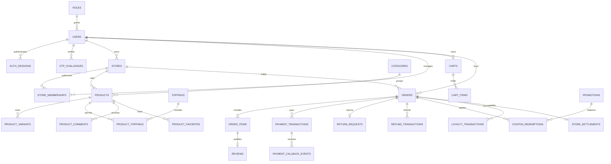

# UTETra — Thiết kế dữ liệu theo yêu cầu cuối kỳ

> Phiên bản 3.0, 13/10/2026. 43 bảng P0, 2 bảng Shipper P1 thêm. Bản mở rộng thay mô hình 26 bảng/COD-only trước đây. CSDL chọn MySQL-compatible TiDB Cloud, database riêng utetra_db; không sửa project_idv.

## 1. Hiện trạng và quy ước

Code baseline có roles, users, auth_sessions trong V1__identity_baseline.sql và 3 Entity tương ứng. Những bảng còn lại dưới đây là đặc tả cho migration/module tiếp theo, chưa tự coi đã tạo trên cloud. Từ điển này thống nhất với USE_CASES.md; không sao chép schema MongoDB/ObjectId/arrays của tài liệu mẫu.

Mọi bảng có id BIGINT PK AUTO_INCREMENT. Dấu ? là nullable, không có ? thì NOT NULL. FK chỉ rõ bảng.id; UQ là unique; UTC là DATETIME(6) lưu UTC; MONEY là DECIMAL(14,2) VND nguyên đồng, không âm. Bảng có version map @Version. String Unicode dùng utf8mb4. Bcrypt hash không phải plaintext; token ngẫu nhiên lưu hash/HMAC, không ghi OTP rõ.

Constraint liên bảng/quyền/transition/sum và các điểm chưa được CHECK trên TiDB đảm bảo ở Service + transaction + unique/locking; kiểm chứng khả năng DDL thực trước khi xác nhận. Không dùng update/create/create-drop trên cloud. FK/index/migration không thay kiểm tra phân quyền.

## 2. Quan hệ chính

ERD là sơ đồ lõi; toàn bộ FK/phạm vi được mô tả tại từ điển. Đơn/User/giỏ/notif/purchase eligibility thuộc người hiện tại; Vendor owner, Manager membership, Admin toàn hệ thống, Shipper assignment khi bật.

## 3. Từ điển 43 bảng bắt buộc và 2 bảng thêm

### 3.1. `roles` — P0, owner `identity-membership`

| Cột | Kiểu/ràng buộc logic |
| --- | --- |
| id | BIGINT PK AUTO_INCREMENT |
| name | VARCHAR(30) UQ |
| description | VARCHAR(255)? |

Enum ROLE_USER/VENDOR/MANAGER/ADMIN/SHIPPER; V1 đã có.

### 3.2. `users` — P0, owner `identity-membership`

| Cột | Kiểu/ràng buộc logic |
| --- | --- |
| id | BIGINT PK AUTO_INCREMENT |
| role_id | BIGINT FK roles |
| username | VARCHAR(50) UQ |
| email | VARCHAR(254) UQ |
| password_hash | VARCHAR(255) |
| full_name | VARCHAR(100) |
| phone | VARCHAR(20)? |
| avatar_url | VARCHAR(1000)? |
| avatar_public_id | VARCHAR(255)? |
| is_active | BOOLEAN |
| email_verified_at | UTC? |
| created_at | UTC |
| updated_at | UTC |
| version | BIGINT |

Active và email_verified_at mới đăng nhập; V1 đã có, @Version.

### 3.3. `auth_sessions` — P0, owner `identity-membership`

| Cột | Kiểu/ràng buộc logic |
| --- | --- |
| id | BIGINT PK AUTO_INCREMENT |
| user_id | BIGINT FK users |
| refresh_token_hash | VARCHAR(64) UQ |
| created_at | UTC |
| expires_at | UTC |
| last_refreshed_at | UTC? |
| revoked_at | UTC? |
| version | BIGINT |

sid JWT = id; rotate hash dưới khóa; V1 đã có.

### 3.4. `otp_challenges` — P0, owner `identity-membership`

| Cột | Kiểu/ràng buộc logic |
| --- | --- |
| id | BIGINT PK AUTO_INCREMENT |
| user_id | BIGINT? FK users |
| email | VARCHAR(254) |
| purpose | VARCHAR(20) |
| otp_hash | VARCHAR(64) |
| attempts | INT |
| created_at | UTC |
| expires_at | UTC |
| consumed_at | UTC? |
| revoked_at | UTC? |
| reset_grant_hash | VARCHAR(64)? |
| version | BIGINT |

REGISTER/PASSWORD_RESET; HMAC OTP; TTL/limit; reset grant một lần, không password_reset_tokens bằng link.

### 3.5. `store_memberships` — P0, owner `identity-membership`

| Cột | Kiểu/ràng buộc logic |
| --- | --- |
| id | BIGINT PK AUTO_INCREMENT |
| user_id | BIGINT FK users |
| store_id | BIGINT FK stores |
| member_role | VARCHAR(20) |
| is_active | BOOLEAN |
| assigned_by | BIGINT FK users |
| created_at | UTC |
| updated_at | UTC |

UQ(user_id,store_id); Manager role/scope, thay staff_store_assignments.

### 3.6. `user_addresses` — P0, owner `identity-membership`

| Cột | Kiểu/ràng buộc logic |
| --- | --- |
| id | BIGINT PK AUTO_INCREMENT |
| user_id | BIGINT FK users |
| recipient_name | VARCHAR(100) |
| phone | VARCHAR(20) |
| address_detail | VARCHAR(500) |
| is_default | BOOLEAN |
| created_at | UTC |
| updated_at | UTC |

Generated default_user_id + unique hoặc transaction lock user; tối đa một default, order giữ snapshot.

### 3.7. `loyalty_accounts` — P0, owner `identity-membership`

| Cột | Kiểu/ràng buộc logic |
| --- | --- |
| id | BIGINT PK AUTO_INCREMENT |
| user_id | BIGINT FK users UQ |
| balance | INT |
| debt | INT |
| lifetime_earned | INT |
| updated_at | UTC |
| version | BIGINT |

User/Vendor; balance/debt >=0; khóa khi ghi ledger.

### 3.8. `loyalty_transactions` — P0, owner `identity-membership`

| Cột | Kiểu/ràng buộc logic |
| --- | --- |
| id | BIGINT PK AUTO_INCREMENT |
| account_id | BIGINT FK loyalty_accounts |
| order_id | BIGINT FK orders |
| type | VARCHAR(20) |
| points_delta | INT |
| balance_after | INT |
| debt_after | INT |
| created_at | UTC |

UQ(order_id,type); REDEEM/REFUND/EARN/REVERSAL; balance-debt = tổng delta.

### 3.9. `audit_logs` — P0, owner `identity-membership`

| Cột | Kiểu/ràng buộc logic |
| --- | --- |
| id | BIGINT PK AUTO_INCREMENT |
| actor_id | BIGINT FK users |
| action | VARCHAR(50) |
| entity_type | VARCHAR(50) |
| entity_id | BIGINT |
| summary | VARCHAR(1000) |
| created_at | UTC |

Append; không token/secret/password/raw body; target đa hình không FK chung.

### 3.10. `stores` — P0, owner `catalog-sales`

| Cột | Kiểu/ràng buộc logic |
| --- | --- |
| id | BIGINT PK AUTO_INCREMENT |
| owner_user_id | BIGINT FK users |
| commission_policy_id | BIGINT FK commission_policies |
| name | VARCHAR(150) |
| slug | VARCHAR(150) UQ |
| address | VARCHAR(500) |
| phone | VARCHAR(20) |
| description | TEXT? |
| image_url | VARCHAR(1000)? |
| image_public_id | VARCHAR(255)? |
| banner_url | VARCHAR(1000)? |
| banner_public_id | VARCHAR(255)? |
| open_time | TIME |
| close_time | TIME |
| status | VARCHAR(20) |
| accepting_orders | BOOLEAN |
| created_at | UTC |
| updated_at | UTC |
| version | BIGINT |

PENDING_APPROVAL/ACTIVE/REJECTED/SUSPENDED; open<close, không qua đêm; owner User khi pending, Vendor khi duyệt.

### 3.11. `store_delivery_areas` — P0, owner `catalog-sales`

| Cột | Kiểu/ràng buộc logic |
| --- | --- |
| id | BIGINT PK AUTO_INCREMENT |
| store_id | BIGINT FK stores |
| area_code | VARCHAR(50) |
| name | VARCHAR(150) |
| is_active | BOOLEAN |
| created_at | UTC |
| updated_at | UTC |

UQ(store_id,area_code); phí trong carrier_area_rates, không tọa độ/khoảng cách.

### 3.12. `categories` — P0, owner `catalog-sales`

| Cột | Kiểu/ràng buộc logic |
| --- | --- |
| id | BIGINT PK AUTO_INCREMENT |
| name | VARCHAR(100) |
| slug | VARCHAR(100) UQ |
| description | TEXT? |
| image_url | VARCHAR(1000)? |
| image_public_id | VARCHAR(255)? |
| display_order | INT |
| is_active | BOOLEAN |
| created_at | UTC |
| updated_at | UTC |

Admin global, Manager delegated scope; soft disable nếu tham chiếu.

### 3.13. `products` — P0, owner `catalog-sales`

| Cột | Kiểu/ràng buộc logic |
| --- | --- |
| id | BIGINT PK AUTO_INCREMENT |
| store_id | BIGINT FK stores |
| category_id | BIGINT FK categories |
| name | VARCHAR(150) |
| slug | VARCHAR(150) UQ |
| description | TEXT? |
| base_price | MONEY |
| image_url | VARCHAR(1000)? |
| image_public_id | VARCHAR(255)? |
| is_active | BOOLEAN |
| is_available | BOOLEAN |
| is_featured | BOOLEAN |
| created_at | UTC |
| updated_at | UTC |
| version | BIGINT |

Product thuộc shop; thay store_products dư thừa; giá không âm; rating/sold/likes query hoặc cache kiểm chứng.

### 3.14. `product_variants` — P0, owner `catalog-sales`

| Cột | Kiểu/ràng buộc logic |
| --- | --- |
| id | BIGINT PK AUTO_INCREMENT |
| product_id | BIGINT FK products |
| size_name | VARCHAR(5) |
| extra_price | MONEY |
| is_active | BOOLEAN |
| created_at | UTC |
| updated_at | UTC |

UQ(product_id,size_name), S/M/L; extra >=0, không xóa đã tham chiếu.

### 3.15. `toppings` — P0, owner `catalog-sales`

| Cột | Kiểu/ràng buộc logic |
| --- | --- |
| id | BIGINT PK AUTO_INCREMENT |
| name | VARCHAR(100) |
| price | MONEY |
| image_url | VARCHAR(1000)? |
| image_public_id | VARCHAR(255)? |
| is_active | BOOLEAN |
| created_at | UTC |
| updated_at | UTC |

Topping chuẩn chuỗi, Admin/Manager quản trị; giá >=0.

### 3.16. `product_toppings` — P0, owner `catalog-sales`

| Cột | Kiểu/ràng buộc logic |
| --- | --- |
| id | BIGINT PK AUTO_INCREMENT |
| product_id | BIGINT FK products |
| topping_id | BIGINT FK toppings |

UQ(product_id,topping_id), chỉ topping được phép chọn.

### 3.17. `store_toppings` — P0, owner `catalog-sales`

| Cột | Kiểu/ràng buộc logic |
| --- | --- |
| id | BIGINT PK AUTO_INCREMENT |
| store_id | BIGINT FK stores |
| topping_id | BIGINT FK toppings |
| is_available | BOOLEAN |
| created_at | UTC |
| updated_at | UTC |

UQ(store_id,topping_id); Vendor shop mình bật/tắt.

### 3.18. `store_registration_requests` — P0, owner `catalog-sales`

| Cột | Kiểu/ràng buộc logic |
| --- | --- |
| id | BIGINT PK AUTO_INCREMENT |
| store_id | BIGINT FK stores |
| applicant_id | BIGINT FK users |
| status | VARCHAR(20) |
| note | VARCHAR(1000)? |
| reviewed_by | BIGINT? FK users |
| reviewed_at | UTC? |
| created_at | UTC |
| version | BIGINT |

PENDING/APPROVED/REJECTED; duyệt có scope, cấp Vendor sau duyệt; append lịch sử/audit.

### 3.19. `carts` — P0, owner `order-payment`

| Cột | Kiểu/ràng buộc logic |
| --- | --- |
| id | BIGINT PK AUTO_INCREMENT |
| user_id | BIGINT FK users UQ |
| store_id | BIGINT FK stores |
| last_merge_key | VARCHAR(36)? |
| created_at | UTC |
| updated_at | UTC |
| version | BIGINT |

Một giỏ DB User/Vendor; Guest session; một shop và version tăng khi dòng sửa.

### 3.20. `cart_items` — P0, owner `order-payment`

| Cột | Kiểu/ràng buộc logic |
| --- | --- |
| id | BIGINT PK AUTO_INCREMENT |
| cart_id | BIGINT FK carts |
| variant_id | BIGINT FK product_variants |
| sugar_level | INT |
| ice_level | INT |
| quantity | INT |
| note | VARCHAR(255) |
| configuration_hash | VARCHAR(64) |

UQ(cart_id,configuration_hash); 1–20, đường/đá 0/30/50/70/100, max50ly kiểm Service.

### 3.21. `cart_item_toppings` — P0, owner `order-payment`

| Cột | Kiểu/ràng buộc logic |
| --- | --- |
| id | BIGINT PK AUTO_INCREMENT |
| cart_item_id | BIGINT FK cart_items |
| topping_id | BIGINT FK toppings |

UQ(cart_item_id,topping_id), một phần mỗi loại mỗi ly.

### 3.22. `orders` — P0, owner `order-payment`

| Cột | Kiểu/ràng buộc logic |
| --- | --- |
| id | BIGINT PK AUTO_INCREMENT |
| order_code | VARCHAR(40) UQ |
| user_id | BIGINT FK users |
| store_id | BIGINT FK stores |
| delivery_area_id | BIGINT FK store_delivery_areas |
| carrier_id | BIGINT FK carriers |
| commission_policy_id | BIGINT FK commission_policies |
| checkout_key | VARCHAR(36) |
| request_hash | VARCHAR(64) |
| recipient_name | VARCHAR(100) |
| recipient_phone | VARCHAR(20) |
| delivery_address | VARCHAR(500) |
| store_name | VARCHAR(150) |
| delivery_area_name | VARCHAR(150) |
| carrier_name | VARCHAR(150) |
| subtotal | MONEY |
| product_discount | MONEY |
| points_discount | MONEY |
| shipping_gross | MONEY |
| shipping_discount | MONEY |
| final_amount | MONEY |
| commission_rate | DECIMAL(5,2) |
| commission_amount | MONEY |
| store_net | MONEY |
| points_used | INT |
| points_earned | INT |
| payment_method | VARCHAR(20) |
| payment_status | VARCHAR(20) |
| status | VARCHAR(30) |
| note | VARCHAR(500)? |
| cancel_reason | VARCHAR(500)? |
| delivered_at | UTC? |
| cancelled_at | UTC? |
| paid_at | UTC? |
| payment_confirmed_by | BIGINT? FK users |
| created_at | UTC |
| updated_at | UTC |
| version | BIGINT |

UQ(user_id,checkout_key); đầy đủ snapshot; price/discount/rate/state theo USE_CASES; area/product thuộc store kiểm Service/FK ghép.

### 3.23. `order_items` — P0, owner `order-payment`

| Cột | Kiểu/ràng buộc logic |
| --- | --- |
| id | BIGINT PK AUTO_INCREMENT |
| order_id | BIGINT FK orders |
| variant_id | BIGINT FK product_variants |
| product_name | VARCHAR(150) |
| size_name | VARCHAR(5) |
| base_price | MONEY |
| extra_price | MONEY |
| drink_unit_price | MONEY |
| topping_unit_total | MONEY |
| quantity | INT |
| sugar_level | INT |
| ice_level | INT |
| note | VARCHAR(255) |
| line_total | MONEY |
| discount_allocated | MONEY |

Snapshot bất biến; công thức và phân bổ discount dùng số nguyên, dư làm tròn vào dòng cuối.

### 3.24. `order_item_toppings` — P0, owner `order-payment`

| Cột | Kiểu/ràng buộc logic |
| --- | --- |
| id | BIGINT PK AUTO_INCREMENT |
| order_item_id | BIGINT FK order_items |
| topping_id | BIGINT FK toppings |
| topping_name | VARCHAR(100) |
| unit_price | MONEY |

UQ(order_item_id,topping_id); snapshot topping mỗi ly.

### 3.25. `order_status_history` — P0, owner `order-payment`

| Cột | Kiểu/ràng buộc logic |
| --- | --- |
| id | BIGINT PK AUTO_INCREMENT |
| order_id | BIGINT FK orders |
| from_status | VARCHAR(30)? |
| to_status | VARCHAR(30) |
| event_type | VARCHAR(30) |
| changed_by | BIGINT? FK users |
| reason | VARCHAR(500)? |
| order_version | BIGINT |
| created_at | UTC |

UQ(order_id,order_version); SYSTEM callback actor nullable nhưng event_type phải giải thích; append.

### 3.26. `notifications` — P0, owner `order-payment`

| Cột | Kiểu/ràng buộc logic |
| --- | --- |
| id | BIGINT PK AUTO_INCREMENT |
| user_id | BIGINT FK users |
| order_id | BIGINT? FK orders |
| event_key | VARCHAR(100) |
| type | VARCHAR(30) |
| title | VARCHAR(200) |
| content | VARCHAR(500) |
| created_at | UTC |
| read_at | UTC? |

UQ(user_id,event_key); đọc độc lập người nhận; link server dựng theo quyền.

### 3.27. `product_favorites` — P0, owner `identity-membership`

| Cột | Kiểu/ràng buộc logic |
| --- | --- |
| id | BIGINT PK AUTO_INCREMENT |
| user_id | BIGINT FK users |
| product_id | BIGINT FK products |
| created_at | UTC |

UQ(user_id,product_id); like/unlike idempotent.

### 3.28. `product_views` — P0, owner `identity-membership`

| Cột | Kiểu/ràng buộc logic |
| --- | --- |
| id | BIGINT PK AUTO_INCREMENT |
| user_id | BIGINT FK users |
| product_id | BIGINT FK products |
| last_viewed_at | UTC |
| view_count | INT |

UQ(user_id,product_id), list của mình; count không dùng làm sold.

### 3.29. `reviews` — P0, owner `identity-membership`

| Cột | Kiểu/ràng buộc logic |
| --- | --- |
| id | BIGINT PK AUTO_INCREMENT |
| author_id | BIGINT FK users |
| order_item_id | BIGINT FK order_items UQ |
| product_id | BIGINT FK products |
| stars | INT |
| content | VARCHAR(2000)? |
| status | VARCHAR(20) |
| created_at | UTC |
| updated_at | UTC |
| version | BIGINT |

1–5 sao, purchase/owner/DELIVERED+PAID; VISIBLE/HIDDEN; admin hide audit.

### 3.30. `review_media` — P0, owner `identity-membership`

| Cột | Kiểu/ràng buộc logic |
| --- | --- |
| id | BIGINT PK AUTO_INCREMENT |
| review_id | BIGINT FK reviews |
| secure_url | VARCHAR(1000) |
| public_id | VARCHAR(255) |
| resource_type | VARCHAR(10) |
| display_order | INT |

image/video; validate server, Cloudinary, xóa sau commit.

### 3.31. `product_comments` — P0, owner `identity-membership`

| Cột | Kiểu/ràng buộc logic |
| --- | --- |
| id | BIGINT PK AUTO_INCREMENT |
| author_id | BIGINT FK users |
| product_id | BIGINT FK products |
| order_item_id | BIGINT FK order_items |
| content | VARCHAR(2000) |
| status | VARCHAR(20) |
| created_at | UTC |
| updated_at | UTC |
| version | BIGINT |

Trim length50–2000; purchased product của author; escape; owner sửa, admin hide.

### 3.32. `comment_media` — P0, owner `identity-membership`

| Cột | Kiểu/ràng buộc logic |
| --- | --- |
| id | BIGINT PK AUTO_INCREMENT |
| comment_id | BIGINT FK product_comments |
| secure_url | VARCHAR(1000) |
| public_id | VARCHAR(255) |
| resource_type | VARCHAR(10) |
| display_order | INT |

image/video; MIME và signature + size, không executable.

### 3.33. `promotions` — P0, owner `catalog-sales`

| Cột | Kiểu/ràng buộc logic |
| --- | --- |
| id | BIGINT PK AUTO_INCREMENT |
| store_id | BIGINT? FK stores |
| created_by | BIGINT FK users |
| scope | VARCHAR(10) |
| kind | VARCHAR(20) |
| code | VARCHAR(50)? UQ |
| name | VARCHAR(150) |
| percent | DECIMAL(5,2) |
| max_discount | MONEY |
| min_order | MONEY |
| usage_limit | INT |
| per_user_limit | INT |
| starts_at | UTC |
| ends_at | UTC |
| is_active | BOOLEAN |
| funded_by | VARCHAR(10) |
| created_at | UTC |
| updated_at | UTC |
| version | BIGINT |

GLOBAL/SHOP, PRODUCT_PERCENT/SHIPPING_PERCENT; 0<percent<=100; starts<ends; APP/SHOP funding; vendor không global.

### 3.34. `promotion_products` — P0, owner `catalog-sales`

| Cột | Kiểu/ràng buộc logic |
| --- | --- |
| id | BIGINT PK AUTO_INCREMENT |
| promotion_id | BIGINT FK promotions |
| product_id | BIGINT FK products |

UQ(promotion_id,product_id); chỉ eligible product cùng scope; không link = toàn scope.

### 3.35. `coupon_redemptions` — P0, owner `order-payment`

| Cột | Kiểu/ràng buộc logic |
| --- | --- |
| id | BIGINT PK AUTO_INCREMENT |
| promotion_id | BIGINT FK promotions |
| order_id | BIGINT FK orders |
| user_id | BIGINT FK users |
| status | VARCHAR(20) |
| discount_snapshot | MONEY |
| created_at | UTC |
| released_at | UTC? |

UQ(promotion_id,order_id); RESERVED/USED/RELEASED; quota khóa, cancel/refund release theo policy.

### 3.36. `commission_policies` — P0, owner `order-payment`

| Cột | Kiểu/ràng buộc logic |
| --- | --- |
| id | BIGINT PK AUTO_INCREMENT |
| name | VARCHAR(100) |
| rate_percent | DECIMAL(5,2) |
| is_active | BOOLEAN |
| created_at | UTC |
| updated_at | UTC |
| version | BIGINT |

0–100; store FK policy; order giữ snapshot, không đổi lịch sử.

### 3.37. `carriers` — P0, owner `order-payment`

| Cột | Kiểu/ràng buộc logic |
| --- | --- |
| id | BIGINT PK AUTO_INCREMENT |
| name | VARCHAR(150) |
| base_fee | MONEY |
| is_active | BOOLEAN |
| created_at | UTC |
| updated_at | UTC |
| version | BIGINT |

Tên/phí bắt buộc; Manager scope được cấp; disable không phá order.

### 3.38. `carrier_area_rates` — P0, owner `order-payment`

| Cột | Kiểu/ràng buộc logic |
| --- | --- |
| id | BIGINT PK AUTO_INCREMENT |
| carrier_id | BIGINT FK carriers |
| delivery_area_id | BIGINT FK store_delivery_areas |
| additional_fee | MONEY |
| is_active | BOOLEAN |
| created_at | UTC |
| updated_at | UTC |

UQ(carrier_id,delivery_area_id); gross=base_fee+additional_fee; không kilomet.

### 3.39. `payment_transactions` — P0, owner `order-payment`

| Cột | Kiểu/ràng buộc logic |
| --- | --- |
| id | BIGINT PK AUTO_INCREMENT |
| order_id | BIGINT FK orders |
| provider | VARCHAR(20) |
| txn_ref | VARCHAR(100) UQ |
| provider_txn_id | VARCHAR(100)? |
| amount | MONEY |
| status | VARCHAR(20) |
| paid_at | UTC? |
| expires_at | UTC? |
| created_at | UTC |
| updated_at | UTC |
| version | BIGINT |

COD/VNPAY; INITIATED/PENDING/SUCCEEDED/FAILED; tổng SUCCEEDED không vượt đơn; giữ txnRef retry riêng, không nhận amount client.

### 3.40. `payment_callback_events` — P0, owner `order-payment`

| Cột | Kiểu/ràng buộc logic |
| --- | --- |
| id | BIGINT PK AUTO_INCREMENT |
| payment_id | BIGINT? FK payment_transactions |
| provider | VARCHAR(20) |
| event_key | VARCHAR(150) |
| payload_hash | VARCHAR(64) |
| verified | BOOLEAN |
| outcome | VARCHAR(30) |
| received_at | UTC |
| processed_at | UTC? |

UQ(provider,event_key); minimal không secret, IPN kiểm hash/ref/amount; replay là no-op.

### 3.41. `return_requests` — P0, owner `order-payment`

| Cột | Kiểu/ràng buộc logic |
| --- | --- |
| id | BIGINT PK AUTO_INCREMENT |
| order_id | BIGINT FK orders UQ |
| requested_by | BIGINT FK users |
| reason | VARCHAR(2000) |
| evidence_url | VARCHAR(1000)? |
| evidence_public_id | VARCHAR(255)? |
| status | VARCHAR(20) |
| waive_physical_return | BOOLEAN |
| reviewed_by | BIGINT? FK users |
| decision_reason | VARCHAR(1000)? |
| created_at | UTC |
| updated_at | UTC |
| version | BIGINT |

REQUESTED/APPROVED/REJECTED/RECEIVED/REFUNDED; cả đơn, refund qua contract; bằng chứng phù hợp đồ uống.

### 3.42. `refund_transactions` — P0, owner `order-payment`

| Cột | Kiểu/ràng buộc logic |
| --- | --- |
| id | BIGINT PK AUTO_INCREMENT |
| order_id | BIGINT FK orders |
| payment_id | BIGINT FK payment_transactions |
| return_request_id | BIGINT? FK return_requests |
| refund_ref | VARCHAR(100) UQ |
| provider_ref | VARCHAR(100)? |
| amount | MONEY |
| status | VARCHAR(20) |
| reason | VARCHAR(1000) |
| evidence_ref | VARCHAR(500)? |
| approved_by | BIGINT FK users |
| created_at | UTC |
| completed_at | UTC? |
| version | BIGINT |

PENDING/SUCCEEDED/FAILED; sumrefund<=paid; pending retry idempotent; VNPAY API/COD bằng chứng thật.

### 3.43. `store_settlements` — P0, owner `order-payment`

| Cột | Kiểu/ràng buộc logic |
| --- | --- |
| id | BIGINT PK AUTO_INCREMENT |
| order_id | BIGINT FK orders UQ |
| store_id | BIGINT FK stores |
| goods_net | MONEY |
| commission_rate | DECIMAL(5,2) |
| commission_amount | MONEY |
| shipping_net | MONEY |
| store_net | MONEY |
| refunded_goods | MONEY |
| refunded_shipping | MONEY |
| commission_reversed | MONEY |
| updated_at | UTC |
| version | BIGINT |

Ledger snapshot/net/refund, chỉ hạch toán paid-delivered và refundsuccess; no internal wallet required.

### 3.44. `delivery_assignments` — P1 Shipper, owner `order-payment`

| Cột | Kiểu/ràng buộc logic |
| --- | --- |
| id | BIGINT PK AUTO_INCREMENT |
| order_id | BIGINT FK orders UQ |
| shipper_id | BIGINT FK users |
| assigned_by | BIGINT FK users |
| status | VARCHAR(20) |
| assigned_at | UTC |
| completed_at | UTC? |
| version | BIGINT |

P1 thêm, một assignment hiện tại, audit reassign; chỉ ROLE_SHIPPER.

### 3.45. `delivery_events` — P1 Shipper, owner `order-payment`

| Cột | Kiểu/ràng buộc logic |
| --- | --- |
| id | BIGINT PK AUTO_INCREMENT |
| assignment_id | BIGINT FK delivery_assignments |
| actor_id | BIGINT FK users |
| type | VARCHAR(30) |
| note | VARCHAR(500)? |
| created_at | UTC |

P1 thêm, append sự kiện nhận/lấy/giao/COD/thất bại.

## 4. Migration và ràng buộc quan trọng

V1 đã có chỉ tạo identity baseline. Migration tiếp theo phải có thứ tự FK: commission_policies trước stores; stores/categories/toppings trước products/variants/areas; user/store trước memberships/addresses/carts; orders trước ledger/callback/refund/settlement; promotion và payment trước các liên kết. Vì dữ liệu owner trải nhiều module, nhóm trưởng tập hợp migration main, không ba V2 khác nhau. Không sửa V1 sau khi chạy; thêm migration mới.

Không còn store_products: products.store_id xác định shop sở hữu. Không còn staff_store_assignments hoặc password_reset_tokens: dùng store_memberships và OTP. Những thay đổi này là cập nhật schema thiết kế trước code nghiệp vụ, không đổi cấu hình các project khác. Địa chỉ/khu vực/carrier/giá/discount/commission/topping được snapshot lúc checkout; enum/state/payment phải theo USE_CASES.

Unique bắt buộc: user/email/username; user giỏ/account; user–product favorite/view; product–size; cart cấu hình; order checkout_key theo user; order/type ledger; promotion/order redemption; payment/refund reference; callback provider/event; review/order_item; return/order; settlement/order. Địa chỉ default tối đa một/user bằng generated nullable default-user key + unique sau kiểm chứng TiDB, cộng lock user tại Service.

Index: products(store_id,category_id,is_active,id); orders(user_id,created_at,id), orders(store_id,status,created_at,id), orders(store_id,delivered_at,payment_status); session(user_id,revoked_at,expires_at); OTP(email,purpose,expires_at); promotion(scope,store_id,starts_at,ends_at); callback(event_key); ledger(account_id,created_at); notif(user_id,read_at,created_at); views(user_id,last_viewed_at); assignment(shipper_id,status). Mỗi FK có index hoặc prefix phù hợp. Không cho rằng %keyword% tự tối ưu bằng B-tree.

## 5. Transaction và chống sai tiền

Checkout khóa giỏ và các row cấu hình cần nhất quán, account/quota theo thứ tự thống nhất; check key/hash cũ trước giỏ và kiểm lại sau chờ khóa; snapshot → redeem → redemption → history/notif → clear cart trong một transaction. Unique conflict rollback rồi đọc lại trong transaction mới. Giá đổi trả quote mới. Không gọi provider/Cloudinary/SMTP trong transaction giữ lock lâu.

Payment IPN/refund sử dụng record pending, verify signature/amount/ref, lock và uniqueevent; append audit, cập nhật trạng thái thật và snapshot ledger/settlement, after commit event. Request callback lặp không chuyển trạng thái hoặc tính doanh thu hai lần. Giao dịch đến muộn cho order đã hủy phải đối soát và refund; không mở đơn lại. Refund thành công mới hoàn điểm/thu hồi earned/quota/net theo quy tắc và không vượt khoản đã thu.

JPA LAZY và DTO trong Service, open-in-view=false; không serialize Entity vòng hoặc password/session. No cascade REMOVE từ user/shop/catalog vào lịch sử đơn. Chỉ dữ liệu giỏ có cascade các dòng tạm. Món/topping/shop referenced dùng ngừng hoạt động; order/items/history/ledger/payment/refund/audit append/giữ lịch sử.

## 6. Seed và kiểm chứng

Tạo riêng utetra_db; không import script từ database project khác. V1 seed 5 role, chưa tự tạo tài khoản đăng nhập. Seed nghiệp vụ sau này gồm shop được duyệt/đang chờ, Vendor có quyền mua, Manager A/B, User A/B, Admin, catalog và các món có >10 ly bán hợp lệ để thử top; đơn/refund/promo/carrier/commission/ledger khớp công thức. Các account giả lập phải qua email verification phù hợp, không plaintext password.

Kiểm schema/migration trên TiDB/MySQL thực và JPA validate; H2 chỉ dùng test isolated không thay kiểm SQL dialect/TLS. Bảng kế hoạch chưa có migration phải ghi chưa hiện thực. Test unique/FK/default/UTC/decimal, callback/replay/competing quota, points debt/reversal, refund/net report, quyền shop/owner/assignment và restore trước bàn giao.
