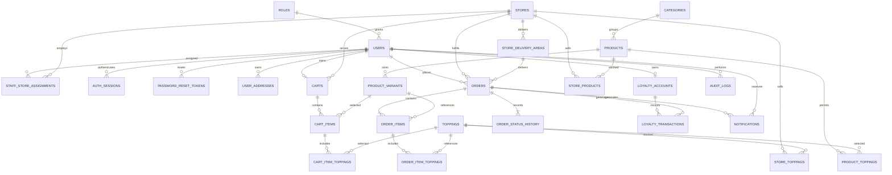

# UTETra — Thiết kế cơ sở dữ liệu

| Thuộc tính | Nội dung |
| --- | --- |
| Phiên bản | 2.0 — ngày 24/09/2026 |
| Phạm vi | Mô hình dữ liệu P0 cho website chuỗi bán trà sữa |
| ORM | Spring Data JPA / Hibernate |
| CSDL mục tiêu | SQL Server, MySQL, PostgreSQL; một hệ quản trị cho mỗi lần triển khai |
| Liên kết | [Kế hoạch](PROJECT_PLAN.md) · [Use case và quy tắc nghiệp vụ](USE_CASES.md) |
| Trạng thái | Đặc tả logic để viết Entity và migration; chưa phải script SQL đã kiểm thử |

## 1. Nguyên tắc thiết kế

Chuẩn hóa dữ liệu tài khoản, danh mục và giỏ hàng; lưu snapshot tại đơn để giữ lịch sử. Dữ liệu chi nhánh và phân công nhân viên là cơ sở phân quyền. Giá bán chung toàn chuỗi, tình trạng bán theo chi nhánh. P0 chỉ hỗ trợ giao tận nơi, COD và giảm giá bằng điểm.

Không coi một script MySQL là SQL dùng chung cho ba hệ quản trị. Mô hình logic dưới đây là nguồn chung; migration theo từng dialect phải hiện thực cùng khóa, ràng buộc và chỉ mục. Chỉ công bố tương thích sau khi kiểm thử trên cả ba CSDL.

### 1.1. Quy ước từ điển

- Mỗi bảng có `id BIGINT` làm PK tự sinh, trừ khi được ghi khác. Mọi cột mặc định **NOT NULL**; dấu `?` sau kiểu nghĩa là cho phép NULL.
- `FK → table` tham chiếu `table.id`; `UQ(...)` là unique constraint/index. Mọi FK cần chỉ mục phù hợp.
- Kiểu logic `TEXT(n)` là chuỗi Unicode giới hạn n ký tự; `LONGTEXT` là văn bản dài; không phải cú pháp DDL dùng nguyên xi.
- `MONEY = DECIMAL(14,2)`, không âm; chỉ nhận VND nguyên đồng. Java dùng `BigDecimal`, không dùng kiểu `money` riêng của SQL Server.
- `UTC` là thời điểm UTC độ chính xác microsecond; UI đổi sang `Asia/Ho_Chi_Minh`. Enum dùng chuỗi và CHECK, JPA `EnumType.STRING`.
- Các bảng ghi `AUDIT` có `created_at UTC`, `updated_at UTC`; ứng dụng đặt thời gian theo cùng một clock. Các bảng ghi `VERSION` có `version BIGINT DEFAULT 0`, map `@Version`.
- Giá trị mặc định chỉ áp dụng nơi ghi rõ; không tự đặt trạng thái hoạt động/tiền/khóa ngoại thiếu dữ liệu.
- PK/FK/UQ/CHECK là ràng buộc CSDL. Quy tắc liên bảng, quyền, state machine và công thức tổng hợp được bảo vệ thêm bằng Service trong transaction.

### 1.2. Ánh xạ theo hệ quản trị

| Kiểu/yêu cầu | SQL Server | MySQL | PostgreSQL |
| --- | --- | --- | --- |
| ID tự sinh | `BIGINT IDENTITY(1,1)` | `BIGINT AUTO_INCREMENT` | `BIGINT GENERATED BY DEFAULT AS IDENTITY` |
| Chuỗi Unicode | `NVARCHAR(n)` | `VARCHAR(n)` + `utf8mb4` | `VARCHAR(n)` + database UTF8 |
| Văn bản dài | `NVARCHAR(MAX)` | `TEXT` + `utf8mb4` | `TEXT` |
| Boolean | `BIT` | `BOOLEAN`/`TINYINT(1)` + CHECK 0/1 | `BOOLEAN` |
| UTC | `DATETIME2(6)` theo UTC | `DATETIME(6)` theo UTC | `TIMESTAMP(6) WITH TIME ZONE` |
| Giờ mở/đóng | `TIME(0)` | `TIME(0)` | `TIME(0)` |
| Tiền | `DECIMAL(14,2)` | `DECIMAL(14,2)` | `NUMERIC(14,2)` |
| Tối đa một địa chỉ mặc định | Filtered unique index | Generated column nullable + unique index | Partial unique index |

Môi trường kiểm chứng dự kiến: SQL Server 2022, MySQL 8.4, PostgreSQL 16. Khóa version image/server trong cấu hình test; đây là baseline, không phải tuyên bố bản mới nhất. Với MySQL cần engine InnoDB và phiên bản thực thi CHECK.

Username/email/slug được trim và chuẩn hóa chữ thường trước khi ghi; chọn collation/index cho so sánh định danh nhất quán giữa ba CSDL. Tìm kiếm tiếng Việt và sắp xếp cần test riêng theo collation. Chuỗi định danh máy như hash/code/token dùng ASCII và đối chiếu chính xác; token thô không được lưu.

## 2. Sơ đồ quan hệ cốt lõi



ERD thể hiện quan hệ chính. FK tác nhân thực hiện như `changed_by`, `payment_confirmed_by` và `assigned_by` được nêu trong từ điển. P0 có **26 bảng**; bảng `audit_logs` lưu mục tiêu dưới dạng loại/ID để ghi lịch sử nhiều loại đối tượng.

## 3. Tài khoản và phân quyền

### 3.1. `roles`

| Cột | Kiểu | Ràng buộc/ý nghĩa |
| --- | --- | --- |
| `name` | TEXT(30) | UQ; `ROLE_CUSTOMER`, `ROLE_STAFF`, `ROLE_ADMIN` |
| `description` | TEXT(255)? | Mô tả vai trò |

Seed ba vai trò cố định. P0 không có quan hệ nhiều vai trò cho một user.

### 3.2. `users` — AUDIT, VERSION

| Cột | Kiểu | Ràng buộc/ý nghĩa |
| --- | --- | --- |
| `role_id` | BIGINT | FK → roles |
| `username` | TEXT(50) | UQ; định danh đã chuẩn hóa |
| `email` | TEXT(254) | UQ; email đã chuẩn hóa |
| `password_hash` | TEXT(255) | BCrypt; không lưu mật khẩu thô |
| `full_name` | TEXT(100) | Họ tên |
| `phone` | TEXT(20)? | Không dùng kiểu số |
| `avatar_url` | TEXT(1000)? | URL HTTPS Cloudinary |
| `avatar_public_id` | TEXT(255)? | Cặp với avatar_url, cùng có hoặc cùng NULL |
| `is_active` | BOOLEAN | DEFAULT true |

Không giữ số dư điểm trực tiếp trong `users`. Không xóa cứng tài khoản đã phát sinh đơn/audit; khóa tài khoản và áp dụng quy trình xử lý dữ liệu cá nhân riêng khi cần.

### 3.3. `staff_store_assignments` — AUDIT

| Cột | Kiểu | Ràng buộc/ý nghĩa |
| --- | --- | --- |
| `user_id` | BIGINT | FK → users; Service kiểm tra role STAFF |
| `store_id` | BIGINT | FK → stores |
| `is_active` | BOOLEAN | DEFAULT true |
| `assigned_by` | BIGINT | FK → users; Admin thực hiện |

UQ(`user_id`, `store_id`). Một dòng được bật/tắt thay vì tạo nhiều bản phân công trùng; lịch sử thay đổi lưu `audit_logs`. Admin không cần bản phân công để quản lý toàn chuỗi.

### 3.4. `auth_sessions`

| Cột | Kiểu | Ràng buộc/ý nghĩa |
| --- | --- | --- |
| `user_id` | BIGINT | FK → users |
| `refresh_token_hash` | TEXT(64) | UQ; SHA-256 hex của token ngẫu nhiên đủ mạnh |
| `created_at` | UTC | Bắt đầu phiên |
| `expires_at` | UTC | Hết hạn tuyệt đối, tối đa 7 ngày từ khi tạo |
| `last_refreshed_at` | UTC? | Thời điểm xoay token gần nhất |
| `revoked_at` | UTC? | NULL nếu chưa thu hồi |
| `version` | BIGINT | DEFAULT 0; @Version |

JWT `sid` trỏ tới `id`; mỗi request kiểm tra phiên chưa thu hồi/hết hạn và user đang hoạt động. Refresh khóa dòng và thay hash nguyên tử; token cũ không còn khớp. P0 không có nhận diện toàn bộ token family bị tái sử dụng; nếu bổ sung cần bảng lịch sử token. Không kéo dài `expires_at` vô hạn qua refresh.

### 3.5. `password_reset_tokens`

| Cột | Kiểu | Ràng buộc/ý nghĩa |
| --- | --- | --- |
| `user_id` | BIGINT | FK → users |
| `token_hash` | TEXT(64) | UQ; hash token ngẫu nhiên |
| `created_at` | UTC | Thời điểm cấp |
| `expires_at` | UTC | Hết hạn sau 15 phút |
| `used_at` | UTC? | Thời điểm dùng thành công |
| `revoked_at` | UTC? | Vô hiệu hóa khi cấp yêu cầu mới |

CHECK `expires_at > created_at`. Cấp reset khóa user và thu hồi các token còn hiệu lực; đặt lại mật khẩu kiểm tra/dùng token trong một transaction, không được dùng hai lần.

### 3.6. `user_addresses` — AUDIT

| Cột | Kiểu | Ràng buộc/ý nghĩa |
| --- | --- | --- |
| `user_id` | BIGINT | FK → users |
| `recipient_name` | TEXT(100) | Người nhận |
| `phone` | TEXT(20) | Số điện thoại nhận hàng |
| `address_detail` | TEXT(500) | Địa chỉ đầy đủ dạng văn bản |
| `is_default` | BOOLEAN | DEFAULT false |

Tối đa một địa chỉ mặc định/user, không bắt buộc luôn có mặc định. Đổi mặc định trong transaction khóa user. Với MySQL, thêm cột sinh `default_user_id = CASE WHEN is_default THEN user_id ELSE NULL END` và unique; với SQL Server/PostgreSQL dùng unique index có điều kiện. Đơn không FK vào địa chỉ có thể xóa; đơn lưu snapshot riêng.

## 4. Chi nhánh và danh mục

### 4.1. `stores` — AUDIT, VERSION

| Cột | Kiểu | Ràng buộc/ý nghĩa |
| --- | --- | --- |
| `name` | TEXT(150) | Tên chi nhánh |
| `slug` | TEXT(150) | UQ |
| `address` | TEXT(500) | Địa chỉ đầy đủ |
| `phone` | TEXT(20) | Hotline |
| `open_time`, `close_time` | TIME | CHECK open_time < close_time; P0 không qua đêm |
| `is_active` | BOOLEAN | DEFAULT true; trạng thái quản trị |
| `accepting_orders` | BOOLEAN | DEFAULT true; cho phép tạm ngừng nhận đơn |

Giờ được hiểu theo `Asia/Ho_Chi_Minh`. Khách tự chọn chi nhánh từ danh sách; không tính khoảng cách hoặc tự chọn chi nhánh gần nhất. Thiết kế không cần tọa độ để đặt hàng. Các chức năng chi nhánh, khu vực giao hàng và phí giao vẫn giữ nguyên.

### 4.2. `store_delivery_areas` — AUDIT

| Cột | Kiểu | Ràng buộc/ý nghĩa |
| --- | --- | --- |
| `store_id` | BIGINT | FK → stores |
| `area_code` | TEXT(50) | Mã nội bộ ổn định, UQ(store_id, area_code) |
| `name` | TEXT(150) | Tên khu vực giao |
| `shipping_fee` | MONEY | >= 0 |
| `is_active` | BOOLEAN | DEFAULT true |

Khách tự chọn chi nhánh, chọn khu vực và nhập địa chỉ; Staff xác minh địa chỉ trước khi nhận đơn. Phí giao lấy trực tiếp từ `shipping_fee` của khu vực, không tính theo khoảng cách và không dùng geocoding tự động. UQ(`store_id`, `id`) hỗ trợ FK ghép kiểm tra khu vực thuộc chi nhánh đơn.

### 4.3. `categories` — AUDIT

| Cột | Kiểu | Ràng buộc/ý nghĩa |
| --- | --- | --- |
| `name` | TEXT(100) | Tên danh mục |
| `slug` | TEXT(100) | UQ |
| `description` | LONGTEXT? | Mô tả |
| `image_url` | TEXT(1000)? | URL ảnh |
| `image_public_id` | TEXT(255)? | Cặp với image_url |
| `display_order` | INT | DEFAULT 0; >= 0 |
| `is_active` | BOOLEAN | DEFAULT true |

### 4.4. `products` — AUDIT, VERSION

| Cột | Kiểu | Ràng buộc/ý nghĩa |
| --- | --- | --- |
| `category_id` | BIGINT | FK → categories |
| `name` | TEXT(150) | Tên đồ uống |
| `slug` | TEXT(150) | UQ |
| `description` | LONGTEXT? | Thành phần/mô tả văn bản, escape khi hiển thị |
| `base_price` | MONEY | >= 0; giá nền trước phụ thu size |
| `image_url` | TEXT(1000)? | NULL thì hiển thị ảnh dự phòng |
| `image_public_id` | TEXT(255)? | Cặp với image_url |
| `is_active` | BOOLEAN | DEFAULT true; ngừng bán toàn chuỗi |
| `is_featured` | BOOLEAN | DEFAULT false; món nổi bật do Admin chọn |

`is_featured` không đồng nghĩa số liệu bán chạy; bán chạy được tính từ đơn hoàn tất. Danh mục ngừng hoạt động làm món không được bán mới.

### 4.5. `product_variants` — AUDIT

| Cột | Kiểu | Ràng buộc/ý nghĩa |
| --- | --- | --- |
| `product_id` | BIGINT | FK → products |
| `size_name` | TEXT(5) | CHECK IN ('S','M','L') |
| `extra_price` | MONEY | DEFAULT 0; >= 0 |
| `is_active` | BOOLEAN | DEFAULT true |

UQ(`product_id`, `size_name`). Giá đồ uống = base_price + extra_price. Giỏ chỉ cần variant_id để suy ra product; không lưu product_id dư thừa dễ lệch. Size bị ngừng bán không được chọn cho đơn mới.

### 4.6. `toppings` — AUDIT

| Cột | Kiểu | Ràng buộc/ý nghĩa |
| --- | --- | --- |
| `name` | TEXT(100) | Tên topping |
| `price` | MONEY | >= 0; một phần topping trên một ly |
| `image_url` | TEXT(1000)? | URL ảnh |
| `image_public_id` | TEXT(255)? | Cặp với image_url |
| `is_active` | BOOLEAN | DEFAULT true |

### 4.7. `product_toppings`

| Cột | Kiểu | Ràng buộc/ý nghĩa |
| --- | --- | --- |
| `product_id` | BIGINT | FK → products |
| `topping_id` | BIGINT | FK → toppings |

UQ(`product_id`, `topping_id`). Có liên kết nghĩa là món cho phép topping này; không có liên kết nghĩa là không cho chọn.

### 4.8. `store_products` — AUDIT

| Cột | Kiểu | Ràng buộc/ý nghĩa |
| --- | --- | --- |
| `store_id` | BIGINT | FK → stores |
| `product_id` | BIGINT | FK → products |
| `is_available` | BOOLEAN | DEFAULT true |

UQ(`store_id`, `product_id`). Admin tạo danh mục món phân phối; Staff bật/tắt tình trạng tại chi nhánh có quyền. Size hoạt động toàn chuỗi áp dụng chung cho mọi chi nhánh bán món trong P0.

### 4.9. `store_toppings` — AUDIT

| Cột | Kiểu | Ràng buộc/ý nghĩa |
| --- | --- | --- |
| `store_id` | BIGINT | FK → stores |
| `topping_id` | BIGINT | FK → toppings |
| `is_available` | BOOLEAN | DEFAULT true |

UQ(`store_id`, `topping_id`). Tình trạng bán không đại diện số lượng nguyên liệu tồn kho.

## 5. Giỏ hàng

### 5.1. `carts` — AUDIT, VERSION

| Cột | Kiểu | Ràng buộc/ý nghĩa |
| --- | --- | --- |
| `user_id` | BIGINT | FK → users; UQ; chỉ Customer |
| `store_id` | BIGINT | FK → stores; một chi nhánh cho cả giỏ |
| `last_merge_key` | TEXT(36)? | Dấu lần hợp nhất giỏ session thành công gần nhất |

Khởi tạo giỏ khi chọn chi nhánh/thêm món; giữ giỏ rỗng sau checkout. Khách vãng lai chỉ lưu session, không tạo dòng có user_id NULL. Mọi thay đổi dòng giỏ phải tăng version của giỏ để checkout phát hiện sửa đồng thời. Hợp nhất session tuần tự dưới khóa giỏ; chỉ xử lý một merge đang chờ mỗi session.

### 5.2. `cart_items`

| Cột | Kiểu | Ràng buộc/ý nghĩa |
| --- | --- | --- |
| `cart_id` | BIGINT | FK → carts |
| `variant_id` | BIGINT | FK → product_variants |
| `sugar_level`, `ice_level` | INT | DEFAULT 100; CHECK IN (0,30,50,70,100) |
| `quantity` | INT | CHECK 1–20 |
| `note` | TEXT(255) | DEFAULT chuỗi rỗng; ghi chú chuẩn hóa |
| `configuration_hash` | TEXT(64) | Hash variant + đường + đá + tập topping đã sort + note |

UQ(`cart_id`, `configuration_hash`). Service dựng hash từ cấu hình chuẩn, không tin hash từ client và đối chiếu cấu hình khi gộp. Không lưu giá đã chốt trong giỏ. Giới hạn 50 ly kiểm tra tại Service dưới khóa giỏ.

### 5.3. `cart_item_toppings`

| Cột | Kiểu | Ràng buộc/ý nghĩa |
| --- | --- | --- |
| `cart_item_id` | BIGINT | FK → cart_items |
| `topping_id` | BIGINT | FK → toppings |

UQ(`cart_item_id`, `topping_id`). Mỗi topping một phần/ly; không lưu danh sách ID trong JSON. Service kiểm tra topping được phép cho product và chi nhánh khi sửa giỏ lẫn checkout.

## 6. Đơn hàng và lịch sử

### 6.1. `orders` — AUDIT, VERSION

| Cột | Kiểu | Ràng buộc/ý nghĩa |
| --- | --- | --- |
| `order_code` | TEXT(40) | UQ; mã hiển thị sinh an toàn, không dùng MAX(id)+1 |
| `user_id` | BIGINT | FK → users; Customer đặt đơn |
| `store_id` | BIGINT | FK → stores |
| `delivery_area_id` | BIGINT | FK ghép (store_id, delivery_area_id) → store_delivery_areas(store_id, id) |
| `checkout_key` | TEXT(36) | UUID từ lần checkout; UQ(user_id, checkout_key) |
| `request_hash` | TEXT(64) | Hash payload chuẩn hóa, gồm cấu hình giỏ/version và báo giá xác nhận |
| `recipient_name` | TEXT(100) | Snapshot |
| `recipient_phone` | TEXT(20) | Snapshot |
| `delivery_address` | TEXT(500) | Snapshot |
| `delivery_area_name` | TEXT(150) | Snapshot tên khu vực |
| `store_name` | TEXT(150) | Snapshot tên chi nhánh |
| `subtotal` | MONEY | Tổng line_total, >= 0 |
| `shipping_fee` | MONEY | Snapshot phí giao, >= 0 |
| `discount_amount` | MONEY | DEFAULT 0; points_used × 1.000 |
| `final_amount` | MONEY | subtotal − discount_amount + shipping_fee |
| `points_used` | INT | DEFAULT 0; >= 0 |
| `points_earned` | INT | DEFAULT 0; chỉ ghi số đã cộng khi hoàn tất |
| `payment_method` | TEXT(20) | DEFAULT 'COD'; P0 chỉ COD |
| `payment_status` | TEXT(20) | DEFAULT 'UNPAID'; UNPAID/PAID/CANCELLED |
| `status` | TEXT(20) | DEFAULT 'PENDING'; PENDING/PREPARING/DELIVERING/COMPLETED/CANCELLED |
| `note` | TEXT(500)? | Ghi chú khách |
| `cancel_reason` | TEXT(500)? | Bắt buộc khi hủy |
| `completed_at` | UTC? | Bắt buộc khi COMPLETED |
| `cancelled_at` | UTC? | Bắt buộc khi CANCELLED |
| `paid_at` | UTC? | Bắt buộc khi PAID |
| `payment_confirmed_by` | BIGINT? | FK → users; Staff/Admin ghi nhận thu COD |

CHECK tiền không âm, discount_amount <= subtotal × 0.20, discount_amount = points_used × 1000 và final_amount = subtotal − discount_amount + shipping_fee. CHECK points_earned/points_used >= 0. Cột thời gian/thanh toán phải nhất quán với trạng thái: COMPLETED ↔ PAID; CANCELLED ↔ payment_status CANCELLED; các bước còn lại UNPAID. Đơn chưa hoàn tất có points_earned = 0; đơn hủy có lý do không rỗng. Service bảo vệ chuyển trạng thái, tổng dòng, điểm và quyền.

Không nhận user_id, tiền, trạng thái hoặc người xác nhận từ client như dữ liệu đáng tin cậy. Request hash chỉ phục vụ chống gửi lặp, không thay kiểm tra quyền/giá. Khi replay đã có đơn, đối chiếu hash trước khi đọc giỏ đã bị xóa.

### 6.2. `order_items`

| Cột | Kiểu | Ràng buộc/ý nghĩa |
| --- | --- | --- |
| `order_id` | BIGINT | FK → orders |
| `variant_id` | BIGINT | FK → product_variants; không xóa cứng variant đã bán |
| `product_name` | TEXT(150) | Snapshot tên món |
| `size_name` | TEXT(5) | Snapshot S/M/L |
| `base_price` | MONEY | Snapshot giá nền |
| `extra_price` | MONEY | Snapshot phụ thu size |
| `drink_unit_price` | MONEY | base_price + extra_price, chưa topping |
| `topping_unit_total` | MONEY | Tổng topping trên một ly |
| `quantity` | INT | CHECK 1–20 |
| `sugar_level`, `ice_level` | INT | CHECK IN (0,30,50,70,100) |
| `note` | TEXT(255) | DEFAULT chuỗi rỗng |
| `line_total` | MONEY | (drink_unit_price + topping_unit_total) × quantity |

CHECK công thức cùng dòng; Service kiểm tra tổng topping và tổng đơn. Đơn thành công có ít nhất một dòng. Snapshot bất biến sau tạo, không lấy giá/tên hiện tại để render hóa đơn cũ.

### 6.3. `order_item_toppings`

| Cột | Kiểu | Ràng buộc/ý nghĩa |
| --- | --- | --- |
| `order_item_id` | BIGINT | FK → order_items |
| `topping_id` | BIGINT | FK → toppings; không xóa cứng topping đã bán |
| `topping_name` | TEXT(100) | Snapshot |
| `unit_price` | MONEY | Giá một phần topping trên một ly |

UQ(`order_item_id`, `topping_id`). Giá topping nhân với số ly của order_item, không cộng một lần cho cả dòng.

### 6.4. `order_status_history`

| Cột | Kiểu | Ràng buộc/ý nghĩa |
| --- | --- | --- |
| `order_id` | BIGINT | FK → orders |
| `from_status` | TEXT(20)? | NULL chỉ ở bản ghi khởi tạo |
| `to_status` | TEXT(20) | Enum trạng thái đơn |
| `changed_by` | BIGINT | FK → users; khách tạo/hủy hoặc Staff/Admin |
| `reason` | TEXT(500)? | Bắt buộc ở chuyển sang CANCELLED |
| `created_at` | UTC | Thời điểm sự kiện |
| `order_version` | BIGINT | Version đơn sau thay đổi |

UQ(`order_id`, `order_version`); chỉ append. Tạo lịch sử khởi tạo NULL → PENDING cùng transaction checkout. Không dùng bảng này thay audit cho tài khoản/danh mục.

## 7. Điểm thưởng, thông báo và audit

### 7.1. `loyalty_accounts` — VERSION

| Cột | Kiểu | Ràng buộc/ý nghĩa |
| --- | --- | --- |
| `user_id` | BIGINT | FK → users; UQ; chỉ Customer |
| `balance` | INT | DEFAULT 0; CHECK >= 0 |
| `lifetime_earned` | INT | DEFAULT 0; CHECK >= 0 |
| `updated_at` | UTC | Cập nhật gần nhất |

Tạo cùng đăng ký Customer. Hạng tính từ lifetime_earned, không lưu bản sao dễ lệch. Khi chuyển vai trò vẫn giữ tài khoản điểm/lịch sử; chỉ Customer được sử dụng điểm.

### 7.2. `loyalty_transactions`

| Cột | Kiểu | Ràng buộc/ý nghĩa |
| --- | --- | --- |
| `account_id` | BIGINT | FK → loyalty_accounts |
| `order_id` | BIGINT | FK → orders |
| `type` | TEXT(10) | CHECK IN ('REDEEM','REFUND','EARN') |
| `points_delta` | INT | REDEEM < 0; REFUND/EARN > 0 |
| `balance_after` | INT | CHECK >= 0 |
| `created_at` | UTC | Thời điểm hạch toán |

UQ(`order_id`, `type`). Không ghi ledger 0 điểm. REDEEM lúc checkout; REFUND khi hủy bằng đúng trị tuyệt đối REDEEM; EARN khi hoàn tất/đã thu COD. Khóa account, ghi ledger và cập nhật balance trong cùng transaction đơn. Service kiểm tra account thuộc chủ đơn. Không sửa/xóa ledger sau ghi; P0 chưa có chỉnh điểm thủ công hoặc hết hạn điểm.

### 7.3. `notifications`

| Cột | Kiểu | Ràng buộc/ý nghĩa |
| --- | --- | --- |
| `user_id` | BIGINT | FK → users; người nhận cụ thể, không NULL |
| `order_id` | BIGINT | FK → orders |
| `event_key` | TEXT(100) | Khóa ổn định theo loại sự kiện, đơn và version |
| `type` | TEXT(30) | ORDER_CREATED/ORDER_STATUS_CHANGED/PAYMENT_UPDATED |
| `title` | TEXT(200) | Tiêu đề |
| `content` | TEXT(500) | Nội dung tối thiểu, không chứa địa chỉ/điện thoại |
| `created_at` | UTC | Thời điểm tạo |
| `read_at` | UTC? | NULL là chưa đọc |

UQ(`user_id`, `event_key`). Tạo một dòng cho mỗi người nhận để trạng thái đọc độc lập. Khi xem chi tiết đơn từ thông báo phải kiểm tra lại quyền hiện tại; bỏ phân công không được mở đơn cũ qua link. Route đích do server dựng theo vai trò, không lưu URL tùy ý. Đây là hộp thông báo lưu bền, không phải bằng chứng WebSocket đã chuyển tới trình duyệt.

### 7.4. `audit_logs`

| Cột | Kiểu | Ràng buộc/ý nghĩa |
| --- | --- | --- |
| `actor_id` | BIGINT | FK → users |
| `action` | TEXT(50) | Ví dụ USER_LOCKED, ROLE_CHANGED, STORE_ASSIGNED, PRODUCT_UPDATED |
| `entity_type` | TEXT(50) | Loại đối tượng |
| `entity_id` | BIGINT | ID mục tiêu; quan hệ đa hình, không FK chung |
| `summary` | TEXT(1000) | Tóm tắt thay đổi đã lọc dữ liệu nhạy cảm |
| `created_at` | UTC | Thời điểm thực hiện |

Chỉ append, ghi cùng transaction thao tác quản trị. Không lưu mật khẩu, token, secret hoặc toàn bộ request body. Log đăng nhập thất bại nằm ở log bảo mật ứng dụng, không bắt buộc có actor_id trong bảng này.

## 8. Chỉ mục và chiến lược xóa

Ngoài PK/UQ và index FK, cần các index phục vụ truy vấn chính:

| Bảng | Index đề xuất | Mục đích |
| --- | --- | --- |
| products | (category_id, is_active, id) | Menu phân trang |
| staff_store_assignments | (store_id, is_active, user_id) | Kiểm tra quyền và người nhận thông báo |
| orders | (user_id, created_at, id) | Lịch sử khách |
| orders | (store_id, status, created_at, id) | Hàng đợi chi nhánh |
| orders | (store_id, completed_at, payment_status) | Báo cáo doanh thu |
| order_status_history | (order_id, created_at, id) | Timeline |
| loyalty_transactions | (account_id, created_at, id) | Lịch sử điểm |
| notifications | (user_id, read_at, created_at, id) | Hộp thông báo |
| auth_sessions | (user_id, revoked_at, expires_at) | Thu hồi phiên và dọn hết hạn |
| password_reset_tokens | (user_id, expires_at) | Thu hồi reset cũ |
| audit_logs | (entity_type, entity_id, created_at) | Tra cứu thay đổi |

Tìm tên kiểu `%keyword%` không mặc nhiên hưởng lợi từ B-tree; P0 chấp nhận tập sản phẩm nhỏ và giới hạn độ dài từ khóa/phân trang. Đo truy vấn trước khi bổ sung full-text riêng từng hệ.

FK mặc định NO ACTION/RESTRICT. Chỉ cascade dữ liệu giỏ: carts → cart_items → cart_item_toppings. Danh mục, món, variant, topping, chi nhánh, khu vực giao đã tham chiếu dùng ngừng hoạt động. User có đơn dùng khóa tài khoản. Địa chỉ được xóa vì đơn giữ snapshot. Orders, order_items, lịch sử, ledger và audit không xóa qua giao diện.

Không cascade từ users/stores/products vào đơn. Không đặt `CascadeType.REMOVE` hoặc `orphanRemoval` trên các quan hệ lịch sử. Dọn session/reset hết hạn bằng tác vụ có thời hạn lưu cấu hình; không dọn đơn/ledger như dữ liệu tạm.

## 9. Transaction và ràng buộc JPA

### 9.1. Checkout nguyên tử

1. Kiểm tra đơn theo `(user_id, checkout_key)`; nếu có, so request_hash rồi trả kết quả hoặc 409.
2. Khóa giỏ, kiểm tra version và idempotency lần nữa sau khi chờ khóa. Khóa/đọc nhất quán cấu hình chi nhánh, khu vực, catalog liên quan; mọi luồng sửa cấu hình phải tuân thủ cơ chế khóa tương ứng.
3. Kiểm tra giá, tình trạng bán, quan hệ topping và tổng số ly; khóa account điểm, xác minh số dư.
4. Insert orders/items/toppings, ledger REDEEM nếu có, lịch sử khởi tạo và notifications; xóa dòng giỏ, tăng version giỏ.
5. Commit rồi mới phát sự kiện STOMP. Nếu tranh chấp unique key, rollback transaction lỗi rồi đọc lại đơn trong transaction mới.

Request hash phải dựa trên payload xác nhận bất biến, không dựng lại từ giỏ đã xóa khi replay. Khóa lấy theo thứ tự thống nhất và theo ID tăng dần trong mỗi nhóm; deadlock/optimistic conflict có retry giới hạn hoặc trả 409, không retry vô hạn.

### 9.2. Chuyển trạng thái

Đọc đơn kèm version, kiểm tra quyền và transition; khóa account nếu cần điểm; cập nhật trạng thái/thanh toán, ledger, lịch sử, notifications trong một transaction. Khi hoàn tất ghi `paid_at`, `payment_confirmed_by`, `completed_at`, `points_earned`. Khi hủy hoàn REDEEM đúng một lần, không ghi EARN. UQ trên ledger và optimistic locking là lớp bảo vệ bổ sung cho kiểm tra Service.

### 9.3. Mapping JPA

- ID `Long`, identity generation phù hợp migration; nhận biết hạn chế batch insert khi dùng IDENTITY.
- `@ManyToOne(fetch = LAZY)`; query DTO projection/entity graph có chủ đích để tránh N+1. Phân trang danh sách đơn, không fetch join collection cùng pagination một cách tùy tiện.
- `@Transactional` tại Service; thao tác điểm tham gia transaction của đơn. Sự kiện dùng listener AFTER_COMMIT; dữ liệu notification phải được ghi trước commit.
- `@Version` trên users, stores, products, carts, orders và loyalty_accounts; auth_sessions có cột version riêng như từ điển.
- `spring.jpa.open-in-view=false`; Controller nhận DTO đã nạp đủ dữ liệu cho JSP.
- `ddl-auto=validate`; Flyway chịu trách nhiệm DDL. Validate của Hibernate không thay việc kiểm tra CHECK/index/migration.
- Không gọi Cloudinary/SMTP bên trong transaction khóa giỏ/đơn; xử lý timeout và thất bại dịch vụ ngoài riêng.

## 10. Migration, seed và kiểm chứng

### 10.1. Thứ tự tạo dữ liệu và schema

| Migration dự kiến | Bảng |
| --- | --- |
| V1 — Identity và chi nhánh | roles, users, stores, staff_store_assignments, auth_sessions, password_reset_tokens, user_addresses, loyalty_accounts |
| V2 — Catalog | store_delivery_areas, categories, products, product_variants, toppings, product_toppings, store_products, store_toppings |
| V3 — Giỏ và đơn | carts, cart_items, cart_item_toppings, orders, order_items, order_item_toppings, order_status_history |
| V4 — Ledger và audit | loyalty_transactions, notifications, audit_logs; index còn lại |

Mỗi dialect có file tương ứng dưới `db/migration/sqlserver`, `db/migration/mysql`, `db/migration/postgresql`. Thêm module hỗ trợ database của Flyway khi phiên bản sử dụng yêu cầu. Không đặt `CREATE DATABASE`, `USE`, `GO` hoặc backtick MySQL vào migration dùng chung. Không tuyên bố có script chạy được trước khi thực sự tạo và kiểm chứng chúng.

Ví dụ CHECK logic cần triển khai bằng cú pháp phù hợp từng dialect:

```sql
CHECK (quantity BETWEEN 1 AND 20)
CHECK (sugar_level IN (0, 30, 50, 70, 100))
CHECK (discount_amount = points_used * 1000)
CHECK (final_amount = subtotal - discount_amount + shipping_fee)
```

Đoạn trên chỉ minh họa biểu thức, không phải một script CREATE TABLE hoàn chỉnh. Mỗi biểu thức phải đặt tại bảng có đủ cột liên quan. Tổng các dòng con, quyền người dùng và state machine vẫn cần Service/transaction.

### 10.2. Dữ liệu demo

Seed tối thiểu 3 chi nhánh, mỗi chi nhánh có khu vực giao/phí; 5 danh mục, 20 món, size hợp lệ, 10 topping và liên kết cho phép. Tạo 1 Admin, Staff cho hai chi nhánh khác nhau và 2 Customer để kiểm thử cách ly dữ liệu. Seed đơn ở đủ trạng thái, đơn có/không dùng điểm, ledger khớp số dư và thông báo theo từng người.

Mật khẩu demo lấy từ cấu hình rồi băm bằng PasswordEncoder; không ghi mật khẩu dùng chung hoặc hash giả vào SQL. Ảnh là tài sản đã upload thật hoặc ảnh dự phòng; không dùng URL Cloudinary bịa. Dữ liệu người nhận là dữ liệu giả lập. Seed demo được bật riêng, không tự chạy khi triển khai thật.

### 10.3. Checklist kiểm chứng schema

- [ ] Tạo schema trống và nâng cấp migration thành công trên cả ba hệ quản trị.
- [ ] Đủ 26 bảng, FK/UQ/CHECK/index, Unicode tiếng Việt và cách xử lý thời gian UTC đúng.
- [ ] Không có hai địa chỉ mặc định, hai giỏ/user, hai size trùng/món hoặc hai ledger cùng loại/đơn.
- [ ] Variant/topping không hợp lệ, khu vực sai chi nhánh, tiền/điểm âm bị từ chối.
- [ ] Hai checkout, hủy/xác nhận và hoàn tất đồng thời không tạo dữ liệu lặp hoặc số dư sai.
- [ ] Tổng đơn bằng tổng dòng; topping được nhân số ly; snapshot không đổi khi catalog thay đổi.
- [ ] Balance bằng tổng points_delta; lifetime_earned bằng tổng EARN; điểm của đơn khớp ledger.
- [ ] Không phát sự kiện từ transaction rollback; offline vẫn đọc được trạng thái/thông báo.
- [ ] Báo cáo chỉ tính COMPLETED/PAID và khớp BR-20–21 trong `USE_CASES.md`.
- [ ] Backup/restore giữ được dữ liệu và migration history; không xem `ddl-auto=update` là kế hoạch migration.

## 11. Truy vết chức năng — dữ liệu

| Nhóm use case | Bảng chính |
| --- | --- |
| UC-CAT-01–09 | categories, products, product_variants, toppings, product_toppings, stores, store_delivery_areas, store_products, store_toppings |
| UC-AUTH-01–05 | users, roles, auth_sessions, password_reset_tokens |
| UC-USER-01–03 | users, user_addresses, loyalty_accounts, loyalty_transactions |
| UC-ADMIN-01 | users, roles, staff_store_assignments, auth_sessions, audit_logs |
| UC-ORD-01–02 | carts, cart_items, cart_item_toppings |
| UC-ORD-03–04/06/08 | orders, order_items, order_item_toppings, order_status_history, loyalty_accounts, loyalty_transactions |
| UC-ORD-05/07, UC-NOT-01 | orders, notifications, auth_sessions, staff_store_assignments |
| UC-RPT-01 | orders, order_items, product_variants, stores |

QR/cổng thanh toán, voucher, nhận tại quán, tồn kho và đánh giá thuộc P1. Các bảng phục vụ chúng sẽ được thiết kế khi mở rộng, không ngầm coi đã có trong schema P0.
