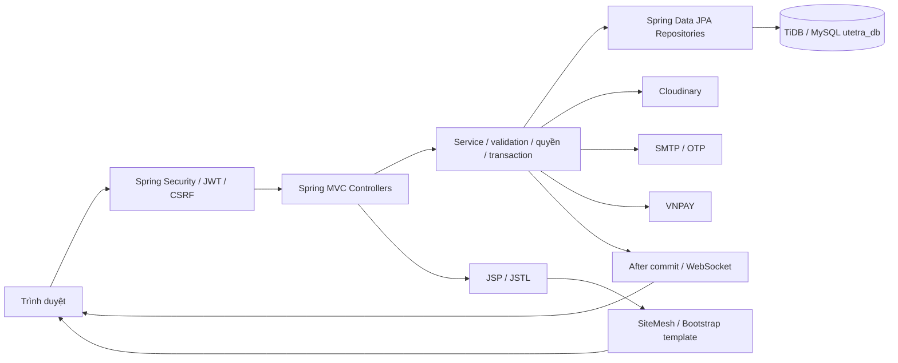

# UTETra — Kế hoạch dự án theo quy định cuối kỳ

> Bổ sung cuối lượt 24/10: VNPAY có adapter và test giao thức, còn merchant sandbox để nghiệm thu; Manager CRUD carrier theo shop. Xem [trạng thái theo yêu cầu thầy](docs/FINAL_REQUIREMENTS_STATUS.md).

> Bổ sung tiếp 24/10: [JWT DB và checkout realtime](docs/features/order-payment/REALTIME_CHECKOUT_JWT.md) đã có JTI/hash/hạn access token trong DB, tồn hữu hạn theo size, chống tranh tồn/voucher, thông báo sau commit và polling. Cần nhập tồn theo size để bật kiểm số lượng; nhánh thành viên phải merge đầy đủ source integration trước khi chạy chung DB. Đây không phải tích hợp ví điện tử.

> Bổ sung 24/10/2026 trên integration: đã thêm chuyển khoản Techcombank QR đối soát thủ công bên cạnh COD; xem [BANK_TRANSFER](docs/features/order-payment/BANK_TRANSFER.md) và [bàn giao sau audit](docs/REMEDIATION_20261024.md). Đây không phải implementation VNPAY/MOMO; UC cổng online vẫn chờ chốt với giảng viên. Kiến trúc catalog đã đưa SQL shop/thống kê về Repository.

> Phiên bản 3.0, 13/10/2026. Nguồn ưu tiên: [Quy định và cấu hình chung](docs/QUY_DINH_VA_CAU_HINH_CHUNG.md). Cập nhật này thay phạm vi Customer/Staff/Admin và COD-only của bản 2; không xóa chức năng đã có. Trạng thái code/test thực tại docs/BASELINE_VERIFICATION.md sau khi kiểm chứng.

## 1. Mục tiêu

Website chuỗi trà sữa với Guest, User, Vendor/Seller, Manager, Admin và Shipper phần thêm. Shop là chi nhánh/cửa hàng trong UTETra. Khách tự chọn shop, không tính khoảng cách hoặc tự chọn gần nhất. Bán hàng và thanh toán là luồng chính; có đủ OTP, tương tác sản phẩm, khuyến mãi, nhà vận chuyển, chiết khấu và trả–hoàn theo yêu cầu giảng viên.

P0 gồm 55 use case bắt buộc trong USE_CASES.md; 3 use case Shipper là P1 thêm. Nhà vận chuyển/phí và các trạng thái giao vẫn bắt buộc dù chưa bật module Shipper. Tích hợp COD + VNPAY sandbox; MOMO là phương án thay thế nếu nhóm đổi thống nhất, không bắt buộc cả hai. JWT, voucher và WebSocket hỗ trợ phần sáng tạo; không thay thế chức năng logic/security 60% điểm.

## 2. Stack và mô hình

| Thành phần | Chốt cấu hình |
| --- | --- |
| Java/Maven | Java 21, Maven Wrapper 3.9.16 |
| Spring Boot | 3.5.13, WAR, package com.utetra |
| Presentation | Spring MVC Controller + JSP/Jakarta JSTL; SiteMesh 3.2.2 ghép layout |
| UI | Bootstrap 5.3.3, một template Start Bootstrap Shop Homepage dùng chung |
| Business | Service validation/quyền/transaction, DTO |
| Data access | Spring Data JPA/Hibernate, Flyway, ddl-auto=validate, open-in-view=false |
| CSDL | MySQL protocol trên TiDB Cloud; database riêng utetra_db, TLS VERIFY_IDENTITY |
| Security | Spring Security 6 theo BOM, BCrypt, Nimbus JWT 10.10, CSRF và kiểm session/user |
| Realtime/ngoài hệ thống | Spring STOMP /ws, Cloudinary HTTP5 2.4.0, Spring Mail/OTP, VNPAY sandbox |

SQL Server/PostgreSQL là lựa chọn trong mô tả gốc; bản này chọn MySQL, không thêm các driver/profile đó. Các cấu hình thật trong application*.properties được Git quản lý theo yêu cầu repository private; không dùng .env. Không đưa credentials vào UI/log/ảnh/prompt.

MVC là cách tổ chức Presentation, không thay thế mô hình ba tầng. Controller không truy vấn DB trực tiếp; JSP không có SQL hoặc logic tính tiền. Endpoint JSON hỗ trợ giao diện cùng app, không đổi thành SPA/Thymeleaf hoặc ghép project khác.

## 3. Phân công theo use case và vai trò

| Thành viên/nhánh | Luồng liên quan từ đầu đến cuối | Phần báo cáo theo role |
| --- | --- | --- |
| TV1 — feature/catalog-sales | Thực đơn, chọn shop, top, Vendor đăng ký/trang chủ/shop/món/khuyến mãi; Manager/Admin catalog/shop | Guest/User xem món; Vendor catalog; Manager/Admin catalog |
| TV2 — feature/identity-membership | OTP/JWT, profile/địa chỉ, thích/xem/đánh giá/bình luận, điểm; Manager/Admin user/role/scope | Guest/User xác thực và tương tác; Manager/Admin identity |
| TV3 — feature/order-payment | Giỏ/checkout/COD/VNPAY/mã giảm giá, đơn mọi role, trả–hoàn, carrier/hoa hồng/revenue, realtime; Shipper thêm | User mua; Vendor vận hành; Manager/Admin đơn/tài chính; Shipper |

Mỗi người làm đầy đủ Entity/Repo/Service/Controller/JSP/test/hồ sơ cho UC được giao. Actor có thể xuất hiện ở nhiều module nhưng mỗi UC có một owner tại USE_CASES.md. Phân công theo cả role và luồng để không giao các tầng rời rạc. Review chéo và điều chỉnh khối lượng theo độ khó, không chỉ số UC.

## 4. Main và tích hợp

Main là nguồn pom/config/layout/contract/migration chung và bản ổn định. Ba nhánh feature lấy main; integration/utetra ghép catalog → identity → order và test xuyên suốt. Không thay cấu hình riêng trên nhánh để chữa lỗi tích hợp. File hướng dẫn nhánh và docs/features có phạm vi/role/UC/contract/setup/prompt.

Baseline hiện dựng các cấu hình chung, 3 Entity identity và migration V1; schema nghiệp vụ mở rộng là thiết kế để các nhánh triển khai tiếp. Không xem trang kiểm chứng nền tảng là menu/checkout đã hoàn thành.

## 5. Lộ trình theo mốc kiểm chứng

| Mốc | Kết quả cần đạt |
| --- | --- |
| B0 | WAR/JSP/JSTL/SiteMesh/Bootstrap, MySQL riêng, JPA/Flyway, JWT/CSRF/role, STOMP, adapter Media, setup/test chung |
| B1 | Khảo sát thực + phân tích actor/UC/sequence/ERD; OTP và shop/catalog; credential SMTP/Cloudinary |
| B2 | Giỏ DB, User/Vendor mua hàng, COD/VNPAY, quota coupon, snapshot/idempotency |
| B3 | Role Vendor/Manager/Admin đầy đủ, khuyến mãi/commission/carrier; trả–hoàn; review/comments/media |
| B4 | Realtime/báo cáo, test cạnh tranh và callback, responsive; Shipper nếu đủ thời gian |
| B5 | GitHub PR/commit, báo cáo mỗi người theo UC/role, DOCX có nguồn hình/prompt, diễn tập |

Chưa có lịch nộp từ giảng viên; không tự coi thời lượng cũ là deadline. Không hạ OTP/VNPAY/coupon/trả–hoàn xuống ngoài phạm vi để đạt demo nhanh.

## 6. Chất lượng và bàn giao

Ưu tiên 6/10 điểm cho đầy đủ chức năng/logic/validation/security. Kiểm thử quyền owner/shop/assignment, OTP retry/replay, token revoked, tiền/điểm/quota, IPN giả/trùng/đến muộn, hoàn tiền thực, media và schema; một template responsive trên mobile/tablet/desktop. Tất cả request thay đổi cần CSRF, trừ callback máy chủ được xác minh chữ ký theo cấu hình đã review khi module thanh toán có thật.

Bàn giao code, WAR, MySQL migrations, cấu hình, SETUP, báo cáo khảo sát/phân tích, hình kiến trúc/activity/code/UI, test thực và prompt AI nguyên văn đã che secret. Báo cáo chấm điểm/ma trận yêu cầu tại docs/QUY_DINH_VA_CAU_HINH_CHUNG.md; hồ sơ tổng hợp tại docs/REPORT_ASSEMBLY.md.

## Cập nhật phạm vi 26/10/2026 — Giỏ và đặt nhóm

Thanh duyệt đặt nhóm theo link mời, mỗi người dùng tài khoản riêng và gửi snapshot món; host chốt rồi thanh toán chung. Chính sách 3/5/10 người giảm 5/10/15%, trần 100.000đ, không cộng dồn mã giảm món. Giữ chọn chi nhánh tại checkout. Thêm badge giỏ nhẹ trên header desktop/mobile và giỏ có ảnh/giá/tóm tắt; tối ưu đọc trang chủ theo lô, User đăng nhập về /. Chi tiết use case/schema/validation và giới hạn tại docs/features/order-payment/GROUP_ORDERS_20261026.md.

## 27/10 — chủ nhóm quyết định thanh toán

Thanh xác nhận chủ nhóm quyết định trả toàn bộ hoặc COD chia phần; host đặt ngay, không đợi từng người xác nhận thanh toán. Entry trang chủ, tham gia trước/chọn món trong nhóm, một đơn chung và bill từng phần sau giảm. Contract ưu tiên bản GROUP_JOIN_FIRST_COD_20261027.md trong docs/features/order-payment; các mô tả nhóm trước đó được thay thế về luồng và thanh toán.

Cập nhật 27/10/2026 theo yêu cầu Thanh: chia phần hỗ trợ cả COD và QR, chủ nhóm đặt ngay, thành viên nhận popup thông báo và xem phần tiền/QR của mình. Chi tiết và giới hạn đối soát ở docs/features/order-payment/GROUP_SPLIT_QR_POPUP_20261027.md.

Cập nhật 27/10/2026 theo yêu cầu Thanh: QR cho đơn mới dùng LOCAL_QR (ví giả lập, không tiền thật), local_qr_payments theo từng người. Đơn nhóm chia phần chỉ được CONFIRMED khi tất cả phần thanh toán thành công. Hướng dẫn/contract mới thay phần QR chuyển khoản trước đó: docs/features/order-payment/LOCAL_QR_WALLET_20261027.md.

Cập nhật 27/10/2026: hủy và hết hạn có popup riêng cho thành viên; mã nhóm/host/time/status và badge Chủ nhóm. Nhãn QR trung tính, cơ chế nội bộ không đổi. Xem docs/features/order-payment/GROUP_LIFECYCLE_20261027.md.
