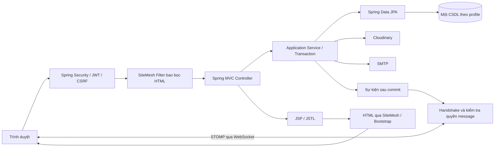

# UTETra — Kế hoạch xây dựng website chuỗi bán trà sữa

| Thuộc tính | Nội dung |
| --- | --- |
| Phiên bản | 2.0 — ngày 24/09/2026 |
| Loại tài liệu | Định hướng sản phẩm, kiến trúc và kế hoạch triển khai |
| Công nghệ | Spring Boot · JSP/JSTL · SiteMesh Decorator · Bootstrap · Spring Data JPA · SQL Server/MySQL/PostgreSQL · JWT · WebSocket · Cloudinary |
| Nhân sự dự kiến | 3 thành viên, kế thừa quy mô của tài liệu ban đầu |
| Trạng thái | Đặc tả đề xuất để triển khai; không phải xác nhận phần mềm đã hoàn thành |

Tài liệu liên quan: [Đặc tả chức năng](USE_CASES.md) và [Thiết kế dữ liệu](DATABASE_DESIGN.md). Quy tắc nghiệp vụ và mã use case lấy từ `USE_CASES.md`; tên bảng, cột và ràng buộc lấy từ `DATABASE_DESIGN.md`. Mọi thay đổi phạm vi phải cập nhật đồng thời ba tài liệu.

## 1. Mục tiêu và phạm vi sản phẩm

UTETra phục vụ hoạt động bán trà sữa của nhiều chi nhánh trên một website thống nhất. Khách hàng chọn chi nhánh, tùy biến đồ uống, đặt giao hàng và theo dõi trạng thái. Nhân viên xử lý đơn thuộc chi nhánh được phân công. Quản trị viên quản lý toàn chuỗi và theo dõi kết quả kinh doanh.

Mục tiêu nghiệm thu là một luồng hoàn chỉnh: **chọn chi nhánh → xem thực đơn → tùy biến món → giỏ hàng → đặt hàng → thanh toán → xử lý và theo dõi đơn**. Trọng tâm đồ án là bán hàng và thanh toán; tài khoản, danh mục, điểm thưởng và báo cáo hỗ trợ luồng này. Website phải giữ nguyên giá trị đơn cũ khi đổi giá bán và không tạo đơn trùng khi khách bấm nhiều lần.

Khách tự chọn chi nhánh từ danh sách. Không tính khoảng cách hoặc tự động chọn chi nhánh gần nhất. Các chức năng còn lại giữ nguyên, bao gồm quản lý chi nhánh, khu vực giao hàng, phí giao, tình trạng bán, tài khoản, điểm thưởng, thông báo và báo cáo. Phí giao lấy theo khu vực đã cấu hình, không tính theo số kilomet.

### 1.1. Phạm vi bắt buộc (P0)

| Phân hệ | Chức năng phải có |
| --- | --- |
| Thực đơn | Trang chủ, tìm kiếm/lọc/phân trang, chi tiết món, size S/M/L, đường/đá, topping hợp lệ theo món |
| Chuỗi cửa hàng | Danh sách để khách tự chọn; thông tin chi nhánh, giờ mở cửa, khu vực giao hàng, phí giao; tình trạng bán món và topping riêng từng chi nhánh |
| Tài khoản | Đăng ký khách hàng, đăng nhập JWT, làm mới phiên, đăng xuất, hồ sơ, đổi/quên mật khẩu, sổ địa chỉ |
| Quản trị | Quản lý danh mục, sản phẩm, size, topping, chi nhánh, tài khoản và phân công nhân viên |
| Giỏ hàng | Giỏ tạm cho khách vãng lai, giỏ CSDL cho khách đăng nhập, hợp nhất giỏ sau đăng nhập |
| Đơn hàng | Giao tận nơi, thanh toán COD, lịch sử đơn, hủy theo điều kiện, lịch sử chuyển trạng thái |
| Thành viên | Sổ giao dịch điểm, sử dụng/hoàn điểm, tích điểm khi hoàn thành, hạng Đồng/Bạc/Vàng |
| Thời gian thực | Thông báo đơn mới cho chi nhánh, cập nhật trạng thái cho chủ đơn, danh sách thông báo đã đọc/chưa đọc |
| Hình ảnh | Upload và thay ảnh qua Cloudinary; lưu URL cùng public ID |
| Báo cáo | Doanh thu thực thu từ đơn hoàn tất, số đơn theo trạng thái, món bán chạy, lọc chi nhánh và khoảng ngày |

### 1.2. Mở rộng sau P0 (P1)

Chuyển khoản QR có đối soát, cổng thanh toán trực tuyến và hoàn tiền; voucher/chương trình khuyến mãi; nhận tại cửa hàng; đánh giá sản phẩm; quản lý nguyên liệu, định lượng và tồn kho; tích hợp đơn vị giao vận; nhiều máy chủ và message broker bên ngoài. Nếu mở rộng, ưu tiên thanh toán trước các chức năng phụ trợ. Tính khoảng cách và tự chọn chi nhánh không thuộc phạm vi đồ án.

P1 chưa thuộc schema và tiêu chí nghiệm thu P0. Khi bổ sung phải thiết kế riêng giao dịch thanh toán, callback, đối soát và hoàn tiền; hiển thị QR không đồng nghĩa đã thanh toán. Tình trạng còn/hết món trong P0 là cờ do nhân viên cập nhật, không phải quản lý tồn kho nguyên liệu.

## 2. Quyết định kiến trúc

### 2.1. Bộ công nghệ thống nhất

| Thành phần | Phương án triển khai | Quy tắc |
| --- | --- | --- |
| Java và build | Java 21 LTS, Maven Wrapper | Chốt phiên bản và đưa Wrapper vào repository |
| Backend | Spring Boot 3.5.x, Spring MVC, Validation | Khóa bản vá cụ thể khi dựng dự án; dùng namespace `jakarta.*` |
| Giao diện máy chủ | JSP + Jakarta JSTL, Tomcat, đóng gói WAR | JSP trong `src/main/webapp/WEB-INF/views/`; không dùng executable JAR cho JSP |
| Decorator | SiteMesh 3.2.x tương thích Jakarta | Kiểm tra cả thư viện lõi và tích hợp JSP; không trộn thư viện dùng `javax.servlet` |
| Giao diện | Bootstrap 5.3.x, CSS thương hiệu, JavaScript | Responsive; dùng Fetch cho thao tác cập nhật từng phần |
| Dữ liệu | Spring Data JPA/Hibernate, Flyway | Entity chung; migration riêng theo hệ quản trị; `ddl-auto=validate` |
| CSDL | SQL Server làm môi trường demo chính; MySQL và PostgreSQL có profile riêng | Mỗi lần chạy một CSDL; kiểm thử cả ba trước khi công bố hỗ trợ |
| Xác thực | Spring Security 6.x theo BOM của Boot, JWT | Cookie cho website JSP; refresh token quản lý phía máy chủ |
| Realtime | Spring WebSocket + STOMP | Native WebSocket cùng origin; simple broker cho một instance; SockJS chỉ bổ sung khi cần |
| Ảnh | Cloudinary Java SDK | Upload phía server, secret từ biến môi trường |
| Email | Spring Mail và SMTP | Gửi liên kết đặt lại mật khẩu; môi trường test dùng mail server giả lập |
| Kiểm thử | JUnit, Spring Boot Test, MockMvc, integration test trên CSDL thật | Không dùng H2 thay thế kiểm thử ba dialect |

Các dòng phiên bản trên là baseline thiết kế, không phải tuyên bố phiên bản mới nhất. Không trộn Spring Boot 2.7/Security 5 với Boot 3/Security 6. Phiên bản chính xác được khóa trong `pom.xml` sau kiểm tra tương thích.

Spring Boot nêu giới hạn JSP khi đóng gói executable JAR; dự án chọn executable WAR với Tomcat. Xem [JSP limitations](https://docs.spring.io/spring-boot/3.3/reference/web/servlet.html#web.servlet.embedded-container.jsp-limitations). Nhánh SiteMesh 3.2.x dùng Jakarta phù hợp với Boot 3.x theo [hướng dẫn tương thích SiteMesh](https://github.com/sitemesh/sitemesh3/blob/master/JAKARTA_UPGRADE.md).

### 2.2. Sơ đồ kiến trúc



Filter bảo mật chạy trước xử lý nghiệp vụ. SiteMesh bao bọc phản hồi HTML, không thay thế Controller hoặc Security. Loại trừ `/api/**`, `/ws/**`, `/assets/**` và nội dung không phải HTML khỏi decorator.

Controller nhận DTO và trả view/response; Service kiểm tra nghiệp vụ và mở transaction; Repository truy cập dữ liệu. JSP chỉ hiển thị bằng EL/JSTL, không viết SQL, scriptlet hoặc logic tính tiền. Không bind trực tiếp request vào Entity; không trả Entity JPA qua JSON.

### 2.3. Cấu trúc dự kiến

```text
src/main/java/com/utetra/
├── config/                 # Security, SiteMesh, WebSocket, JPA, Cloudinary
├── security/               # JWT, authentication session, authorization
├── controller/
│   ├── publicweb/          # Trang chủ, thực đơn, chi nhánh
│   ├── auth/               # Đăng ký, đăng nhập, quên mật khẩu
│   ├── customer/           # Giỏ hàng, checkout, hồ sơ, đơn cá nhân
│   ├── staff/              # Vận hành chi nhánh
│   └── admin/              # Quản trị toàn chuỗi
├── service/                # Nghiệp vụ và ranh giới transaction
├── repository/
├── entity/                 # Tên thống nhất: OrderItem, OrderItemTopping
├── dto/
├── mapper/
├── enums/
├── event/                  # Sự kiện sau commit
└── exception/

src/main/resources/
├── application.yml
├── application-{sqlserver,mysql,postgresql}.yml
├── db/migration/{sqlserver,mysql,postgresql}/
└── static/assets/{css,js,images}/

src/main/webapp/WEB-INF/views/
├── layouts/{client,staff,admin,auth}.jsp
├── fragments/
├── publicweb/
├── auth/
├── customer/
├── staff/
├── admin/
└── errors/{403,404,500}.jsp

src/test/java/com/utetra/
```

Đây là cây thiết kế, chưa phải các file đã tồn tại. Tên trong dấu `{...}` biểu thị nhiều file/thư mục riêng.

## 3. Quy tắc kỹ thuật xuyên suốt

### 3.1. JWT, cookie và phân quyền

- Access JWT dự kiến sống 15 phút; refresh token ngẫu nhiên sống tối đa 7 ngày. JWT chứa `sub` là user ID, `sid` là session ID, `iat`, `exp`, `iss`, `aud`; kiểm tra chữ ký và thuật toán cho phép.
- Website lưu token trong cookie `HttpOnly`, `Secure` ở HTTPS, `SameSite=Lax`; không đưa token vào URL hoặc `localStorage`. Cookie refresh giới hạn path `/auth`; xóa cookie bằng đúng path khi đăng xuất.
- Lưu hash refresh token trong `auth_sessions`, xoay token mỗi lần refresh dưới khóa giao dịch. Đăng xuất thu hồi phiên; đổi/đặt lại mật khẩu và khóa tài khoản thu hồi mọi phiên của người dùng.
- Mỗi request đã xác thực kiểm tra tài khoản và phiên còn hiệu lực; quyền/chi nhánh lấy từ dữ liệu hiện tại. P0 chấp nhận truy vấn kiểm tra phiên để hỗ trợ thu hồi ngay.
- Bảo vệ CSRF cho form JSP và request thay đổi dữ liệu, kể cả đăng nhập/đăng xuất. `HttpOnly` và JWT không thay thế CSRF khi dùng cookie. Dùng POST cho thao tác thay đổi; GET chỉ đọc.
- Phân quyền ở URL và Service theo vai trò, chủ sở hữu và chi nhánh. Ẩn nút trên JSP chỉ hỗ trợ giao diện.
- Giỏ khách vãng lai có thể dùng `HttpSession`; đây là dữ liệu giỏ tạm, không phải phiên xác thực Spring Security. Đổi session ID sau đăng nhập và hợp nhất giỏ đúng một lần.
- Mật khẩu băm BCrypt; giới hạn thử đăng nhập, refresh và reset; không ghi mật khẩu/token vào log. Reset dùng token ngẫu nhiên một lần, lưu hash, hết hạn sau 15 phút.

### 3.2. Giao dịch đơn hàng và điểm thưởng

Một đơn chỉ thuộc chi nhánh khách tự chọn. Server kiểm tra chi nhánh đang nhận đơn, khu vực giao hàng, size và topping còn bán rồi tính lại toàn bộ giá. Phí giao lấy theo khu vực đã cấu hình, không tính khoảng cách. Request chỉ gửi lựa chọn, số lượng, địa chỉ và điểm muốn sử dụng.

Checkout thực hiện trong một transaction: khóa giỏ và tài khoản điểm → kiểm tra khóa chống gửi lặp → xác minh dữ liệu và giá → tạo snapshot đơn/món/topping → trừ điểm và ghi ledger → tạo lịch sử, thông báo → xóa các dòng giỏ đã đặt → commit. Nếu một bước lỗi, toàn bộ dữ liệu được rollback.

`checkout_key` duy nhất theo khách hàng chống tạo đơn trùng; `request_hash` giúp từ chối cùng key nhưng khác nội dung. Dùng `@Version` khi cập nhật đơn; request từ màn hình cũ trả lỗi xung đột và tải lại trạng thái. Quy tắc tính tiền, trạng thái và điểm tại [USE_CASES.md](USE_CASES.md).

### 3.3. Hợp đồng WebSocket

| Thành phần | Quy ước |
| --- | --- |
| Handshake | `/ws`, cùng origin, xác thực cookie JWT |
| Khách hàng | Subscribe `/user/queue/orders` và `/user/queue/notifications` của chính mình |
| Nhân viên | Subscribe `/topic/stores/{storeId}/orders` khi có phân công đang hoạt động |
| Quản trị viên | Subscribe `/topic/admin/orders`; được xem kênh chi nhánh |
| Sự kiện | `ORDER_CREATED`, `ORDER_STATUS_CHANGED`, `PAYMENT_UPDATED` |
| Payload | `eventId`, `type`, `orderId`, `orderCode`, `storeId`, `status`, `version`, `occurredAt` |
| Dữ liệu riêng tư | Không phát tên, số điện thoại, địa chỉ hoặc token lên topic; đọc chi tiết qua HTTP có kiểm tra quyền |

Kiểm tra quyền `CONNECT` và từng `SUBSCRIBE`; chặn client `SEND` vào `/topic/**` và `/queue/**`. Mọi thay đổi đơn đi qua HTTP Service. Truyền CSRF token trong STOMP CONNECT; kiểm tra lại quyền khi người dùng bị khóa, thu hồi phiên hoặc bỏ phân công và đóng kết nối tương ứng. Đóng socket khi JWT hết hạn; refresh rồi kết nối lại. Thiết kế theo [Spring Security WebSocket](https://docs.spring.io/spring-security/reference/6.5/servlet/integrations/websocket.html).

Phát sự kiện sau commit, không để lỗi broker rollback đơn đã lưu. Simple broker không bảo đảm giao lại thông điệp: khi mở trang/kết nối lại, đọc trạng thái và thông báo từ CSDL; khi socket lỗi, polling mỗi 15 giây lúc trang đang hiển thị. Client bỏ sự kiện cũ/trùng theo version/event ID. Thông báo đã đọc lưu riêng từng người nhận. Âm thanh chỉ phát sau khi người dùng cho phép tương tác trình duyệt.

### 3.4. Cloudinary

Upload qua server, chỉ chấp nhận JPEG/PNG/WebP, tối đa 5 MB mỗi ảnh; kiểm tra nội dung thực và kích thước ảnh giải mã. Lưu `secure_url` và `public_id`; không nhận public ID tùy ý từ client để xóa. Dùng ảnh dự phòng nếu chưa có ảnh.

Khi thay ảnh: upload ảnh mới → lưu tham chiếu mới trong DB → sau commit mới xóa ảnh cũ. DB rollback thì dọn ảnh mới; tác vụ dọn lỗi ghi log và thử lại. Transaction SQL không bao phủ Cloudinary. Chi tiết API xem [Cloudinary Java upload](https://cloudinary.com/documentation/java_image_and_video_upload) và [Upload API](https://cloudinary.com/documentation/image_upload_api_reference).

## 4. Phân công nhóm ba thành viên

Mỗi thành viên chịu trách nhiệm đầy đủ Entity/Repository → Service → Controller → JSP → kiểm thử của phân hệ. Phân công dưới đây là đề xuất quản lý công việc, không phải thông tin cá nhân đã được xác nhận.

| Thành viên | Trách nhiệm chính | Bàn giao và phụ thuộc |
| --- | --- | --- |
| TV1 — Nền tảng và danh mục | WAR/JSP/SiteMesh, layout Bootstrap, danh mục/món/size/topping, chi nhánh/khu vực giao, tình trạng bán, Cloudinary, migration catalog | Cung cấp `CatalogService`, `StoreService`, `MediaService` cho TV2/TV3 |
| TV2 — Tài khoản và bảo mật | JWT/CSRF, phiên và reset mật khẩu, hồ sơ/địa chỉ, phân công nhân viên, tài khoản, điểm/hạng, migration identity | Cung cấp kiểm tra quyền, `LoyaltyService`; phối hợp bảo mật WebSocket và transaction đơn với TV3 |
| TV3 — Bán hàng và vận hành | Giỏ, checkout, COD, đơn/lịch sử, thông báo/STOMP, dashboard/báo cáo, migration order | Tích hợp giá/tình trạng bán của TV1 và quyền/điểm của TV2 |
| Cả nhóm | Chốt contract, review, kiểm thử ba CSDL, seed, tài liệu và diễn tập | Mỗi PR có ít nhất một người khác review |

Thống nhất DTO dùng chung trước khi phát triển: `CartItemRequest`, `CheckoutRequest`, `OrderStatusRequest`, `OrderEvent`, `MediaUploadResult`. Service điểm tham gia cùng transaction của đơn, không tự commit độc lập. Thay đổi schema cần chủ phân hệ liên quan review.

## 5. Lộ trình triển khai dự kiến

Ước lượng 6 tuần cho ba thành viên; điều chỉnh theo lịch học và năng lực thực tế. Không rút ngắn kiểm thử để đưa P1 vào P0.

| Mốc | Nội dung | Điều kiện hoàn thành |
| --- | --- | --- |
| Tuần 1 — Nền tảng | Khóa phiên bản; WAR; JSP/JSTL/SiteMesh; ba profile DB; migration; skeleton Security; CI | Build sạch; WAR hiển thị tiếng Việt và layout; migration chạy trên ba CSDL |
| Tuần 2 — Danh mục và tài khoản | CRUD catalog/chi nhánh; Cloudinary; đăng ký/đăng nhập/refresh/reset; phân quyền | Khách xem thực đơn; admin CRUD; staff không truy cập cấu hình toàn chuỗi |
| Tuần 3 — Giỏ và đặt hàng | Tùy biến món, hợp nhất giỏ, chọn chi nhánh, địa chỉ/khu vực giao, giá và COD, chống đơn trùng | Checkout lưu đủ snapshot; không nhận giá client; rollback đúng |
| Tuần 4 — Vận hành | Chuyển trạng thái, thu COD, điểm/hoàn điểm, WebSocket/thông báo | Demo nhiều trình duyệt và hai chi nhánh; không rò dữ liệu chéo |
| Tuần 5 — Tích hợp | Báo cáo; cạnh tranh; token/CSRF; Cloudinary/SMTP lỗi; kiểm thử DB | Kiểm thử P0 qua; số liệu báo cáo khớp đơn mẫu |
| Tuần 6 — Bàn giao | Responsive, seed, hướng dẫn cài/chạy, báo cáo và kịch bản bảo vệ | Cài từ môi trường sạch, chạy WAR, phục hồi DB và demo đầy đủ |

Checklist khởi tạo:

- [ ] Thêm Web, Security, Data JPA, Validation, WebSocket, Mail, Jasper, Jakarta JSTL, SiteMesh, JWT, Cloudinary, Flyway và JDBC driver phù hợp.
- [ ] Dùng BOM Spring Boot cho dependency được quản lý; khóa phiên bản dependency ngoài BOM.
- [ ] Thiết lập view resolver, bốn decorator và trang lỗi; kiểm tra JSP trong WAR thực tế.
- [ ] Tạo migration theo thứ tự FK trong `DATABASE_DESIGN.md`, seed chỉ chạy profile demo/test.
- [ ] Tạo repository Git và CI; chưa xem các nhánh nêu dưới đây là đã tồn tại.

## 6. Cấu hình, triển khai và vận hành

| Nhóm cấu hình | Biến môi trường dự kiến |
| --- | --- |
| Profile và CSDL | `SPRING_PROFILES_ACTIVE`, `DB_URL`, `DB_USERNAME`, `DB_PASSWORD` |
| JWT | `JWT_SECRET`, `JWT_ISSUER`, `JWT_AUDIENCE` |
| Cloudinary | `CLOUDINARY_CLOUD_NAME`, `CLOUDINARY_API_KEY`, `CLOUDINARY_API_SECRET` |
| SMTP | `MAIL_HOST`, `MAIL_PORT`, `MAIL_USERNAME`, `MAIL_PASSWORD`, `MAIL_FROM` |
| Website | `APP_BASE_URL`, `APP_TIME_ZONE=Asia/Ho_Chi_Minh` |

Các biến phải được ánh xạ trong cấu hình ứng dụng. JWT secret có độ mạnh phù hợp thuật toán; không ghi secret thật vào Git hoặc tài liệu. Chỉ profile local HTTP mới được tắt Secure của cookie. Môi trường triển khai dùng HTTPS/WSS và origin cụ thể.

Lệnh dự kiến sau khi có mã nguồn và Maven Wrapper:

```powershell
$env:SPRING_PROFILES_ACTIVE = 'sqlserver'
.\mvnw.cmd clean verify
java -jar target/utetra.war
```

Cấu hình Maven `finalName=utetra` để thống nhất tên WAR. Profile `mysql` và `postgresql` dùng URL/driver/migration tương ứng; không bật đồng thời nhiều profile CSDL. Cài database và tài khoản trước khi chạy; migration tạo schema bên trong database, không tự cấp quyền quản trị máy chủ.

Ghi log có request ID, order code và tác nhân; che dữ liệu nhạy cảm. Giám sát lỗi checkout, email, Cloudinary và WebSocket. Sao lưu trước migration, thử khôi phục trước bàn giao; không sửa migration đã áp dụng, tạo migration mới để thay đổi có kiểm soát.

## 7. Kiểm thử và tiêu chí nghiệm thu

| Nhóm | Kiểm chứng bắt buộc |
| --- | --- |
| Chức năng | Toàn bộ use case P0 tại `USE_CASES.md`, gồm luồng lỗi và kiểm tra quyền |
| Giá/điểm | Giá topping theo từng ly; điểm không âm; giảm tối đa 20%; hủy hoàn một lần; hoàn tất tích một lần |
| Giao dịch | Hai checkout đồng thời, gửi lại request, cạnh tranh xác nhận/hủy, cập nhật từ màn hình cũ |
| Bảo mật | Thiếu CSRF, JWT sai/hết hạn/thu hồi, đơn người khác, staff khác chi nhánh, subscribe trái phép |
| Tích hợp | Upload/reset mail lỗi; DB rollback không gửi sự kiện; reconnect tải lại; khóa tài khoản ngắt socket |
| Dữ liệu | Migration từ DB trống và nâng cấp trên ba hệ; FK, unique, Unicode, thời gian, decimal |
| Giao diện | Độ rộng 375/768/1440 px; nhãn form, bàn phím, validation, loading/empty/error states |
| Báo cáo | Chỉ tính đơn hoàn tất và đã trả; đối chiếu bộ seed có đơn hủy và chưa thu COD |

Mục tiêu hiệu năng đề xuất: với 100 sản phẩm, 10.000 đơn và 30 người dùng đồng thời, p95 request đọc dưới 2 giây, checkout dưới 3 giây khi không gọi dịch vụ ngoài, realtime dưới 2 giây sau commit trong mạng demo. Ghi cấu hình máy, công cụ, dữ liệu và kết quả thực đo; chưa xem đây là kết quả đã đạt.

Definition of Done: đúng đặc tả và quyền dữ liệu, validation phía server, giao diện hoàn chỉnh, migration tương ứng, kiểm thử liên quan qua, không lộ secret, được review và cập nhật tài liệu. Bàn giao gồm mã nguồn, WAR, migration ba CSDL, cấu hình mẫu, hướng dẫn chạy, tài khoản demo cấp riêng, kết quả kiểm thử và kịch bản demo.

## 8. Quy trình phối hợp và rủi ro

Dùng `main` cho nền tảng cấu hình chung và bản ổn định, `integration/utetra` để ghép chức năng, ba nhánh `feature/catalog-sales`, `feature/identity-membership`, `feature/order-payment` cho ba nhóm use case trọn luồng. Phân chia nhánh cập nhật ngày 13/10/2026 được chi tiết tại [docs/BRANCH_WORKFLOW.md](docs/BRANCH_WORKFLOW.md), thay quy ước nhánh tích hợp trước đây. PR nêu vấn đề, kết quả, schema và cách kiểm thử; không đẩy trực tiếp vào nhánh bảo vệ. Commit dùng `feat:`, `fix:`, `docs:`, `test:`, `refactor:`. Chia commit theo use case có thể review và tích hợp thường xuyên.

Mỗi thành viên ghi hướng dẫn triển khai, kiến trúc/activity, hình diễn giải code/UI, setup, kết quả kiểm thử và prompt AI thực đã dùng theo [docs/README.md](docs/README.md). Cấu hình/contract dùng chung được chốt trên main theo [docs/COMMON_BASELINE.md](docs/COMMON_BASELINE.md); không tự tạo project hoặc phiên bản thư viện khác trên từng nhánh. Hồ sơ Markdown là nguồn để tổng hợp thành DOCX theo yêu cầu giảng viên, không phải xác nhận code/hình thực đã hoàn tất.

| Rủi ro | Biện pháp và người phụ trách |
| --- | --- |
| JSP/SiteMesh không tương thích hoặc lỗi đóng gói | TV1 kiểm chứng trang mẫu trong WAR ngay tuần 1 |
| Khác biệt SQL và Unicode | TV1 điều phối migration, mỗi chủ phân hệ kiểm thử schema của mình |
| Đơn trùng, sai tiền hoặc điểm lặp | TV3 và TV2 kiểm thử transaction, unique key và khóa cạnh tranh |
| Rò dữ liệu chéo chi nhánh | TV2 kiểm tra quyền, TV3 kiểm thử subscribe và payload |
| Dịch vụ ảnh/email hoặc socket gián đoạn | Timeout, thông báo rõ, dọn ảnh lỗi, polling và phục hồi trạng thái |
| Phạm vi vượt thời gian | Hoàn thành P0 trước; P1 chỉ làm khi còn thời gian và đã bổ sung thiết kế |
