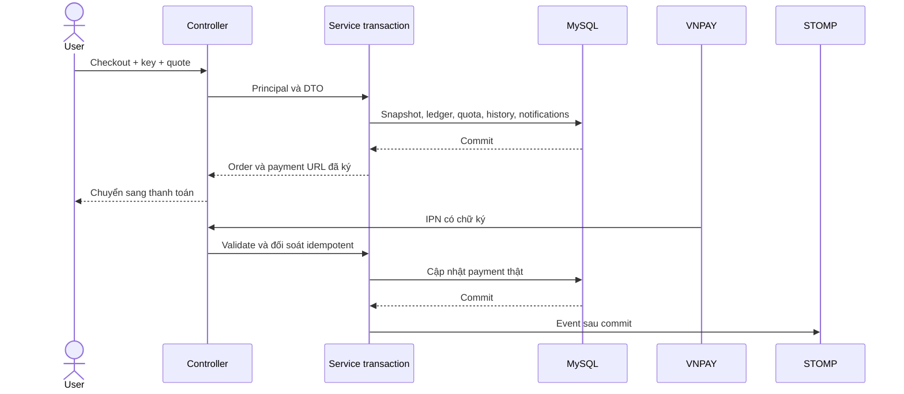

# UTETra — Use case theo quy định giảng viên

> UC-CSKH-01: User mở hội thoại Admin/chi nhánh; nhân viên trả lời trong scope, lưu DB và WebSocket private sau commit. Không có chat staff–staff. Contract và kiểm quyền tại docs/features/customer-support/UC-CSKH-01.md. Phần nhập địa chỉ tự do tại checkout được giữ; kiểm role/bảo mật mới nhất tại docs/ROLE_REQUIREMENTS_20261027.md.

> UC-ORD-06 đã có VnpaySettings/Service/Controller và test, chưa nghiệm thu merchant thật. UC-MGR-06 đã có CRUD carrier theo shop. Xem [trạng thái cuối kỳ](docs/FINAL_REQUIREMENTS_STATUS.md).

> Bổ sung 24/10 cho auth/checkout/realtime: [JWT DB, tranh tồn/quota và WebSocket checkout](docs/features/order-payment/REALTIME_CHECKOUT_JWT.md). Không tăng số UC để tự tính tỷ lệ đạt; đây là mở rộng các luồng đăng nhập/refresh/logout, checkout, voucher, hủy đơn, quản lý sản phẩm và realtime đã đặc tả.

> Bổ sung 24/10/2026: [luồng chuyển khoản ngân hàng QR](docs/features/order-payment/BANK_TRANSFER.md) mở rộng checkout/đơn/hủy/trả–hoàn; Admin đối soát tài khoản nhận chung. Không đánh dấu UC-ORD-06 VNPAY hoàn thành bằng QR thủ công, không đổi số UC bắt buộc của đặc tả cũ chỉ để tăng mức hoàn thiện.

> Phiên bản 3.0, 13/10/2026. Nguồn: docs/QUY_DINH_VA_CAU_HINH_CHUNG.md. 55 UC bắt buộc và 3 UC Shipper phần thêm. Mã UC bản này thay danh mục 28 UC cũ; nhật ký lịch sử giữ nguyên để tra lại. Đây là đặc tả, không phải tất cả chức năng đã code.

## 1. Actor và quyền

| Actor | Quyền và phạm vi |
| --- | --- |
| Guest | Public menu/shop/search/OTP; giỏ session; đăng nhập trước checkout |
| User — ROLE_USER | Mua hàng, địa chỉ/giỏ/đơn/điểm/tương tác của mình |
| Vendor — ROLE_VENDOR | Toàn bộ quyền mua của User + shop/món/khuyến mãi/đơn/doanh thu mình |
| Manager — ROLE_MANAGER | Các nghiệp vụ quản trị theo shop được phân công, user liên quan; không tự cấp Admin |
| Admin — ROLE_ADMIN | Toàn hệ thống, phân quyền/policy/đối soát/audit |
| Shipper — ROLE_SHIPPER | Phần thêm, đơn được giao; không tự refund hay đọc đơn khác |

Một tài khoản có một role; policy cho Vendor kế thừa quyền User, không tạo user phụ. Manager scope qua store_memberships, Vendor scope qua stores.owner_user_id. Public shop phải đã duyệt và đang hoạt động. Profile/đổi mật khẩu chung cho người đăng nhập; address/loyalty/mua hàng cho User và Vendor.

## 2. Danh mục UC và owner

| Mã | Chức năng | Actor | Module/nhánh owner | Phạm vi | Điều kiện nghiệm thu |
| --- | --- | --- | --- | --- | --- |
| UC-AUTH-01 | Đăng ký tài khoản | Guest | identity-membership | P0 bắt buộc | Tạo User chưa xác minh, BCrypt và gửi OTP email |
| UC-AUTH-02 | Kích hoạt bằng OTP | Guest | identity-membership | P0 bắt buộc | OTP đúng/hạn/một lần mới ghi email_verified_at |
| UC-AUTH-03 | Đăng nhập | Guest | identity-membership | P0 bắt buộc | Chỉ tài khoản hoạt động đã xác minh; tạo phiên và JWT |
| UC-AUTH-04 | Đăng xuất | Người đăng nhập | identity-membership | P0 bắt buộc | Thu hồi phiên, xóa cookie đúng path, ngắt socket |
| UC-AUTH-05 | Quên mật khẩu gửi OTP | Guest | identity-membership | P0 bắt buộc | Phản hồi chung, OTP reset riêng mục đích, giới hạn gửi |
| UC-AUTH-06 | Đặt lại mật khẩu bằng OTP | Guest | identity-membership | P0 bắt buộc | Xác minh rồi đổi BCrypt, dùng challenge một lần, thu hồi mọi phiên |
| UC-AUTH-07 | Làm mới phiên | Người đăng nhập | identity-membership | P0 bắt buộc | Khóa và xoay refresh hash, không kéo dài hạn tuyệt đối |
| UC-CAT-01 | Trang chủ Guest | Guest | catalog-sales | P0 bắt buộc | Sản phẩm bán >10 ly, giảm dần số bán; giả định cần thầy xác nhận |
| UC-CAT-02 | Tìm kiếm và lọc | Mọi người | catalog-sales | P0 bắt buộc | Tên, danh mục, shop, giá; sort allowlist, phân trang |
| UC-CAT-03 | Trang chủ User và top 20 | User, Vendor | catalog-sales | P0 bắt buộc | Bốn nhóm mới/bán chạy/đánh giá/yêu thích, mỗi nhóm tối đa 20 và phân trang |
| UC-CAT-04 | Sản phẩm theo danh mục | Mọi người | catalog-sales | P0 bắt buộc | Chỉ món/shop đang hoạt động; filter, paging và empty state |
| UC-CAT-05 | Chi tiết và tùy biến trà sữa | Mọi người | catalog-sales | P0 bắt buộc | Size S/M/L, đường/đá, topping hợp lệ, ảnh và giá dự kiến |
| UC-CAT-06 | Xem/chọn chi nhánh và trang shop | Mọi người | catalog-sales | P0 bắt buộc | Chọn thủ công; thông tin, khu vực/phí; không tính khoảng cách |
| UC-USER-01 | Profile, avatar và đổi mật khẩu | Người đăng nhập | identity-membership | P0 bắt buộc | Chỉ hồ sơ mình; Cloudinary; đổi mật khẩu thu hồi phiên |
| UC-USER-02 | Nhiều địa chỉ nhận hàng | User, Vendor | identity-membership | P0 bắt buộc | CRUD của mình, tối đa một mặc định, snapshot đơn không đổi |
| UC-USER-03 | Thích/bỏ thích sản phẩm | User, Vendor | identity-membership | P0 bắt buộc | Unique user/product, danh sách yêu thích và số thích đúng |
| UC-USER-04 | Sản phẩm đã xem | User, Vendor | identity-membership | P0 bắt buộc | Upsert lần xem, danh sách gần nhất của mình |
| UC-USER-05 | Đánh giá sản phẩm đã mua | User, Vendor | identity-membership | P0 bắt buộc | Đơn đã giao và trả tiền, sao 1–5, không đánh giá trùng order_item |
| UC-USER-06 | Bình luận text, ảnh/video | User, Vendor | identity-membership | P0 bắt buộc | Đã mua; text 50–2000 ký tự sau trim; media kiểm nội dung/kích thước |
| UC-USER-07 | Điểm và hạng thành viên | User, Vendor | identity-membership | P0 bắt buộc | Ledger trừ/hoàn/cộng/thu hồi điểm đúng một lần, hạng và số dư nhất quán |
| UC-ORD-01 | Thêm món vào giỏ | Guest, User, Vendor | order-payment | P0 bắt buộc | Validate tùy chọn, gộp đúng cấu hình, topping theo mỗi ly |
| UC-ORD-02 | Sửa/xóa/hợp nhất giỏ | Guest, User, Vendor | order-payment | P0 bắt buộc | Giỏ database cho người đăng nhập, session cho Guest; merge chống lặp |
| UC-ORD-03 | Checkout | User, Vendor | order-payment | P0 bắt buộc | Store/area/carrier/address/quote, server tính giá, snapshot và idempotency |
| UC-ORD-04 | Chọn mã giảm giá | User, Vendor | order-payment | P0 bắt buộc | Scope shop/sản phẩm/thời gian/hạn mức; khóa quota tại checkout |
| UC-ORD-05 | Thanh toán COD | User, Vendor | order-payment | P0 bắt buộc | Khách xác nhận tiền; chỉ người có quyền ghi thu tiền khi giao thành công |
| UC-ORD-06 | Thanh toán VNPAY | User, Vendor | order-payment | P0 bắt buộc | Sandbox URL ký, IPN xác thực số tiền/ref/signature, callback idempotent |
| UC-ORD-07 | Lịch sử và theo dõi đơn | User, Vendor | order-payment | P0 bắt buộc | Đơn mình theo mới/xác nhận/lấy hàng/giao/đã giao/hủy/trả/hoàn |
| UC-ORD-08 | Hủy đơn | User, Vendor | order-payment | P0 bắt buộc | Chỉ NEW cho khách; hoàn điểm, tạo refund nếu đã trả, không refund lặp |
| UC-ORD-09 | Yêu cầu trả hàng–hoàn tiền | User, Vendor | order-payment | P0 bắt buộc | Đơn đã giao, cửa sổ cấu hình, lý do/chứng cứ, theo dõi kết quả thật |
| UC-ORD-10 | Realtime và hộp thông báo | Người đăng nhập | order-payment | P0 bắt buộc | Lưu người nhận riêng, after commit, quyền subscribe, reconnect/polling |
| UC-VND-01 | Đăng ký shop | User, Vendor | catalog-sales | P0 bắt buộc | Hồ sơ chờ duyệt; duyệt mới hoạt động và cấp quyền Vendor |
| UC-VND-02 | Quản lý trang chủ shop | Vendor | catalog-sales | P0 bắt buộc | Profile/banner/giờ/nhận đơn của shop mình, ảnh Cloudinary |
| UC-VND-03 | Quản lý sản phẩm của mình | Vendor | catalog-sales | P0 bắt buộc | CRUD món/size/topping/availability đúng shop, không xóa lịch sử đã bán |
| UC-VND-04 | Quản lý đơn shop | Vendor | order-payment | P0 bắt buộc | Shop mình, chuyển trạng thái hợp lệ/version, có bước PICKED_UP |
| UC-VND-05 | Tạo khuyến mãi shop | Vendor | catalog-sales | P0 bắt buộc | Giảm sản phẩm và mã giảm giá của shop mình, không sửa chính sách toàn app |
| UC-VND-06 | Doanh thu shop | Vendor | order-payment | P0 bắt buộc | Hàng hóa/phí/hoa hồng/hoàn/net tách riêng, filter shop/date |
| UC-VND-07 | Xử lý yêu cầu trả hàng | Vendor | order-payment | P0 bắt buộc | Chấp nhận/từ chối có lý do theo shop; refund qua dịch vụ chung |
| UC-MGR-01 | Tìm/quản lý user | Manager | identity-membership | P0 bắt buộc | Phạm vi user liên quan shop được giao, không tự cấp Admin |
| UC-MGR-02 | Quản lý sản phẩm shop | Manager | catalog-sales | P0 bắt buộc | Shop được phân công, validation và audit |
| UC-MGR-03 | Quản lý danh mục/topping | Manager | catalog-sales | P0 bắt buộc | Theo phân quyền quản trị catalog được giao, không sửa ngoài phạm vi |
| UC-MGR-04 | Chiết khấu app cho shop | Manager | order-payment | P0 bắt buộc | Tỷ lệ/policy shop được giao, không đổi snapshot đơn cũ |
| UC-MGR-05 | Quản lý khuyến mãi | Manager | catalog-sales | P0 bắt buộc | Giảm % món/giảm phí giao trong shop được giao |
| UC-MGR-06 | Nhà vận chuyển và phí | Manager | order-payment | P0 bắt buộc | Tên/phí và biểu phí khu vực trong phạm vi được cấp, không tính kilomet |
| UC-MGR-07 | Quản lý cửa hàng | Manager | catalog-sales | P0 bắt buộc | Thông tin/trạng thái cửa hàng đã phân công; duyệt hồ sơ trong phạm vi |
| UC-MGR-08 | Đơn, trả hàng và hoàn tiền | Manager | order-payment | P0 bắt buộc | Kiểm quyền shop, transition/transaction/refund/audit |
| UC-MGR-09 | Báo cáo cửa hàng | Manager | order-payment | P0 bắt buộc | Doanh thu/net/hoàn theo phạm vi shop được giao |
| UC-ADM-01 | Tìm/quản lý user và phân quyền | Admin | identity-membership | P0 bắt buộc | Toàn hệ thống, khóa/revoke, phân công Manager, giữ Admin cuối cùng |
| UC-ADM-02 | Quản lý sản phẩm các shop | Admin | catalog-sales | P0 bắt buộc | Toàn chuỗi, duyệt/ngừng bán, không thay snapshot cũ |
| UC-ADM-03 | Quản lý danh mục/topping | Admin | catalog-sales | P0 bắt buộc | CRUD chung, unique/validation và quy tắc tham chiếu |
| UC-ADM-04 | Chiết khấu app cho shop | Admin | order-payment | P0 bắt buộc | Policy hoa hồng toàn app/shop, tỷ lệ snapshot và ledger doanh thu |
| UC-ADM-05 | Quản lý chương trình khuyến mãi | Admin | catalog-sales | P0 bắt buộc | Giảm % sản phẩm, giảm phí vận chuyển, mã/quota/scope/thời hạn |
| UC-ADM-06 | Nhà vận chuyển/phí | Admin | order-payment | P0 bắt buộc | CRUD carrier/rate toàn hệ thống; audit và giữ phí đơn đã chốt |
| UC-ADM-07 | Duyệt/quản lý shop | Admin | catalog-sales | P0 bắt buộc | Duyệt đăng ký, khóa/mở shop, owner và scope Manager |
| UC-ADM-08 | Đơn/giao dịch/trả–hoàn | Admin | order-payment | P0 bắt buộc | Tra cứu, đối soát, refund có chứng cứ, không giả PAID/REFUNDED |
| UC-ADM-09 | Báo cáo toàn hệ thống | Admin | order-payment | P0 bắt buộc | Giá trị thu, hoàn, hoa hồng và shop net đối chiếu được |
| UC-SHP-01 | Đơn giao được phân công | Shipper | order-payment | P1 thêm | Phần thêm, chỉ assignment còn hiệu lực |
| UC-SHP-02 | Cập nhật giao hàng | Shipper | order-payment | P1 thêm | Phần thêm, lấy/giao/thất bại/COD theo assignment, không tự refund |
| UC-SHP-03 | Thống kê giao hàng | Shipper | order-payment | P1 thêm | Phần thêm, thống kê đúng đơn giao cho mình |

## 3. Quy tắc chung

- BR-01: Khách tự chọn shop. Một giỏ/đơn thuộc một shop; đổi shop phải xác nhận. Không tính khoảng cách, chọn gần nhất hoặc geocoding. Khu vực/phí/carrier vẫn còn.
- BR-02: Product thuộc shop; chỉ món/size/topping/shop hoạt động được bán. Giá có thể khác theo shop. S/M/L cấu hình từng món; đường/đá 0/30/50/70/100. Topping một phần mỗi loại/ly, tổng topping nhân quantity.
- BR-03: Dòng giỏ 1–20 ly, đơn tối đa 50 ly; gộp theo variant/đường/đá/tập topping/note. Guest session, User/Vendor DB; merge key/version chống lặp, không âm thầm mất giỏ khác shop.
- BR-04: Username/email chuẩn hóa, unique; password BCrypt theo giới hạn byte phù hợp. Đăng ký role User chưa verified; không cho đăng nhập/checkout trước OTP.
- BR-05: OTP 6 chữ số từ CSPRNG, HMAC với app.otp.secret-key và challenge/purpose/email; TTL 5 phút, tối đa 5 lần sai, cooldown gửi lại 60 giây, hạn mức gửi theo email/IP. REGISTER và PASSWORD_RESET không dùng lẫn. Mỗi lần gửi mới thu hồi challenge cũ; verify/consume dưới khóa; không trả OTP rõ qua API/log.
- BR-06: Reset xác minh OTP rồi cấp quyền reset một lần/hạn ngắn, đặt password và consume trong transaction, thu hồi mọi phiên. Phản hồi gửi OTP không tiết lộ email tồn tại. SMTP lỗi không báo thành công giả.
- BR-07: JWT HS256 kiểm signature/alg/issuer/audience/sub/sid/iat/exp/nbf; active và email_verified_at, role/session hiện tại. Access 15 phút, refresh tối đa 7 ngày và xoay hash nguyên tử. Cookie JWT + CSRF; GET chỉ đọc.
- BR-08: Top Guest tạm hiểu sold_units >10 và DESC; cần xác nhận thầy. User có bốn top 20: created_at DESC, sold_units DESC, rating DESC, favorites_count DESC; tie-break id ổn định và paging. Bán chạy chỉ ly đã giao/đã trả, trừ đơn đã hoàn toàn.
- BR-09: Review 1–5 sao chỉ order_item thuộc đơn đã giao/đã trả của người dùng; unique author/order_item. Comment phải chứng minh đã mua product, text sau trim 50–2000 ký tự; ảnh/video kiểm MIME/nội dung/giới hạn, không executable. Chỉ author sửa/xóa; quản trị ẩn có audit. Chọn hiển thị review bị trả hàng theo chính sách minh bạch, không tự xóa dữ liệu lịch sử.
- BR-10: Vendor đăng ký shop qua hồ sơ chờ duyệt; Admin hoặc Manager đủ scope duyệt. Lần đầu duyệt cấp Vendor và thu hồi phiên cũ; giữ quyền User. Vendor không tự duyệt shop hoặc sửa shop/product ngoài owner.

## 4. Giá, chương trình khuyến mãi và điểm

Tiền VND nguyên đồng bằng BigDecimal/DECIMAL(14,2). Khách chỉ gửi lựa chọn; server quyết định giá/phí/quota/hoa hồng. Khi quote/version thay đổi phải xác nhận lại, không tự tạo đơn với số tiền khác.

```text
drink_unit_price = base_price + extra_price
line_total = (drink_unit_price + topping_unit_total) * quantity
subtotal = SUM(line_total)
shipping_gross = carrier.base_fee + carrier_area_rates.additional_fee
product_discount = giảm giá món theo một chương trình hợp lệ, tối đa subtotal
points_discount = points_used * 1000
shipping_discount = giảm phí giao theo một chương trình hợp lệ, tối đa shipping_gross
goods_net = subtotal - product_discount - points_discount
final_amount = goods_net + shipping_gross - shipping_discount
commission_amount = floor(goods_net * commission_rate / 100)
store_net = goods_net - commission_amount
```

BR-11: Mỗi đơn tối đa một ưu đãi hàng hóa và một ưu đãi phí giao; có thể cộng điểm, trần điểm = floor((subtotal-product_discount)*20%/1000). Promo có scope GLOBAL/SHOP, product eligibility, start/end UTC, min order, percent/max amount và global/per-user quota. Manager chỉ shop được giao, Vendor shop mình, Admin toàn app. Không cộng hai promo hàng hóa chồng nhau; khóa/quota redemption trong transaction checkout.

BR-12: 1 điểm = 1.000 đồng; redeem khi tạo đơn, refund points đúng một lần khi hủy/hoàn tiền thành công, earn floor(goods_net/10000) khi DELIVERED và PAID. Hạng Đồng <100, Bạc 100–499, Vàng >=500 điểm kiếm hợp lệ. Khi hoàn một đơn đã earn phải REVERSAL; nếu điểm đã tiêu, debt ghi riêng và earn tương lai trả debt trước, balance không âm. Ledger/state/refund cùng transaction theo contract. Balance - debt bằng tổng delta ledger; lifetime_earned loại điểm earn của đơn đã refund.

BR-13: App commission là phần shop trả hệ thống, tách discount khách/phí giao. Lưu snapshot rate/amount/funding tại đơn và store_settlements; thay policy không đổi đơn cũ. Vendor revenue tách hàng hóa, phí, hoa hồng, refund, net; số refund chỉ tính giao dịch hoàn thực thành công. Ngày báo cáo là delivered_at và refunded_at tương ứng, UTC chuyển từ Asia/Ho_Chi_Minh, khoảng đầu gồm/cuối không gồm.

## 5. Thanh toán và trạng thái

Mã trạng thái xử lý: NEW → CONFIRMED (đã xác nhận/đang pha chế) → PICKED_UP → DELIVERING → DELIVERED. User được hủy NEW; Vendor/Manager/Admin có thể hủy trước DELIVERED khi có lý do và khả năng hoàn khoản đã trả. Không bỏ trạng thái hoặc sửa ngược tùy ý.

Sau DELIVERED, trong cửa sổ return cấu hình **3 giờ kể từ delivered_at** (người dùng chốt ngày 14/10/2026; đúng mốc 3 giờ đã hết hạn): RETURN_REQUESTED → RETURN_APPROVED → RETURNED → REFUNDED. Từ chối request có lý do trở về DELIVERED; ghi lịch sử. Có trường waive_physical_return cho đồ uống lỗi đã được duyệt bằng chứng. Bản cơ bản hoàn cả đơn, không triển khai partial refund trước khi có schema/logic mới.

Payment status độc lập: UNPAID, PENDING, PAID, FAILED, CANCELLED, REFUND_PENDING, REFUNDED. COD thu đủ mới PAID và DELIVERED trong một transaction. VNPAY có thể PAID khi đơn còn NEW; Vendor chỉ confirm prepaid order sau xác nhận IPN. Hủy đơn PAID phải tạo REFUND_PENDING, không giả là chưa trả. Giao dịch online thất bại/timeout phải có retry/reconcile/expiry và giữ audit.

Callback: không tin ReturnUrl của browser; kiểm secure hash, TmnCode, txnRef, số tiền theo đơn và response/transaction status theo tài liệu VNPAY. Lock transaction, unique reference/event; callback lặp không charge/earn/cộng revenue lần nữa. Callback trả chậm cho đơn đã hủy vẫn ghi tiền nhận thật và yêu cầu refund; không tự mở lại đơn. Refund online gọi API/đối soát, COD cần bằng chứng tiền hoàn; chỉ thành công thực mới ghi REFUNDED. Dịch vụ ngoài không nằm trong transaction SQL dài; dùng pending record + retry/reconcile. Nguồn: [VNPAY pay/IPN](https://sandbox.vnpayment.vn/apis/docs/thanh-toan-pay/pay.html), [query/refund](https://sandbox.vnpayment.vn/apis/docs/truy-van-hoan-tien/querydr%26refund.html).

## 6. Các luồng trọng tâm để lập hồ sơ

**OTP đăng ký/reset:** submit dữ liệu → validate/giới hạn → tạo challenge hash → gửi SMTP → nhập OTP → lock/verify mục đích-hạn-số lần → kích hoạt hoặc cho reset một lần → consume → thông báo. Lỗi email/OTP không cấp quyền; challenge cũ hết hiệu lực khi gửi lại.

**Checkout:** xác thực User/Vendor → kiểm key/hash cũ trước đọc giỏ → lock cart/store/catalog/point/quota theo thứ tự chung → reprice → tạo snapshot order/items/toppings/carrier/area/promo/commission → redeem + coupon redemption + history/notification → xóa dòng giỏ → commit → gọi tạo payment URL nếu online và phát after-commit event. Lỗi rollback không mất giỏ/điểm; same key + same payload trả đơn cũ, khác payload trả 409.

**Vendor xử lý:** kiểm owner shop hoặc Manager scope/Admin → load version → validate transition và payment → update history/notification → commit → event. COD DELIVERED đi cùng PAID/earn/settlement; request màn hình cũ phải báo conflict.

**Review/comment:** kiểm owner order item và đơn đã giao/paid → validate nội dung/sao/media → upload tài sản → lưu entity/media → after commit dọn ảnh cũ, rollback dọn mới → hiển thị có escape. Không accept userId/orderId/client publicId làm bằng chứng quyền.

**Trả–hoàn:** kiểm owner và hạn → request/chứng cứ → Vendor/Manager/Admin xử lý có lý do → return/waive → tạo refund pending → provider/COD xác nhận thực → update order/payment/ledger/coupon/settlement/history → after commit event. Refund retry idempotent, tổng refund không vượt đã thu.



## 7. Ma trận route

| Route | Quyền |
| --- | --- |
| /, /menu, /products/**, /stores/** | Public dữ liệu shop/món được duyệt |
| /auth/** | Register/OTP/login/forgot/reset/refresh/logout theo tiền điều kiện |
| /account/profile, /account/password | Người đăng nhập, hồ sơ mình |
| /account/addresses, /account/loyalty, /favorites, /viewed, /reviews, /comments | User/Vendor, owner và purchase eligibility |
| /cart/**, /checkout/**, /orders/** | Guest chỉ cart session; User/Vendor cart DB/checkout/order mình |
| /vendor/** | Vendor owner shop; mua hàng vẫn dùng route User |
| /manager/** | Manager shop scope; Admin quyền quản trị tương ứng |
| /admin/** | Admin toàn hệ thống |
| /shipper/** | Phần thêm: Shipper được phân công |
| /notifications/** và /ws | Auth + owner/destination scope; role/session kiểm hiện tại |
| /payments/vnpay/ipn, /payments/vnpay/return | Module chưa có thì không mở route; khi có callback signature/reconcile theo contract, không xác nhận tiền bằng browser |

WebSocket /user/queue/orders và /user/queue/notifications cho mình; /topic/stores/{storeId}/orders cho owner/Manager scope/Admin; /topic/admin/orders cho Admin. Không client SEND broker topic, chỉ HTTP Service đổi đơn. Payload tối thiểu không có địa chỉ/token; after commit, version/eventId, polling 15 giây khi offline. Thu hồi quyền/hết token phải ngắt socket và kiểm session khi nhận message.

## 8. Test nghiệm thu bắt buộc

OTP đúng/sai/hết hạn/replay/resend/SMTP lỗi; BCrypt và Vendor quyền User; mỗi top/filter/paging; cart DB/merge; owner/scope HTTP/socket; comment 49 ký tự bị chặn, 50 được xử lý và video sai bị chặn; checkout tampered price/quote/quota/points/replay; COD thu lặp; VNPAY IPN giả/sai tiền/trùng/đến muộn; cancel-confirm race; return/refund thật/retry/ledger reversal; net report có refund/commission; responsive một template. H2 chỉ test bảo mật isolated, không thay kiểm chứng migration/JPA/TLS trên MySQL/TiDB thật.

## UC-ORD-GROUP — Đặt đơn nhóm (26/10/2026)

User/Vendor đã xác minh chọn món cá nhân; host tạo link mời 24h; thành viên gửi/cập nhật/rút snapshot; host xem món mọi người, chốt ít nhất 2 người, chọn chi nhánh ở checkout và thanh toán một đơn chung. 3/5/10 tài khoản có món được giảm 5/10/15%, tối đa 100.000đ, không chồng mã giảm sản phẩm. Không nhập số người thủ công. Tổng tối đa 50 ly, 20 ly/dòng; kiểm version, quyền host, hạn nhóm, tồn kho, giá và hash ở backend. Giỏ host sau chốt bị khóa sửa; host có thể hủy nhóm để giữ món và bỏ ưu đãi. Sau khi tạo order dùng workflow đơn hàng hiện có, không tái sử dụng nhóm. Contract: docs/features/order-payment/GROUP_ORDERS_20261026.md.

## UC-ORD-CART-SELECT — Tick chọn và hạn giỏ

User chọn từng dòng/chọn tất cả, tóm tắt theo dòng chọn; chỉ các dòng đó được ánh xạ chi nhánh, báo giá và tạo đơn. Dòng bỏ tick giữ trong giỏ. Hết 1 giờ từ cập nhật gần nhất, server từ chối dùng giỏ cũ và reset giỏ; đọc trang không gia hạn, đơn đã tạo giữ nguyên. Nhóm đã chốt không được đổi tập lựa chọn. Checkout hỗ trợ lưu địa chỉ mới ngay tại bước giao hàng. Contract: docs/features/order-payment/CART_SELECTION_EXPIRY_20261027.md.

## UC-ORD-GROUP-JOIN-FIRST — cập nhật 27/10

Trang chủ có Đặt đơn nhóm. Tạo/tham gia khi chưa chọn món; sau tham gia mỗi người chọn trực tiếp trong nhóm, độc lập giỏ cá nhân. Chỉ host chọn trả hết hoặc COD chia phần. Host đặt một đơn chung ngay, không cần thành viên xác nhận thanh toán; chỉ tính người có món cho mốc giảm và phí giao chia đều. Bảng phần tiền sau giảm lưu theo snapshot order; không tự đánh dấu đã thanh toán. Contract mới ưu tiên: docs/features/order-payment/GROUP_JOIN_FIRST_COD_20261027.md.


Cập nhật 27/10/2026 theo yêu cầu Thanh: chia phần hỗ trợ cả COD và QR, chủ nhóm đặt ngay, thành viên nhận popup thông báo và xem phần tiền/QR của mình. Chi tiết và giới hạn đối soát ở docs/features/order-payment/GROUP_SPLIT_QR_POPUP_20261027.md.


Cập nhật 27/10/2026 theo yêu cầu Thanh: QR cho đơn mới dùng LOCAL_QR (ví giả lập, không tiền thật), local_qr_payments theo từng người. Đơn nhóm chia phần chỉ được CONFIRMED khi tất cả phần thanh toán thành công. Hướng dẫn/contract mới thay phần QR chuyển khoản trước đó: docs/features/order-payment/LOCAL_QR_WALLET_20261027.md.


Cập nhật 27/10/2026: hủy và hết hạn có popup riêng cho thành viên; mã nhóm/host/time/status và badge Chủ nhóm. Nhãn QR trung tính, cơ chế nội bộ không đổi. Xem docs/features/order-payment/GROUP_LIFECYCLE_20261027.md.
