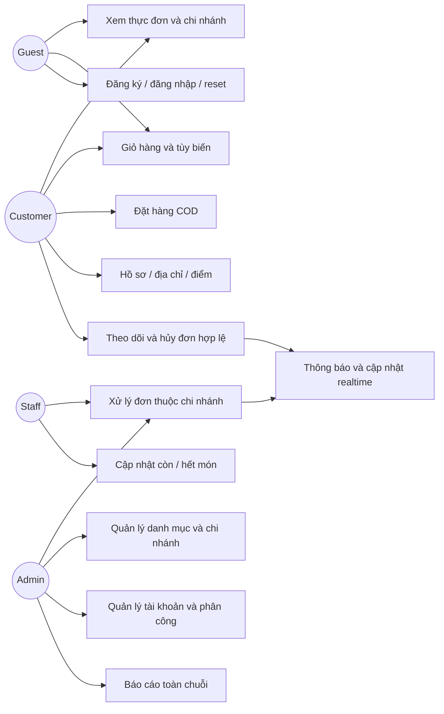
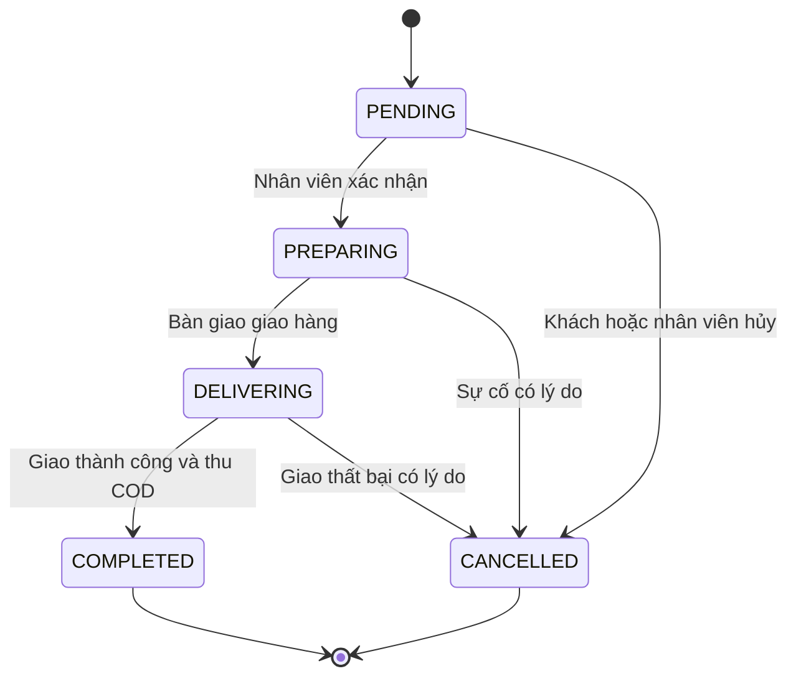
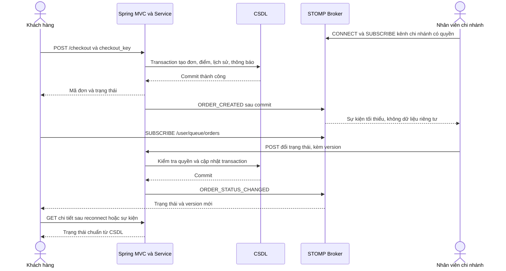

# UTETra — Đặc tả chức năng và quy tắc nghiệp vụ

| Thuộc tính | Nội dung |
| --- | --- |
| Phiên bản | 2.0 — ngày 24/09/2026 |
| Phạm vi | Website chuỗi bán trà sữa; bản bắt buộc P0 |
| Công nghệ | Spring Boot, JSP/JSTL, SiteMesh, Bootstrap, JPA, SQL Server/MySQL/PostgreSQL, JWT, WebSocket, Cloudinary |
| Liên kết | [Kế hoạch triển khai](PROJECT_PLAN.md) · [Thiết kế dữ liệu](DATABASE_DESIGN.md) |
| Trạng thái | Đặc tả để triển khai và nghiệm thu |

## 1. Tác nhân và ranh giới hệ thống

| Tác nhân | Vai trò |
| --- | --- |
| Guest — Khách vãng lai | Xem thực đơn/chi nhánh, tùy biến món, giữ giỏ tạm; phải đăng nhập trước khi đặt hàng |
| Customer — Khách hàng | `ROLE_CUSTOMER`; đặt hàng, quản lý hồ sơ/địa chỉ, xem đơn và điểm của mình |
| Staff — Nhân viên | `ROLE_STAFF`; vận hành các chi nhánh có phân công còn hiệu lực |
| Admin — Quản trị viên | `ROLE_ADMIN`; quản lý toàn chuỗi, tài khoản/phân công, đơn và báo cáo |
| Cloudinary | Dịch vụ bên ngoài lưu và phân phối ảnh |
| SMTP | Dịch vụ bên ngoài gửi email đặt lại mật khẩu |

Mỗi tài khoản có một vai trò trong P0; một nhân viên có thể được phân công nhiều chi nhánh. Staff/Admin dùng tài khoản Customer riêng khi muốn mua hàng. Hệ thống không có vai trò shipper hoặc tích hợp giao vận trong P0; nhân viên ghi nhận kết quả giao hàng.

### Sơ đồ phạm vi chức năng

Đây là sơ đồ liên kết tác nhân–chức năng bằng Mermaid, không phải sơ đồ UML use case với đầy đủ ký pháp include/extend.



## 2. Quy tắc nghiệp vụ chuẩn

**Use case chính của đồ án:** xem/chọn món (`UC-CAT-01–03`), giỏ hàng (`UC-ORD-01–02`), đặt hàng (`UC-ORD-03`), thanh toán COD (`UC-ORD-04`), xử lý/theo dõi/hủy đơn (`UC-ORD-06–08`). Khách tự chọn chi nhánh từ danh sách; không tính khoảng cách hoặc tự động tìm chi nhánh gần nhất. Các chức năng khác giữ nguyên, bao gồm quản lý khu vực giao hàng và phí giao theo khu vực. Tài khoản, danh mục, thông báo, điểm và báo cáo hỗ trợ luồng bán hàng này.

### 2.1. Chi nhánh, thực đơn và giỏ hàng

| Mã | Quy tắc |
| --- | --- |
| BR-01 | Một giỏ/đơn chỉ thuộc một chi nhánh. Đổi chi nhánh khi giỏ có món phải thông báo và yêu cầu người dùng xác nhận xóa giỏ cũ. |
| BR-02 | P0 dùng giá chung toàn chuỗi. Món/size/topping phải được kích hoạt toàn hệ thống và được bán tại chi nhánh. Không có dòng liên kết chi nhánh nghĩa là chưa bán tại đó. |
| BR-03 | Size nằm trong S/M/L; mỗi món có ít nhất một size hoạt động, không bắt buộc đủ ba size. Đường và đá có các mức 0, 30, 50, 70, 100; backend kiểm tra giá trị. |
| BR-04 | Chỉ chọn topping được cấu hình cho món và còn bán tại chi nhánh. Mỗi loại topping tối đa một phần trên một ly trong P0; nhiều loại được phép kết hợp. |
| BR-05 | Số lượng 1–20 ly mỗi dòng, tổng tối đa 50 ly mỗi đơn. Dòng giống variant, đường, đá, tập topping và ghi chú được gộp; khác tùy chọn giữ riêng. |
| BR-06 | Khách vãng lai giữ giỏ trong session; khách đăng nhập có tối đa một giỏ CSDL. Giỏ không giữ giá và không giữ tồn kho. |
| BR-07 | Khi đăng nhập: nếu giỏ CSDL rỗng thì nhập giỏ tạm; cùng chi nhánh thì gộp dưới giới hạn; khác chi nhánh thì cho chọn giữ giỏ nào. Không âm thầm mất món hoặc chuyển chi nhánh. |
| BR-08 | Chi nhánh nhận đơn khi `is_active` và `accepting_orders` bật, giờ địa phương nằm trong `[open_time, close_time)`. P0 dùng lịch hàng ngày, không qua đêm; ngày nghỉ dùng cờ ngừng nhận đơn. |
| BR-09 | Khách tự chọn chi nhánh, chọn khu vực giao trong danh sách của chi nhánh và nhập địa chỉ chi tiết. Phí giao lấy từ khu vực đã cấu hình, không tính theo khoảng cách. P0 không tự xác minh địa chỉ bằng bản đồ; nhân viên xác minh trước khi nhận đơn. |

### 2.2. Giá, thanh toán và điểm thưởng

Tất cả giá trị tiền dùng VND nguyên đồng, Java `BigDecimal`, CSDL `DECIMAL(14,2)` với phần lẻ bằng 00; không dùng `float`/`double`. Giá trên trình duyệt chỉ là dự tính, server là nguồn quyết định.

```text
drink_unit_price = base_price + extra_price
topping_unit_total = tổng giá các topping chọn cho một ly
line_total = (drink_unit_price + topping_unit_total) × quantity
subtotal = tổng line_total
discount_amount = points_used × 1.000
final_amount = subtotal - discount_amount + shipping_fee
```

| Mã | Quy tắc |
| --- | --- |
| BR-10 | Server kiểm tra lại giá ở checkout. Nếu khác mức khách vừa xem, trả báo giá mới và yêu cầu khách xác nhận lại; không tự đặt đơn với giá thay đổi. |
| BR-11 | P0 chỉ dùng COD. Khi tạo đơn: `payment_status=UNPAID`; khi xác nhận giao thành công và đã thu tiền: chuyển `PAID` cùng transaction hoàn tất đơn. |
| BR-12 | Chỉ Customer đã đăng nhập được checkout. Khóa `checkout_key` duy nhất theo khách; gửi lại cùng nội dung trả đơn cũ, khác nội dung trả xung đột. |
| BR-13 | 1 điểm đổi 1.000 đồng. Điểm dùng là số nguyên không âm, không vượt số dư hoặc `floor(subtotal × 20% / 1.000)`. Không giảm phí giao; P0 chưa có voucher. |
| BR-14 | Trừ điểm khi tạo đơn thành công; đơn hủy hoàn đúng số điểm đã dùng, đúng một lần. Khóa tài khoản điểm khi thay đổi số dư; không cho số dư âm. |
| BR-15 | Đơn `COMPLETED` và `PAID` được cộng `floor((subtotal - discount_amount) / 10.000)` điểm, đúng một lần; không tích điểm từ phí giao. |
| BR-16 | Hạng theo tổng điểm đã kiếm được suốt vòng đời: Đồng dưới 100; Bạc từ 100 đến 499; Vàng từ 500. Tiêu điểm không làm giảm hạng; P0 chưa có ưu đãi riêng theo hạng. |
| BR-17 | Đơn lưu snapshot tên món, size, giá, topping, phí giao, khu vực, tên chi nhánh và địa chỉ nhận. Đổi danh mục, cấu hình phí giao hoặc hồ sơ không sửa lịch sử đơn. |

Ví dụ: món 32.000 đồng, size thêm 8.000, topping 8.000, số lượng 2 → `subtotal=96.000`. Phí giao 15.000; dùng 10 điểm giảm 10.000 → thanh toán 101.000. Điểm tối đa được dùng là 19; hoàn tất được cộng 8 điểm. Hủy trước hoàn tất hoàn 10 điểm và không cộng 8 điểm.

### 2.3. Vòng đời đơn hàng

Mã trạng thái tiếng Anh dùng trong code và CSDL; JSP hiển thị nhãn tiếng Việt. Trạng thái thanh toán độc lập với trạng thái xử lý nhưng phải tuân thủ điều kiện dưới đây.



| Trạng thái hiện tại | Được chuyển tới | Chủ thể và điều kiện |
| --- | --- | --- |
| `PENDING` — Chờ xác nhận | `PREPARING` | Staff đúng chi nhánh/Admin kiểm tra địa chỉ và khả năng phục vụ |
| `PENDING` | `CANCELLED` | Chủ đơn hoặc Staff/Admin; ghi lý do |
| `PREPARING` — Đang pha chế | `DELIVERING` | Staff đúng chi nhánh/Admin |
| `PREPARING` | `CANCELLED` | Staff đúng chi nhánh/Admin, lý do sự cố bắt buộc |
| `DELIVERING` — Đang giao | `COMPLETED` | Staff đúng chi nhánh/Admin xác nhận giao và thu đủ COD; thanh toán → `PAID` |
| `DELIVERING` | `CANCELLED` | Staff đúng chi nhánh/Admin, giao thất bại và chưa thu tiền; thanh toán → `CANCELLED` |
| `COMPLETED`, `CANCELLED` | Không có | Trạng thái kết thúc; không sửa ngược qua màn hình quản trị |

Hủy ở mọi bước hợp lệ đều chuyển thanh toán từ `UNPAID` sang `CANCELLED`. P0 không hỗ trợ hủy/hoàn tiền sau `COMPLETED`. Không bỏ bước, không xóa đơn đã phát sinh. Mỗi lần chuyển lưu người thực hiện, thời điểm, trạng thái trước/sau và lý do; dùng version để phát hiện cập nhật cạnh tranh.

### 2.4. Quyền dữ liệu và báo cáo

- **BR-18:** Khách chỉ truy cập đơn/địa chỉ/giỏ/thông báo của mình; nhân viên chỉ vận hành chi nhánh đang được phân công. Kiểm tra cả HTTP và WebSocket, không dựa vào ID do client gửi.
- **BR-19:** Khóa tài khoản hoặc đổi quyền phải thu hồi phiên và ngắt socket liên quan; bỏ phân công phải loại quyền xem đơn và subscribe chi nhánh đó.
- **BR-20:** Doanh thu hàng hóa bằng tổng `subtotal - discount_amount`; phí giao báo riêng; tổng thực thu bằng tổng `final_amount`, chỉ từ đơn `COMPLETED` và `PAID`, theo `completed_at`.
- **BR-21:** Món bán chạy theo tổng số ly của các đơn đủ điều kiện BR-20. Thống kê số đơn theo trạng thái dùng `created_at` và ghi rõ cơ sở ngày lọc. Khoảng ngày nhập theo `Asia/Ho_Chi_Minh`, chuyển sang UTC dạng đầu bao gồm/cuối không bao gồm.

## 3. Danh mục use case P0

Tất cả use case dưới đây thuộc P0. Cột nghiệm thu là điều kiện quan sát được; các quy tắc BR áp dụng cho cả luồng chính và luồng thay thế.

| Mã | Chức năng | Tác nhân | Nghiệm thu chính |
| --- | --- | --- | --- |
| UC-CAT-01 | Xem thực đơn/trang chủ | Mọi người | Chọn chi nhánh, thấy món hoạt động và giá từ size rẻ nhất đang bán |
| UC-CAT-02 | Tìm kiếm/lọc/sắp xếp | Mọi người | Lọc tên, danh mục, giá đồ uống chưa topping; phân trang, trạng thái rỗng rõ ràng |
| UC-CAT-03 | Chi tiết món | Mọi người | Hiển thị size, topping hợp lệ, giá tùy chọn, mô tả và ảnh |
| UC-CAT-04 | Xem và chọn chi nhánh | Mọi người | Chọn thủ công từ danh sách; thấy địa chỉ, hotline, giờ, khu vực giao và trạng thái nhận đơn; không tính khoảng cách |
| UC-CAT-05 | Quản lý danh mục | Admin | Thêm/sửa/ẩn; không xóa danh mục đang được tham chiếu |
| UC-CAT-06 | Quản lý món và size | Admin | Validate giá/slug/size, upload ảnh, thay giá không đổi đơn cũ |
| UC-CAT-07 | Quản lý topping | Admin | Giá không âm, thiết lập topping cho món, ảnh và trạng thái |
| UC-CAT-08 | Quản lý chi nhánh/khu vực giao | Admin | Thêm/sửa thông tin chi nhánh, giờ hợp lệ, khu vực và phí giao không âm, bật/tắt nhận đơn |
| UC-CAT-09 | Tình trạng bán tại chi nhánh | Staff, Admin | Staff chỉ bật/tắt món, topping và nhận đơn tại chi nhánh được giao; không sửa giá toàn chuỗi |
| UC-AUTH-01 | Đăng ký | Guest | Username/email không trùng, tài khoản luôn là Customer |
| UC-AUTH-02 | Đăng nhập | Guest | Kiểm tra tài khoản, cấp phiên/token, điều hướng theo vai trò |
| UC-AUTH-03 | Đăng xuất | Người đã đăng nhập | Thu hồi phiên hiện tại, xóa cookie, ngắt socket |
| UC-AUTH-04 | Quên/đặt lại mật khẩu | Guest | Token một lần, hết hạn, phản hồi không tiết lộ email tồn tại |
| UC-AUTH-05 | Làm mới phiên | Người có refresh token hợp lệ | Xoay token nguyên tử; token cũ không dùng lại được |
| UC-USER-01 | Hồ sơ/ảnh/đổi mật khẩu | Người đã đăng nhập | Chỉ sửa hồ sơ mình; đổi mật khẩu thu hồi mọi phiên |
| UC-USER-02 | Sổ địa chỉ | Customer | Thêm/sửa/xóa, tối đa một mặc định; đơn cũ giữ địa chỉ snapshot |
| UC-USER-03 | Điểm và hạng | Customer | Xem số dư, tổng đã kiếm, ledger và hạng theo BR-13–16 |
| UC-ADMIN-01 | Tài khoản và phân công | Admin | Khóa/mở, tạo Staff, phân công nhiều chi nhánh; không vô hiệu hóa Admin hoạt động cuối cùng |
| UC-ORD-01 | Thêm món vào giỏ | Guest, Customer | Validate BR-01–06; giá từ server; gộp đúng tùy chọn |
| UC-ORD-02 | Xem/sửa/hợp nhất giỏ | Guest, Customer | Tăng/giảm/xóa, hiển thị món hết bán, hợp nhất không lặp |
| UC-ORD-03 | Checkout | Customer | Một đơn từ một chi nhánh; giá đúng, chống trùng, lưu snapshot đầy đủ |
| UC-ORD-04 | Thanh toán COD và ghi nhận thu tiền | Customer, Staff, Admin | Khách kiểm tra số tiền, xác nhận COD tại checkout và trả khi nhận hàng; nhân viên ghi thu tiền cùng hoàn tất đơn, không thu lặp |
| UC-ORD-05 | Thông báo đơn mới | Staff, Admin nhận | Sau commit, đúng chi nhánh; khi offline đọc lại từ CSDL |
| UC-ORD-06 | Tiếp nhận/cập nhật đơn | Staff, Admin | Đúng state machine, quyền chi nhánh và version; có lịch sử |
| UC-ORD-07 | Theo dõi realtime | Customer | Chỉ đơn mình; reconnect/polling phục hồi trạng thái mới nhất |
| UC-ORD-08 | Lịch sử/hủy đơn | Customer | Phân trang đơn mình; chỉ hủy `PENDING`; hoàn điểm đúng một lần |
| UC-NOT-01 | Xem/đánh dấu thông báo | Người đã đăng nhập | Đọc riêng từng người; người khác không sửa được |
| UC-RPT-01 | Dashboard/báo cáo | Staff, Admin | Staff giới hạn chi nhánh; Admin toàn chuỗi; công thức BR-20–21 |

## 4. Đặc tả luồng trọng tâm

### 4.1. UC-AUTH-01–05: Xác thực và phục hồi tài khoản

**Tiền điều kiện:** Người dùng truy cập website; dịch vụ gửi mail được cấu hình cho reset. **Kích hoạt:** Gửi form đăng ký, đăng nhập hoặc reset.

Luồng chính:

1. Đăng ký: nhập username, email, họ tên, mật khẩu và xác nhận; server chuẩn hóa username/email, kiểm tra trùng bằng unique constraint, băm mật khẩu, tạo Customer.
2. Đăng nhập: xác thực mật khẩu và trạng thái tài khoản, tạo `auth_sessions`; cấp access JWT 15 phút và refresh token tối đa 7 ngày bằng cookie bảo vệ.
3. Điều hướng Customer về trang công khai/checkout đang chờ, Staff về `/staff/orders`, Admin về `/admin/dashboard`. Chỉ chấp nhận return URL nội bộ.
4. Refresh: xác minh hash token, phiên và hạn dùng; khóa phiên, thay refresh token và cấp JWT mới trong một giao dịch. Các tab phối hợp để chỉ gửi một request refresh tại một thời điểm.
5. Đăng xuất: POST có CSRF, thu hồi session hiện tại và xóa cookie; đơn/giỏ CSDL vẫn tồn tại.
6. Quên mật khẩu: trả cùng thông báo dù email tồn tại hay không; nếu hợp lệ, lưu hash token và gửi link hết hạn sau 15 phút. Mỗi tài khoản chỉ một yêu cầu reset còn hiệu lực.
7. Đặt lại: token hợp lệ, mật khẩu đáp ứng quy tắc; cập nhật hash, đánh dấu token đã dùng, vô hiệu hóa token reset khác và thu hồi mọi phiên.

**Ngoại lệ:** Sai thông tin trả thông báo chung; vượt số lần thử bị giới hạn; refresh/reset hết hạn yêu cầu đăng nhập hoặc gửi lại link; SMTP lỗi được ghi nhận để gửi lại, không tiết lộ tài khoản. Token không được ghi log. Mật khẩu tối thiểu 10 ký tự, tối đa 72 byte UTF-8 để phù hợp BCrypt; kiểm tra cả phía server.

**Hậu điều kiện:** Chỉ phiên còn hiệu lực truy cập được tài nguyên bảo vệ. **Nghiệm thu:** Token refresh cũ không dùng lại; JWT thuộc phiên đã thu hồi bị từ chối; thiếu CSRF không thay đổi dữ liệu.

### 4.2. UC-CAT-06: Món, size và ảnh Cloudinary

**Tiền điều kiện:** Admin đăng nhập; danh mục tồn tại. **Kích hoạt:** Lưu form món tại `/admin/products`.

1. Nhập tên, slug, mô tả, giá gốc, size/phụ thu, topping được phép và chi nhánh phân phối.
2. Server kiểm tra dữ liệu và quyền; slug không trùng; size không trùng trong một món; món đang bán có ít nhất một size hoạt động.
3. Nếu có ảnh mới, kiểm tra JPEG/PNG/WebP tối đa 5 MB rồi upload Cloudinary; nhận URL HTTPS và public ID.
4. Lưu món, size, topping và tham chiếu ảnh trong transaction.
5. Sau commit, dọn ảnh cũ; hiển thị thông báo thành công.

**Ngoại lệ:** Upload lỗi giữ dữ liệu cũ; DB lỗi thì rollback và dọn ảnh vừa upload; slug trùng trả lỗi tại trường. Không xóa cứng món/size đã được tham chiếu, dùng ngừng bán.

**Hậu điều kiện:** Thực đơn phản ánh cấu hình mới; snapshot của đơn cũ không đổi. **Nghiệm thu:** Thay ảnh không làm mất ảnh đang dùng nếu cập nhật thất bại; Staff không thể gọi chức năng sửa giá bằng URL trực tiếp.

### 4.3. UC-ORD-01–02: Tùy biến và hợp nhất giỏ

**Tiền điều kiện:** Đã chọn chi nhánh. **Kích hoạt:** Bấm thêm món hoặc sửa giỏ.

1. Khách chọn size, đường/đá, topping và số lượng.
2. Server kiểm tra quan hệ variant–product, topping–product và trạng thái chi nhánh; tính giá dự kiến.
3. Tạo/gộp dòng theo toàn bộ tùy chọn; lưu session hoặc CSDL theo trạng thái đăng nhập.
4. Trả giỏ mới và số ly; đánh dấu món không còn khả dụng khi mở lại giỏ.
5. Sau đăng nhập Customer, hợp nhất theo BR-07; chỉ xóa giỏ session sau khi thao tác CSDL thành công. Lưu dấu lần hợp nhất để retry không nhân đôi số lượng.

**Ngoại lệ:** Khác chi nhánh cần lựa chọn của khách; vượt giới hạn thì giữ giỏ cũ và báo điều chỉnh; món hết bán không được tự thay bằng món khác. **Hậu điều kiện:** Giỏ hợp lệ, không bảo đảm giữ giá cho checkout.

### 4.4. UC-ORD-03: Đặt hàng

**Tiền điều kiện:** Customer đang hoạt động, giỏ không rỗng, chi nhánh nhận đơn. **Kích hoạt:** Gửi form checkout có CSRF, `checkout_key`, version giỏ và thông tin báo giá vừa xác nhận.

1. Khách kiểm tra chi nhánh tự chọn, nhập/chọn tên, điện thoại, địa chỉ chi tiết, khu vực giao, ghi chú và điểm sử dụng; xem tiền món, giảm giá, phí giao theo khu vực và tổng COD.
2. Server lấy khách từ principal, kiểm tra idempotency. Nếu cùng key và nội dung đã thành công, trả lại đơn cũ.
3. Khóa giỏ, chi nhánh/khu vực và các dòng cấu hình bán cần đọc nhất quán; kiểm tra lại giá, phí giao theo khu vực, giờ nhận đơn và giới hạn. Khóa tài khoản điểm trước khi thay số dư.
4. Nếu giá thay đổi, trả báo giá mới để khách xác nhận; không tạo đơn.
5. Tính tiền/điểm theo BR-10–17; tạo `orders`, món/topping snapshot, lịch sử khởi tạo và giao dịch trừ điểm nếu có.
6. Tạo thông báo cho Admin hoạt động và Staff được phân công; xóa các dòng giỏ đã đặt; commit toàn bộ.
7. Phát `ORDER_CREATED` sau commit; điều hướng tới trang xác nhận/chi tiết đơn.

**Ngoại lệ:** Thiếu quyền/địa chỉ sai/vượt điểm/hết món/chi nhánh đóng cửa → không tạo đơn, giỏ còn nguyên. Trùng key khác nội dung hoặc giỏ thay đổi → xung đột. Lỗi ghi DB → rollback. Mất phản hồi sau commit → gửi lại key cũ để nhận đúng đơn đã tạo. WebSocket lỗi → đơn vẫn thành công.

**Hậu điều kiện:** Chính xác một đơn `PENDING`/`UNPAID` cho lần checkout thành công, điểm và giỏ nhất quán. **Nghiệm thu:** Hai request đồng thời không tạo hai đơn hoặc làm số dư âm.

### 4.5. UC-ORD-04/06: Xử lý đơn và thu COD

**Phía khách hàng:** Tại checkout, xem đầy đủ các khoản tiền và xác nhận phương thức COD; sau khi đặt, trang chi tiết hiển thị số tiền phải trả và trạng thái chưa thanh toán. Khách trả tiền khi nhận hàng; chỉ nhân viên có quyền được ghi nhận đã thu tiền. Việc khách bấm đặt hàng không tự chuyển thanh toán sang `PAID`.

**Tiền điều kiện:** Staff có phân công hoặc Admin; đơn thuộc phạm vi được xem. **Kích hoạt:** Gửi lệnh chuyển trạng thái kèm version hiện tại.

1. Server kiểm tra người dùng, chi nhánh và cạnh trạng thái được phép.
2. Nhân viên xác minh địa chỉ, xác nhận `PENDING → PREPARING`; pha xong chuyển `DELIVERING`.
3. Khi giao thành công, nhân viên xác nhận đã thu đủ COD. Server chuyển `COMPLETED` và `PAID`, lưu người/thời gian thu, cộng điểm và cập nhật tổng điểm đã kiếm trong cùng transaction.
4. Lưu lịch sử và thông báo cho khách; commit rồi phát sự kiện trạng thái/thanh toán.

**Ngoại lệ:** Version cũ hoặc đơn đã kết thúc → không thay đổi, yêu cầu tải lại. Không xác nhận thu tiền → không hoàn tất. Giao thất bại → hủy với lý do, không cộng điểm. **Hậu điều kiện:** Đơn có lịch sử đầy đủ; không ghi nhận COD/điểm hai lần.

### 4.6. UC-ORD-08: Khách hủy đơn

**Tiền điều kiện:** Chủ đơn đăng nhập, trạng thái còn `PENDING`. **Kích hoạt:** Bấm hủy và nhập lý do.

1. Kiểm tra sở hữu đơn và version; khóa dữ liệu liên quan.
2. Chuyển đơn/thanh toán sang `CANCELLED`; lưu lịch sử.
3. Nếu đã dùng điểm, tạo một ledger `REFUND` và cộng lại đúng số điểm.
4. Commit rồi thông báo cho chi nhánh và khách.

**Ngoại lệ:** Nhân viên đã xác nhận trước → từ chối hủy, hiển thị trạng thái mới. Request gửi lại không hoàn thêm điểm. Staff/Admin hủy ở bước sau dùng cùng quy tắc hoàn điểm nhưng quyền theo bảng trạng thái. **Hậu điều kiện:** Đơn hủy không tính doanh thu hoặc điểm kiếm được.

### 4.7. UC-ORD-05/07 và UC-NOT-01: Realtime và thông báo

**Tiền điều kiện:** Phiên hợp lệ, quyền subscribe đúng. **Kích hoạt:** Đặt đơn hoặc thay đổi trạng thái đã commit.



Kênh chuẩn: `/topic/stores/{storeId}/orders` cho Staff được phân công; `/topic/admin/orders` cho Admin; `/user/queue/orders` và `/user/queue/notifications` cho chính người dùng. Server xác định người nhận, không tin user ID do client tự khai.

**Ngoại lệ:** Mất kết nối dùng polling 15 giây khi trang hiển thị; kết nối lại lấy dữ liệu từ DB; sự kiện trùng/cũ bị bỏ qua; phiên hết hạn refresh rồi kết nối lại; bị khóa/thu hồi quyền thì ngắt socket. **Nghiệm thu:** Hai nhân viên đọc cùng thông báo có trạng thái đã đọc độc lập; khách không subscribe được kênh quản trị/chi nhánh.

### 4.8. UC-ADMIN-01 và UC-RPT-01: Quản trị và báo cáo

**Tiền điều kiện:** Admin quản lý tài khoản; Staff/Admin xem báo cáo trong phạm vi quyền.

Admin tạo Staff, gán chi nhánh, khóa/mở tài khoản và đổi vai trò. Thay đổi quyền thu hồi phiên và lưu audit; không cho tự khóa hoặc hạ quyền Admin hoạt động cuối cùng. Các request đồng thời phải giữ được ít nhất một Admin hoạt động.

Dashboard chọn khoảng ngày/chi nhánh, hiển thị số đơn, doanh thu hàng hóa, phí giao, thực thu, món bán chạy. Staff chỉ chọn chi nhánh được giao; backend vẫn lọc phạm vi dù client sửa tham số. Áp dụng BR-20–21 và có trạng thái không có dữ liệu.

**Nghiệm thu:** Tổng thực thu khớp đơn hoàn tất; đơn hủy/chưa trả không lọt doanh thu; Admin xem toàn chuỗi và Staff không xem dữ liệu chi nhánh ngoài quyền.

## 5. Ma trận truy cập và quy ước route

`Của mình` và `Chi nhánh` là điều kiện bắt buộc ở Service. Route dưới đây là hợp đồng thiết kế, chưa phải endpoint đã triển khai.

| Nhóm route/chức năng | Guest | Customer | Staff | Admin |
| --- | --- | --- | --- | --- |
| GET `/`, `/menu`, `/products/{slug}`, `/stores` | Có | Có | Có | Có |
| `/auth/register`, `/auth/login`, `/auth/forgot-password`, `/auth/reset-password` | Có | Điều hướng nếu đã đăng nhập | Tương tự | Tương tự |
| POST `/auth/refresh`, `/auth/logout` | Refresh cần token hợp lệ | Phiên mình | Phiên mình | Phiên mình |
| `/account/profile`, `/account/password` | Không | Của mình | Của mình | Của mình |
| `/account/addresses`, `/account/loyalty` | Không | Của mình | Không | Không |
| `/cart/**` | Giỏ session | Giỏ mình | Không | Không |
| `/checkout`, `/orders/**` | Không | Của mình | Không | Không |
| `/staff/orders/**`, `/staff/availability/**`, `/staff/reports` | Không | Không | Chi nhánh | Toàn chuỗi |
| `/admin/products/**`, `/admin/categories/**`, `/admin/toppings/**`, `/admin/stores/**` | Không | Không | Không | Có |
| `/admin/users/**`, `/admin/dashboard`, `/admin/reports` | Không | Không | Không | Có |
| `/notifications/**` | Không | Của mình | Của mình | Của mình |

Mọi route có GET để hiển thị và POST cho thay đổi theo thiết kế Controller; tuyệt đối không thay dữ liệu qua GET. API JSON hỗ trợ giao diện, nếu dùng, đặt dưới `/api/**` và áp dụng cùng quyền. JSP nằm dưới `WEB-INF`, không truy cập trực tiếp từ URL.

Validation trả lỗi rõ theo trường; API dùng 400 cho dữ liệu sai, 401 cho chưa xác thực, 403 cho thiếu quyền, 404 cho tài nguyên không tồn tại/không được tiết lộ, 409 cho xung đột, 429 cho vượt giới hạn. Trang JSP thể hiện lỗi thân thiện, giữ dữ liệu nhập an toàn, không hiển thị stack trace.

## 6. Kịch bản nghiệm thu xuyên suốt

| Mã kiểm thử | Kịch bản | Kết quả mong đợi |
| --- | --- | --- |
| AT-01 | Guest tùy biến món rồi đăng nhập | Giỏ hợp nhất một lần, đúng chi nhánh và tùy chọn |
| AT-02 | Checkout ví dụ 96.000 + 15.000 − 10.000 | COD 101.000; hoàn tất cộng 8 điểm |
| AT-03 | Gửi hai checkout cùng key | Một đơn, một lần trừ điểm; key khác nội dung bị từ chối |
| AT-04 | Client sửa giá hoặc dùng quá điểm | Server tính lại/từ chối; không làm sai dữ liệu |
| AT-05 | Customer xem/hủy đơn của tài khoản khác | Bị từ chối, không lộ thông tin người nhận |
| AT-06 | Staff chi nhánh A gọi HTTP/subscribe chi nhánh B | Bị từ chối dù biết ID/URL |
| AT-07 | Khách hủy đồng thời nhân viên xác nhận | Chỉ một chuyển trạng thái thắng; điểm không hoàn lặp |
| AT-08 | Mất socket, cập nhật đơn rồi kết nối lại | Trang lấy trạng thái mới nhất và thông báo đã lưu |
| AT-09 | Đổi giá/ảnh/địa chỉ sau khi đặt | Đơn cũ giữ giá, tên món và địa chỉ snapshot |
| AT-10 | Đổi mật khẩu/khóa tài khoản | JWT phiên cũ và socket mất hiệu lực |
| AT-11 | Refresh/reset token đã dùng hoặc thiếu CSRF | Không thay đổi dữ liệu hoặc cấp phiên trái phép |
| AT-12 | Hoàn tất/thu COD bị gửi lại | Một lần thanh toán, một ledger EARN, doanh thu không nhân đôi |
| AT-13 | Checkout lỗi DB hoặc upload lỗi | Rollback nhất quán; giỏ/ảnh cũ không mất |
| AT-14 | Báo cáo hai chi nhánh có đơn hủy | Phạm vi và doanh thu khớp BR-20–21 |
| AT-15 | Cùng bộ test trên ba CSDL | Kết quả nghiệp vụ tương đương; Unicode, tiền và UTC đúng |
| AT-16 | Khách tự chọn chi nhánh và khu vực giao | Giữ đúng chi nhánh khách chọn; phí giao lấy theo khu vực cấu hình, không tính khoảng cách hoặc tự đổi sang cửa hàng gần nhất |

Các tính năng QR/cổng thanh toán, voucher, nhận tại quán và kho nguyên liệu thuộc P1 theo `PROJECT_PLAN.md`; chỉ bổ sung use case sau khi chốt quy tắc và schema tương ứng.
