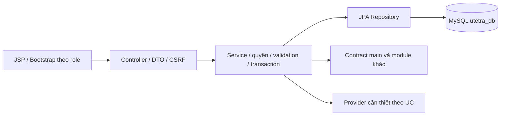

# feature/catalog-sales — Danh mục, shop Vendor và khuyến mãi

> Cập nhật theo quy định thầy ngày 13/10/2026. Người phụ trách TV1: [điền tên]. Baseline main/commit: [điền]. Hướng dẫn gốc; trạng thái mới ngày 15/10/2026 tại [RUNBOOK](RUNBOOK.md). Đã có code cho 18 UC, kiểm H2/Tomcat; chưa nghiệm thu cloud/tích hợp.

## 1. Các file phải đọc và cấu hình

Đọc QUY_DINH_VA_CAU_HINH_CHUNG, PROJECT_PLAN, DATABASE_DESIGN, USE_CASES, docs/README, COMMON_BASELINE, SETUP và file hướng dẫn ở gốc nhánh. Java21/Boot3.5.13/WAR/JSP/JSTL/SiteMesh3.2.2/Bootstrap5.3.3/MavenWrapper/MySQL utetra_db/JPA/Flyway theo main; không .env, không tự đổi pom/profile/migration/secret. Một template Shop Homepage chung; Vendor có quyền User, Manager theo scope, Admin global.

## 2. Use case, role và công việc

| Mã | Chức năng | Actor | Module owner | Phạm vi | Kết quả kiểm chứng cần đạt |
| --- | --- | --- | --- | --- | --- |
| UC-CAT-01 | Trang chủ Guest | Guest | catalog-sales | P0 bắt buộc | Sản phẩm bán >10 ly, giảm dần số bán; giả định cần thầy xác nhận |
| UC-CAT-02 | Tìm kiếm và lọc | Mọi người | catalog-sales | P0 bắt buộc | Tên, danh mục, shop, giá; sort allowlist, phân trang |
| UC-CAT-03 | Trang chủ User và top 20 | User, Vendor | catalog-sales | P0 bắt buộc | Bốn nhóm mới/bán chạy/đánh giá/yêu thích, mỗi nhóm tối đa 20 và phân trang |
| UC-CAT-04 | Sản phẩm theo danh mục | Mọi người | catalog-sales | P0 bắt buộc | Chỉ món/shop đang hoạt động; filter, paging và empty state |
| UC-CAT-05 | Chi tiết và tùy biến trà sữa | Mọi người | catalog-sales | P0 bắt buộc | Size S/M/L, đường/đá, topping hợp lệ, ảnh và giá dự kiến |
| UC-CAT-06 | Xem/chọn chi nhánh và trang shop | Mọi người | catalog-sales | P0 bắt buộc | Chọn thủ công; thông tin, khu vực/phí; không tính khoảng cách |
| UC-VND-01 | Đăng ký shop | User, Vendor | catalog-sales | P0 bắt buộc | Hồ sơ chờ duyệt; duyệt mới hoạt động và cấp quyền Vendor |
| UC-VND-02 | Quản lý trang chủ shop | Vendor | catalog-sales | P0 bắt buộc | Profile/banner/giờ/nhận đơn của shop mình, ảnh Cloudinary |
| UC-VND-03 | Quản lý sản phẩm của mình | Vendor | catalog-sales | P0 bắt buộc | CRUD món/size/topping/availability đúng shop, không xóa lịch sử đã bán |
| UC-VND-05 | Tạo khuyến mãi shop | Vendor | catalog-sales | P0 bắt buộc | Giảm sản phẩm và mã giảm giá của shop mình, không sửa chính sách toàn app |
| UC-MGR-02 | Quản lý sản phẩm shop | Manager | catalog-sales | P0 bắt buộc | Shop được phân công, validation và audit |
| UC-MGR-03 | Quản lý danh mục/topping | Manager | catalog-sales | P0 bắt buộc | Theo phân quyền quản trị catalog được giao, không sửa ngoài phạm vi |
| UC-MGR-05 | Quản lý khuyến mãi | Manager | catalog-sales | P0 bắt buộc | Giảm % món/giảm phí giao trong shop được giao |
| UC-MGR-07 | Quản lý cửa hàng | Manager | catalog-sales | P0 bắt buộc | Thông tin/trạng thái cửa hàng đã phân công; duyệt hồ sơ trong phạm vi |
| UC-ADM-02 | Quản lý sản phẩm các shop | Admin | catalog-sales | P0 bắt buộc | Toàn chuỗi, duyệt/ngừng bán, không thay snapshot cũ |
| UC-ADM-03 | Quản lý danh mục/topping | Admin | catalog-sales | P0 bắt buộc | CRUD chung, unique/validation và quy tắc tham chiếu |
| UC-ADM-05 | Quản lý chương trình khuyến mãi | Admin | catalog-sales | P0 bắt buộc | Giảm % sản phẩm, giảm phí vận chuyển, mã/quota/scope/thời hạn |
| UC-ADM-07 | Duyệt/quản lý shop | Admin | catalog-sales | P0 bắt buộc | Duyệt đăng ký, khóa/mở shop, owner và scope Manager |

Mỗi UC do một người làm đủ Entity/Repo/DTO → Service → Controller → JSP/JS → kiểm thử → hồ sơ. Viết báo cáo tách phần actor/role của từng UC, không chỉ tên module. Chọn chi nhánh thủ công; không loại các chức năng OTP/voucher/refund/review/carrier của thầy.

## 3. Schema, contract và phụ thuộc

Owner các bảng: stores, store_delivery_areas, categories, products, product_variants, toppings, product_toppings, store_toppings, store_registration_requests, promotions, promotion_products. V1 identity giữ nguyên. Entity nghiệp vụ đã thêm; DDL tại proposals/catalog-sales.sql chờ main review/đặt version. Chưa áp dụng cloud; xem RUNBOOK về prerequisite và các điểm schema cần chốt.

Contract: CatalogService, StoreService, PromotionService, MediaService. Phụ thuộc: Cloudinary + catalog/store/promo; dùng Authorization/StoreAccessPolicy/Audit từ TV2, giao quote/eligibility/quota contract cho TV3. Signature/DTO/error/transaction/locking phải chốt trên main trước khi ghép; mock chỉ trong test. Không viết lại giá/điểm/auth/payment service của owner khác.

## 4. Thứ tự thực hiện từng UC

1. Merge main, ghi baseline/role/UC, đọc tiền điều kiện/BR/acceptance và dependency.
2. Chốt activity/sequence và schema/DTO/permission; đề xuất migration vào main.
3. Entity/Repository/query/DTO → Service validation/quyền/transaction/idempotency.
4. Controller route/error/CSRF → JSP/Bootstrap/JS loading/empty/error theo cùng template.
5. Chạy test luồng chính/lỗi/quyền/cạnh tranh/callback/media theo UC; đọc kết quả thật.
6. Ghi code path/symbol/commit, chụp code có chú giải và UI chạy thật; xuất sơ đồ có nguồn.
7. Điền setup/demo/data/profile, prompt nguyên văn/response/nhóm sửa/test; review/commit.

## 5. Kiến trúc dự kiến của module



Sơ đồ này là khung kiến trúc dự kiến. Mỗi UC phải có activity/sequence riêng từ code thực và xuất ảnh PNG/SVG; không dùng một hình generic thay tất cả UC trong báo cáo cuối.

## 6. Chỗ ghi minh chứng và tiến độ

| UC/role | Path/symbol/commit | Activity/sequence/ảnh code/UI | Config/setup/data | Prompt/response | Test/reviewer/trạng thái |
| --- | --- | --- | --- | --- | --- |
| UC-CAT-01 / Guest | [điền] | [chưa có] | [điền] | [điền] | Có code; xem RUNBOOK, chờ tích hợp/TiDB |
| UC-CAT-02 / Mọi người | [điền] | [chưa có] | [điền] | [điền] | Có code; xem RUNBOOK, chờ tích hợp/TiDB |
| UC-CAT-03 / User, Vendor | [điền] | [chưa có] | [điền] | [điền] | Có code; xem RUNBOOK, chờ tích hợp/TiDB |
| UC-CAT-04 / Mọi người | [điền] | [chưa có] | [điền] | [điền] | Có code; xem RUNBOOK, chờ tích hợp/TiDB |
| UC-CAT-05 / Mọi người | [điền] | [chưa có] | [điền] | [điền] | Có code; xem RUNBOOK, chờ tích hợp/TiDB |
| UC-CAT-06 / Mọi người | [điền] | [chưa có] | [điền] | [điền] | Có code; xem RUNBOOK, chờ tích hợp/TiDB |
| UC-VND-01 / User, Vendor | [điền] | [chưa có] | [điền] | [điền] | Có code; xem RUNBOOK, chờ tích hợp/TiDB |
| UC-VND-02 / Vendor | [điền] | [chưa có] | [điền] | [điền] | Có code; xem RUNBOOK, chờ tích hợp/TiDB |
| UC-VND-03 / Vendor | [điền] | [chưa có] | [điền] | [điền] | Có code; xem RUNBOOK, chờ tích hợp/TiDB |
| UC-VND-05 / Vendor | [điền] | [chưa có] | [điền] | [điền] | Có code; xem RUNBOOK, chờ tích hợp/TiDB |
| UC-MGR-02 / Manager | [điền] | [chưa có] | [điền] | [điền] | Có code; xem RUNBOOK, chờ tích hợp/TiDB |
| UC-MGR-03 / Manager | [điền] | [chưa có] | [điền] | [điền] | Có code; xem RUNBOOK, chờ tích hợp/TiDB |
| UC-MGR-05 / Manager | [điền] | [chưa có] | [điền] | [điền] | Có code; xem RUNBOOK, chờ tích hợp/TiDB |
| UC-MGR-07 / Manager | [điền] | [chưa có] | [điền] | [điền] | Có code; xem RUNBOOK, chờ tích hợp/TiDB |
| UC-ADM-02 / Admin | [điền] | [chưa có] | [điền] | [điền] | Có code; xem RUNBOOK, chờ tích hợp/TiDB |
| UC-ADM-03 / Admin | [điền] | [chưa có] | [điền] | [điền] | Có code; xem RUNBOOK, chờ tích hợp/TiDB |
| UC-ADM-05 / Admin | [điền] | [chưa có] | [điền] | [điền] | Có code; xem RUNBOOK, chờ tích hợp/TiDB |
| UC-ADM-07 / Admin | [điền] | [chưa có] | [điền] | [điền] | Có code; xem RUNBOOK, chờ tích hợp/TiDB |

Ghi setup thực và thao tác demo theo role; lỗi/vấn đề còn lại ở cuối từng UC note. Không chụp secret/config password vào báo cáo. Phản hồi dài lưu ai-responses/<ID>.md; ảnh/source lưu assets/<UC-ID>. Không bịa test pass hoặc ảnh chạy.

## 7. Prompt mẫu — chưa sử dụng

```text
Đọc toàn bộ quy định/baseline UTETra và hướng dẫn nhánh hiện tại.
Triển khai <UC-ID> từ Entity/Repo/DTO tới Service/Controller/JSP/test.
Giữ MySQL utetra_db, stack và contract main. Actor/scope/OTP/payment/media
phải đúng đặc tả; không tự bỏ chức năng hoặc đổi framework.
Ghi prompt thật, phản hồi, code/ảnh/setup/commit, phần nhóm sửa và kiểm chứng
vào AI_LOG và hồ sơ UC. Sơ đồ dự kiến và ảnh UI thật phải phân biệt.
```

## 8. Checklist bàn giao

- [ ] Đủ UC/role được giao; cả luồng chính/lỗi và quyền dữ liệu.
- [ ] Cấu hình/DDL/DTO/contract đúng main; provider thiếu ghi rõ.
- [ ] Có kiến trúc/activity/sequence, hình code/UI chú giải, setup và test thật.
- [ ] Prompt nguyên văn/response/nhóm sửa/commit/reviewer đầy đủ.
- [ ] Ghép integration cùng owner dependency; kiểm chức năng chung theo thang điểm.


## Cập nhật tích hợp 20/10/2026

Nhánh identity đã ghép UI/schema/service với module này theo IDN-AI-003. Xem [kết quả và giới hạn hiện tại](../identity-membership/INTEGRATION_20261020.md); các ghi chú chưa tích hợp phía trên là lịch sử của nhánh gốc.
