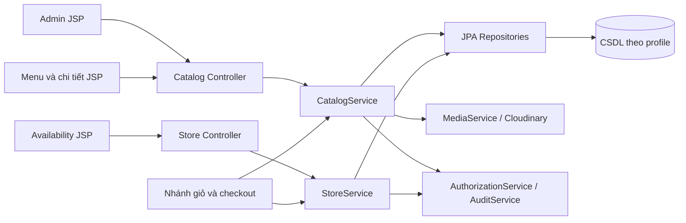
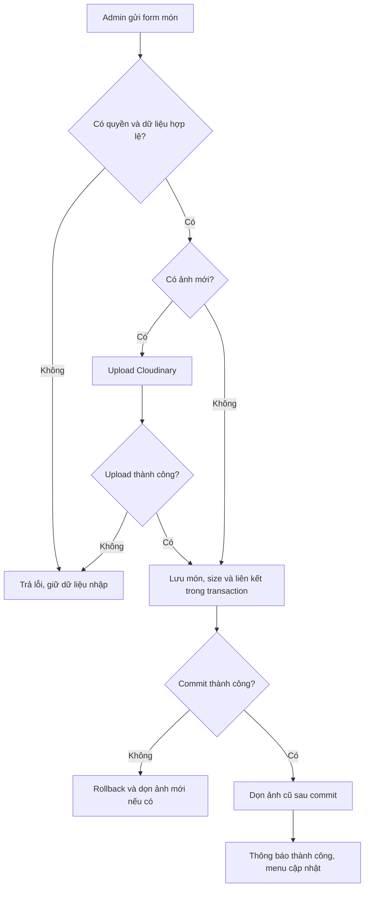

# Nhánh feature/catalog-sales — Danh mục, hình ảnh và chi nhánh

## 1. Thông tin nhận việc

| Mục | Giá trị |
| --- | --- |
| Người phụ trách | [CẦN BỔ SUNG] — TV1 |
| Nhánh | feature/catalog-sales |
| Baseline main/commit hiện tại | [CẦN BỔ SUNG] |
| Use case | UC-CAT-01 đến UC-CAT-09 |
| Trạng thái | Chưa lập trình; hướng dẫn và sơ đồ thiết kế ban đầu |
| Nhật ký AI | [AI_LOG.md](AI_LOG.md) |

Đọc bốn tài liệu gốc theo [README](../../README.md), [COMMON_BASELINE](../../COMMON_BASELINE.md), [SETUP](../../SETUP.md) và hướng dẫn ở gốc nhánh. Làm trọn luồng quản trị danh mục → phân phối tại chi nhánh → khách xem/chọn món. Không chỉ bàn giao Entity hoặc giao diện rời rạc.

## 2. Công việc theo use case

| UC | Các bước phải xây dựng | Minh chứng cần ghi |
| --- | --- | --- |
| CAT-01 | Query món hoạt động theo chi nhánh → DTO phân trang → public controller → trang chủ/menu | Menu, giá size thấp nhất, món nổi bật và trạng thái rỗng |
| CAT-02 | Validate keyword/filter/sort → query → giữ tham số khi phân trang → UI lọc | Tìm tên, lọc danh mục/giá, không có kết quả |
| CAT-03 | Đọc chi tiết, size và topping cho phép/còn bán → JSP tùy biến → báo giá dự kiến | Các tổ hợp size/đường/đá/topping; đầu ra để TV3 thêm giỏ |
| CAT-04 | Danh sách chi nhánh, giờ/khu vực/phí → chọn thủ công → trạng thái nhận đơn | Chi nhánh được chọn, chi nhánh đóng; không tính khoảng cách |
| CAT-05 | Entity/Repo/Service/Controller/JSP danh mục → validate → ẩn thay xóa khi tham chiếu | Form thêm/sửa, lỗi trùng slug, ẩn danh mục |
| CAT-06 | CRUD món/size → upload ảnh → transaction lưu → dọn ảnh sau commit | Form giá/size, ảnh, lỗi upload, giá đơn cũ không đổi |
| CAT-07 | CRUD topping → liên kết topping cho món → validate giá/trạng thái | Form topping, chọn hợp lệ và loại bỏ topping không được phép |
| CAT-08 | CRUD chi nhánh/khu vực giao/phí → validate giờ và FK khu vực | Form chi nhánh, phí theo khu vực, bật/tắt nhận đơn |
| CAT-09 | Query phân công → Staff bật/tắt món/topping/nhận đơn đúng chi nhánh | Staff A không sửa B; Staff không đổi giá toàn chuỗi |

Mã đầy đủ dùng tiền tố UC-CAT trong hồ sơ riêng. Tình trạng bán không phải kho nguyên liệu. Không bỏ chức năng khu vực/phí giao, tài khoản hoặc điểm vì chủ đề chi nhánh được đơn giản hóa.

## 3. Cấu hình và quyền sở hữu

- Bám Java 21/Boot 3.5.x/WAR/JSP/JSTL/SiteMesh/Bootstrap/JPA trong baseline. Không tự thêm project/pom riêng.
- Dùng profile sqlserver/mysql/postgresql và migration đã chốt trên main. Chủ 9 bảng: stores, store_delivery_areas, categories, products, product_variants, toppings, product_toppings, store_products, store_toppings.
- Cloudinary đọc CLOUDINARY_CLOUD_NAME/API_KEY/API_SECRET từ biến môi trường. Upload server JPEG/PNG/WebP tối đa 5 MB; lưu URL và publicId theo schema. Không đưa secret vào JSP/JS/log.
- Dùng AuthorizationService và AuditService của TV2; quyền Admin cho CRUD chung, Staff chỉ availability/nhận đơn trong phân công.
- Cung cấp CatalogService, StoreService, MediaService đúng contract main. TV3 lấy giá/phí/trạng thái từ server; TV2 dùng MediaService cho avatar.
- Route public /menu, /products/{slug}, /stores; Admin /admin/categories, /admin/products, /admin/toppings, /admin/stores; Staff /staff/availability. JSP dưới WEB-INF, decorator theo vai trò.

## 4. Thứ tự thực hiện

1. Đồng bộ B0 và ghi commit/version; chốt DTO/contract với TV2/TV3.
2. Đối chiếu từ điển 9 bảng, đề xuất migration ba dialect cho main; viết Entity/Repo/DTO theo schema, tránh tên cột tùy ý.
3. Xây catalog và store Service có validation/transaction/quyền/audit; kiểm tra size và topping hợp lệ.
4. Làm Cloudinary adapter và xử lý upload/DB lỗi; ảnh cũ chỉ dọn sau commit, tài sản dùng chung không xóa nhầm.
5. Làm Controller CRUD và JSP Admin, sau đó menu/detail/chọn chi nhánh và UI Staff.
6. Kiểm thử quyền, ảnh lỗi, giá và các trạng thái UI; bàn giao DTO/Service cho nhánh đơn và tài khoản.
7. Ghi từng UC bằng mẫu USE_CASE_NOTE; chụp ảnh, lưu nguồn sơ đồ/prompt và commit.

## 5. Hình thiết kế ban đầu

Sơ đồ dưới đây là **thiết kế dự kiến**, cần kiểm tra với code rồi xuất PNG/SVG. Lưu nguồn và hình tại assets của UC, không xem khối Mermaid là ảnh đã tạo.





Mỗi UC còn lại phải có activity riêng nêu cả nhánh lỗi/quyền; sơ đồ mẫu quản lý món không đại diện cho mọi chức năng.

## 6. Ghi chú code, giao diện và setup

| UC | File/symbol/commit thực | Đoạn code cần giải thích | Hình giao diện cần chụp | Hình/setup/test đã có |
| --- | --- | --- | --- | --- |
| CAT-01–04 | [CẦN BỔ SUNG theo từng UC] | Query/filter/DTO, giới hạn topping, chọn store | Home/menu/detail/stores + empty/error | [CẦN BỔ SUNG] |
| CAT-05–08 | [CẦN BỔ SUNG theo từng UC] | Validate, transaction, MediaService, FK khu vực | Form/list admin + lỗi trường/upload | [CẦN BỔ SUNG] |
| CAT-09 | [CẦN BỔ SUNG] | Kiểm tra assignment và audit | Staff availability + từ chối sai chi nhánh | [CẦN BỔ SUNG] |

Setup riêng: cần catalog/chi nhánh/khu vực seed, Cloudinary và Admin/Staff thật trong môi trường test. Ghi biến môi trường đã ánh xạ, lệnh chạy, data tối thiểu và thao tác demo; che secret. Hướng dẫn dựng từ đầu phải nêu thứ tự file code đã tạo và lý do, không chỉ ghi “AI sinh CRUD”.

## 7. Prompt gợi ý — chưa sử dụng

```text
Đọc baseline UTETra và UC-CAT-06. Xây dựng trọn luồng quản lý món và size
trên feature/catalog-sales: Entity/Repo/DTO/Service/Controller/JSP.
Giữ schema, WAR/Jakarta/JSP/SiteMesh. Dùng AuthorizationService/AuditService
đã chốt, upload Cloudinary và dọn ảnh đúng khi DB thất bại.
Giải thích transaction, validation, quyền; viết test có ý nghĩa và ghi hồ sơ UC.
```

```text
Từ source code thực của UC-CAT-06 tại commit <hash>, tạo Mermaid kiến trúc
và activity diagram có nhánh upload lỗi/rollback. Chỉ dùng thành phần đang có.
Đề xuất chú giải cho ảnh code và ảnh form món. Ghi rõ phần chưa triển khai.
```

## 8. Tiến độ và bàn giao

| UC | Thiết kế | Code | Test | Hình/code/UI | Setup | Prompt thật | Review/commit |
| --- | --- | --- | --- | --- | --- | --- | --- |
| UC-CAT-01–09, tách mỗi UC thành một dòng khi làm | Chưa | Chưa | Chưa | Chưa | Chưa | Chưa | [điền] |

- [ ] Đủ 9 UC và không tự đổi cấu hình main.
- [ ] Contract catalog/store/media chạy thật, có test tích hợp với nhánh dùng.
- [ ] Chọn chi nhánh thủ công, phí khu vực đúng; giữ các chức năng còn lại.
- [ ] Hình kiến trúc/activity/code/UI có nguồn, caption và commit.
- [ ] AI_LOG ghi prompt thật và phần nhóm kiểm chứng/sửa.

Lỗi còn lại và yêu cầu phối hợp: [CẦN BỔ SUNG].
