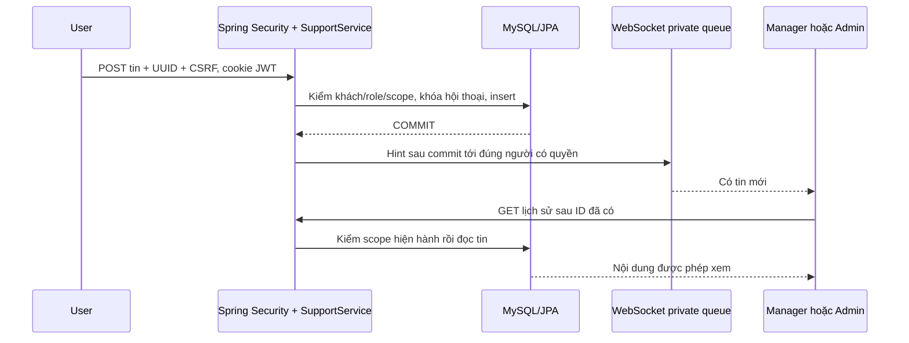

# CSKH UTETra — User chat với chi nhánh hoặc Admin

Phát triển trực tiếp trên integration/utetra ngày 27/10/2026. identify efddd5f đã có trên origin, lệnh push báo up to date; bản đó được ghép vào integration bằng bdbeeca, xử lý năm xung đột storefront/group UI. Nhánh phát hành phần bổ sung là integration/utetra; trạng thái commit/remote tra lịch sử Git.

## Contract theo vai trò

- ROLE_USER đã kích hoạt và đang hoạt động được chủ động mở hội thoại với đội Admin hoặc một chi nhánh ACTIVE có Manager đang được phân công/hoạt động.
- Manager chỉ thấy/trả lời hội thoại khách hàng của chi nhánh được giao; membership bị thu hồi thì mất quyền ngay ở lần đọc/gửi tiếp theo. Admin chỉ thấy/trả lời hội thoại User gửi tới kênh Admin.
- Nhân viên không được tạo hội thoại, truyền một staff ID làm người nhận hoặc gửi sang kênh staff khác. Không có conversation Admin–Manager, Manager–Manager hoặc Admin–Admin riêng.
- Một hội thoại là khách hàng với nhóm nhân viên phụ trách kênh, không gán riêng một nhân viên cố định. Nhiều Admin hoặc Manager cùng scope có thể hỗ trợ cùng khách; nội dung luôn thuộc hội thoại có khách hàng, không phải DM giữa nhân viên.
- Guest/Vendor/Shipper không dùng CSKH này theo yêu cầu User bình thường. Vendor vẫn giữ các chức năng mua hàng có sẵn. Nếu mở rộng CSKH cho Vendor sau này phải đổi contract/test, không chỉ mở menu.
- Không cho client chọn customerId/senderId/role; server lấy từ principal JWT hiện hành và kiểm role/active/verified/session trong DB.

## Dữ liệu và API

Migration mới V2026102704 tạo support_conversations và support_messages. Hội thoại duy nhất theo customer + scope ADMIN hoặc STORE:id. Tin có sender, role snapshot, nội dung, timestamp và UUID client_message_id; khóa unique theo hội thoại/người gửi/UUID ngăn retry thành tin mới. Lịch sử vẫn có khi reload/đăng nhập lại.

- GET /support, /manager/support, /admin/support: JSP theo vai trò, dùng cùng app.jsp và Bootstrap/theme.
- GET /api/support/targets: User lấy kênh Admin/chi nhánh đủ điều kiện.
- GET /api/support/conversations?page=0: danh sách trong scope, 30 mục/trang.
- POST /api/support/conversations với storeId null (Admin) hoặc ID chi nhánh: chỉ User được mở; mở lại cùng kênh trả hội thoại cũ.
- GET /api/support/conversations/{uuid}/messages: lấy 50 tin mới nhất, before để tải cũ, after để lấy mới; hai cursor không dùng đồng thời. Luôn lọc theo hội thoại đã được cấp quyền.
- POST /api/support/conversations/{uuid}/messages với body và clientMessageId: kiểm phiên/role/scope, độ dài 1–2000 Unicode code point, không nhận control char nguy hiểm; retry cùng UUID/nội dung trả tin cũ, đổi nội dung với UUID cũ trả 409.

Gửi qua HTTP có CSRF và transaction; sau commit mới phát WebSocket/STOMP lên /user/queue/support cho các principal có quyền. Payload realtime chỉ có conversationId/messageId, không broadcast nội dung hoặc danh sách khách hàng. Client đọc tin mới qua API đã kiểm quyền. Không cho gửi mutation thẳng vào broker, không cho subscribe queue người khác. Broker lỗi vẫn giữ tin trong DB; client polling 7 giây để phục hồi. Thu hồi phiên được guard socket hiện có kiểm tiếp.

Đây là chat văn bản; không bao gồm ảnh/file, voice, bot hoặc trạng thái đã đọc. Không gán nhầm yêu cầu bình luận sản phẩm có media sang chat. Nội dung hiển thị bằng textContent, không render HTML từ khách.

## Source ba tầng

- Presentation: SupportController, support/chat.jsp, support.js, support.css (scope support-page).
- Service: SupportService (quyền, idempotency, validation) và SupportEvents (AFTER_COMMIT/private hints).
- Data: SupportRepository qua JPA/IdentityRepository và hai entity SupportConversation/SupportMessage. SQL ở repository, không đặt trong JSP/controller/service.
- Config chung: SecurityConfig và WebSocketConfig/WebSocketSecurityConfig thêm đúng route/queue; backend không tin menu hay role cookie.

## Setup và kiểm chứng

Giữ Java 21/Spring Boot/JSP/JSTL/SiteMesh/Bootstrap/JPA/MySQL. Flyway áp dụng migration khi khởi động bản ứng dụng; đã áp dụng migration CSKH 2704 và bỏ plaintext 2705 trên utetra_db theo yêu cầu tiếp theo; 17 migration thành công. Không cần provider hoặc khóa CSKH mới, dùng WebSocket/JWT hiện có. Cần tài khoản User verified, Admin active và membership Manager đúng shop. Không tự gán quyền/dữ liệu thật để lấy ảnh.

Kiểm test SupportIntegrationTest, IntegratedMigrationTest; kiểm browser bằng tools/check_all_ui.py --support trên H2 cô lập, gồm chat nhiều phiên, queue giả, XSS text, nhập địa chỉ mới và COD. Kết quả và ảnh được ghi trong docs/ROLE_REQUIREMENTS_20261027.md, docs/demo/support-20261027. Không dùng ảnh H2 để chứng minh chat/hệ thống cloud đã nghiệm thu production.

Nguồn thiết kế theo tài liệu chính thức: https://docs.spring.io/spring-security/reference/servlet/integrations/websocket.html và https://docs.spring.io/spring-framework/reference/data-access/transaction/event.html. Áp dụng kênh riêng, kiểm subscribe và sự kiện sau commit; chi tiết kết quả phải dựa trên test thực.
