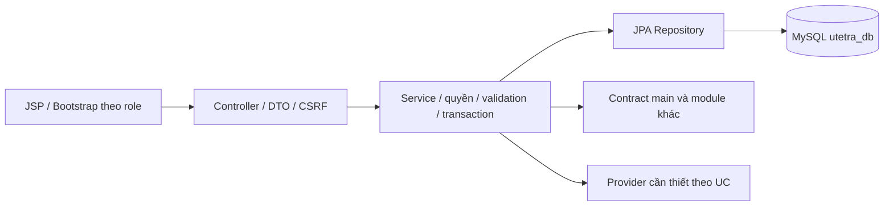

# feature/identity-membership — OTP, tài khoản, tương tác và thành viên

Bàn giao 24/10: đọc [JWT DB, stock/version và WebSocket checkout](../order-payment/REALTIME_CHECKOUT_JWT.md) trước khi merge/chạy với schema mới. Các nhánh cần nhận đủ source integration, không chỉ migration/JS; JWT cũ cần đăng nhập lại hoặc refresh hợp lệ.

> Cập nhật theo quy định thầy ngày 13/10/2026. Người phụ trách TV2: [điền tên]. Baseline main/commit: [điền]. Đây là hướng dẫn công việc, không xác nhận mọi UC đã code.

## 1. Các file phải đọc và cấu hình

Đọc QUY_DINH_VA_CAU_HINH_CHUNG, PROJECT_PLAN, DATABASE_DESIGN, USE_CASES, docs/README, COMMON_BASELINE, SETUP và file hướng dẫn ở gốc nhánh. Java21/Boot3.5.13/WAR/JSP/JSTL/SiteMesh3.2.2/Bootstrap5.3.3/MavenWrapper/MySQL utetra_db/JPA/Flyway theo main; không .env, không tự đổi pom/profile/migration/secret. Một template Shop Homepage chung; Vendor có quyền User, Manager theo scope, Admin global.

## 2. Use case, role và công việc

| Mã | Chức năng | Actor | Module owner | Phạm vi | Kết quả kiểm chứng cần đạt |
| --- | --- | --- | --- | --- | --- |
| UC-AUTH-01 | Đăng ký tài khoản | Guest | identity-membership | P0 bắt buộc | Tạo User chưa xác minh, BCrypt và gửi OTP email |
| UC-AUTH-02 | Kích hoạt bằng OTP | Guest | identity-membership | P0 bắt buộc | OTP đúng/hạn/một lần mới ghi email_verified_at |
| UC-AUTH-03 | Đăng nhập | Guest | identity-membership | P0 bắt buộc | Chỉ tài khoản hoạt động đã xác minh; tạo phiên và JWT |
| UC-AUTH-04 | Đăng xuất | Người đăng nhập | identity-membership | P0 bắt buộc | Thu hồi phiên, xóa cookie đúng path, ngắt socket |
| UC-AUTH-05 | Quên mật khẩu gửi OTP | Guest | identity-membership | P0 bắt buộc | Phản hồi chung, OTP reset riêng mục đích, giới hạn gửi |
| UC-AUTH-06 | Đặt lại mật khẩu bằng OTP | Guest | identity-membership | P0 bắt buộc | Xác minh rồi đổi BCrypt, dùng challenge một lần, thu hồi mọi phiên |
| UC-AUTH-07 | Làm mới phiên | Người đăng nhập | identity-membership | P0 bắt buộc | Khóa và xoay refresh hash, không kéo dài hạn tuyệt đối |
| UC-USER-01 | Profile, avatar và đổi mật khẩu | Người đăng nhập | identity-membership | P0 bắt buộc | Chỉ hồ sơ mình; Cloudinary; đổi mật khẩu thu hồi phiên |
| UC-USER-02 | Nhiều địa chỉ nhận hàng | User, Vendor | identity-membership | P0 bắt buộc | CRUD của mình, tối đa một mặc định, snapshot đơn không đổi |
| UC-USER-03 | Thích/bỏ thích sản phẩm | User, Vendor | identity-membership | P0 bắt buộc | Unique user/product, danh sách yêu thích và số thích đúng |
| UC-USER-04 | Sản phẩm đã xem | User, Vendor | identity-membership | P0 bắt buộc | Upsert lần xem, danh sách gần nhất của mình |
| UC-USER-05 | Đánh giá sản phẩm đã mua | User, Vendor | identity-membership | P0 bắt buộc | Đơn đã giao và trả tiền, sao 1–5, không đánh giá trùng order_item |
| UC-USER-06 | Bình luận text, ảnh/video | User, Vendor | identity-membership | P0 bắt buộc | Đã mua; text 50–2000 ký tự sau trim; media kiểm nội dung/kích thước |
| UC-USER-07 | Điểm và hạng thành viên | User, Vendor | identity-membership | P0 bắt buộc | Ledger trừ/hoàn/cộng/thu hồi điểm đúng một lần, hạng và số dư nhất quán |
| UC-MGR-01 | Tìm/quản lý user | Manager | identity-membership | P0 bắt buộc | Phạm vi user liên quan shop được giao, không tự cấp Admin |
| UC-ADM-01 | Tìm/quản lý user và phân quyền | Admin | identity-membership | P0 bắt buộc | Toàn hệ thống, khóa/revoke, phân công Manager, giữ Admin cuối cùng |

Mỗi UC do một người làm đủ Entity/Repo/DTO → Service → Controller → JSP/JS → kiểm thử → hồ sơ. Viết báo cáo tách phần actor/role của từng UC, không chỉ tên module. Chọn chi nhánh thủ công; không loại các chức năng OTP/voucher/refund/review/carrier của thầy.

## 3. Schema, contract và phụ thuộc

Owner các bảng: roles, users, auth_sessions, otp_challenges, store_memberships, user_addresses, loyalty_accounts, loyalty_transactions, audit_logs, product_favorites, product_views, reviews, review_media, product_comments, comment_media. Chỉ V1 identity đã có trong baseline; bảng khác theo schema thiết kế và migration main mới, không tự tạo cấu trúc khác.

Contract: AuthService, OtpService, AddressService, AuthorizationService, LoyaltyService, AuditService. Phụ thuộc: SMTP/OTP/JWT/session; MediaService từ TV1; purchase eligibility/đơn và transaction points từ TV3. Signature/DTO/error/transaction/locking phải chốt trên main trước khi ghép; mock chỉ trong test. Không viết lại giá/điểm/auth/payment service của owner khác.

## 4. Thứ tự thực hiện từng UC

1. Merge main, ghi baseline/role/UC, đọc tiền điều kiện/BR/acceptance và dependency.
2. Chốt activity/sequence và schema/DTO/permission; đề xuất migration vào main.
3. Entity/Repository/query/DTO → Service validation/quyền/transaction/idempotency.
4. Controller route/error/CSRF → JSP/Bootstrap/JS loading/empty/error theo cùng template.
5. Chạy test luồng chính/lỗi/quyền/cạnh tranh/callback/media theo UC; đọc kết quả thật.
6. Ghi code path/symbol/commit, chụp code có chú giải và UI chạy thật; xuất sơ đồ có nguồn.
7. Điền setup/demo/data/profile, prompt nguyên văn/response/nhóm sửa/test; review/commit.

## 5. Kiến trúc dự kiến của module



Sơ đồ này là khung kiến trúc dự kiến. Mỗi UC phải có activity/sequence riêng từ code thực và xuất ảnh PNG/SVG; không dùng một hình generic thay tất cả UC trong báo cáo cuối.

## 6. Chỗ ghi minh chứng và tiến độ

| UC/role | Path/symbol/commit | Activity/sequence/ảnh code/UI | Config/setup/data | Prompt/response | Test/reviewer/trạng thái |
| --- | --- | --- | --- | --- | --- |
| UC-AUTH-01 / Guest | [điền] | [chưa có] | [điền] | [điền] | Đã có code/test H2; chờ nghiệm thu provider/integration |
| UC-AUTH-02 / Guest | [điền] | [chưa có] | [điền] | [điền] | Đã có code/test H2; chờ nghiệm thu provider/integration |
| UC-AUTH-03 / Guest | [điền] | [chưa có] | [điền] | [điền] | Đã có code/test H2; chờ nghiệm thu provider/integration |
| UC-AUTH-04 / Người đăng nhập | [điền] | [chưa có] | [điền] | [điền] | Đã có code/test H2; chờ nghiệm thu provider/integration |
| UC-AUTH-05 / Guest | [điền] | [chưa có] | [điền] | [điền] | Đã có code/test H2; chờ nghiệm thu provider/integration |
| UC-AUTH-06 / Guest | [điền] | [chưa có] | [điền] | [điền] | Đã có code/test H2; chờ nghiệm thu provider/integration |
| UC-AUTH-07 / Người đăng nhập | [điền] | [chưa có] | [điền] | [điền] | Đã có code/test H2; chờ nghiệm thu provider/integration |
| UC-USER-01 / Người đăng nhập | [điền] | [chưa có] | [điền] | [điền] | Đã có code/test H2; chờ nghiệm thu provider/integration |
| UC-USER-02 / User, Vendor | [điền] | [chưa có] | [điền] | [điền] | Đã có code/test H2; chờ nghiệm thu provider/integration |
| UC-USER-03 / User, Vendor | [điền] | [chưa có] | [điền] | [điền] | Đã có code/test H2; chờ nghiệm thu provider/integration |
| UC-USER-04 / User, Vendor | [điền] | [chưa có] | [điền] | [điền] | Đã có code/test H2; chờ nghiệm thu provider/integration |
| UC-USER-05 / User, Vendor | [điền] | [chưa có] | [điền] | [điền] | Đã có code/test H2; chờ nghiệm thu provider/integration |
| UC-USER-06 / User, Vendor | [điền] | [chưa có] | [điền] | [điền] | Đã có code/test H2; chờ nghiệm thu provider/integration |
| UC-USER-07 / User, Vendor | [điền] | [chưa có] | [điền] | [điền] | Đã có code/test H2; chờ nghiệm thu provider/integration |
| UC-MGR-01 / Manager | [điền] | [chưa có] | [điền] | [điền] | Đã có code/test H2; chờ nghiệm thu provider/integration |
| UC-ADM-01 / Admin | [điền] | [chưa có] | [điền] | [điền] | Đã có code/test H2; chờ nghiệm thu provider/integration |

Ghi setup thực và thao tác demo theo role; lỗi/vấn đề còn lại ở cuối từng UC note. Không chụp secret/config password vào báo cáo. Phản hồi dài lưu ai-responses/<ID>.md; ảnh/source lưu assets/<UC-ID>. Không bịa test pass hoặc ảnh chạy.

## 7. Prompt mẫu — chưa sử dụng

```text
Đọc toàn bộ quy định/baseline UTETra và hướng dẫn nhánh hiện tại.
Triển khai <UC-ID> từ Entity/Repo/DTO tới Service/Controller/JSP/test.
Giữ MySQL utetra_db, stack và contract main. Actor/scope/OTP/payment/media
phải đúng đặc tả; không tự bỏ chức năng hoặc đổi framework.
Ghi prompt thật, phản hồi, code/ảnh/setup/commit, phần nhóm sửa và kiểm chứng
vào AI_LOG và hồ sơ UC. Sơ đồ dự kiến và ảnh UI thật phải phân biệt.
```

## 8. Checklist bàn giao

- [ ] Đủ UC/role được giao; cả luồng chính/lỗi và quyền dữ liệu.
- [ ] Cấu hình/DDL/DTO/contract đúng main; provider thiếu ghi rõ.
- [ ] Có kiến trúc/activity/sequence, hình code/UI chú giải, setup và test thật.
- [ ] Prompt nguyên văn/response/nhóm sửa/commit/reviewer đầy đủ.
- [ ] Ghép integration cùng owner dependency; kiểm chức năng chung theo thang điểm.

## 9. Cập nhật triển khai 17/10/2026

Đã merge origin/main trên feature/identity-membership, baseline 8a18438; có code cho đủ 16 UC. Module ở src/main/java/com/utetra/identity có 12 Entity metadata mới, repository JPA/native projection, DTO, Service/Controller, audit và policy membership; JSP/JS dùng template chung. Thêm migration timestamp, không sửa V1 hoặc datasource.

Kết quả hiện hành: [VERIFICATION](VERIFICATION.md) — verify 42 test đạt và WAR; Playwright 16 check đạt. Hướng dẫn setup/demo/route/contract: [RUNBOOK](RUNBOOK.md). Main cần review [CONTRACT_REVIEW](CONTRACT_REVIEW.md) và FK liên module. Chưa kiểm SMTP/upload Cloudinary/TiDB/checkout-refund thật, chưa có reviewer và chưa commit/push source. Checklist nghiệm thu provider và tích hợp ở trên chưa đánh dấu hoàn tất vì chưa có bằng chứng thật.

Mỗi hồ sơ UC có phần cập nhật 17/10: flow từ code, code path/method, test thực, diagram nguồn Mermaid/SVG, ảnh đoạn source có chú giải và ảnh UI fixture H2. Mẫu test/placeholder lịch sử phía trên được giữ để đối chiếu thiết kế, không được dùng để phủ nhận hoặc thay bằng chứng hiện tại. Prompt IDN-AI-001 và phản hồi được liên kết trong AI_LOG và AI_PROMPT_HISTORY.

## 10. Rà validation và chạy demo 20/10/2026

Đọc lại các tài liệu, kiểm từ DTO/form tới Service/API/database và sửa phone, version bắt buộc, strict JSON, Unicode, reset grant anonymous/resend, upload decode và snapshot điểm. Thêm migration validation theo version mới, không đổi V1. 53 test đạt; 23 check trình duyệt đạt. Chi tiết/ma trận lỗi và hướng dẫn demo: [VALIDATION_REVIEW_20261020](VALIDATION_REVIEW_20261020.md). Kết quả 42 test ở phần 17/10 giữ làm lịch sử.


## Tích hợp thực tế 20/10/2026 — IDN-AI-003

Đã merge catalog-sales/order-payment vào identity, thống nhất UI/quyền/ledger và chạy WAR với TiDB thật. Các giới hạn H2/demo/integration của các phần lịch sử phía trên được thay bằng trạng thái hiện tại tại [INTEGRATION_20261020](INTEGRATION_20261020.md). Không push.


## Cập nhật IDN-AI-005 — UI và tài khoản

Đã nâng cấp layout/ảnh thương hiệu, trang chủ, menu, sản phẩm, cửa hàng, auth/account và các màn hình mua hàng/quản lý; mật khẩu 8 tài khoản khởi tạo được đổi sang dạng dễ nhớ, BCrypt và revoke session cũ. Xem [báo cáo thiết kế/kiểm chứng](UI_REDESIGN_20261020.md), [audit](UI_REDESIGN_AUDIT_20261020.json). Mật khẩu hiện hành ở .local/TAI_KHOAN_UTETRA.md, không ghi vào Git.


## IDN-AI-006 — Tài khoản và Gmail OTP

Đã thay thế liên kết kích hoạt riêng bằng luồng tự chuyển sau đăng ký; quên/đặt lại mật khẩu bắt buộc OTP. Đồng bộ UI 5 trang. Gmail người gửi luxiphot123456@gmail.com đã bật và kiểm tra gửi thật; cấu hình bí mật chỉ ở .local/mail.properties, Git bỏ qua. Xem [báo cáo và bằng chứng kiểm tra](AUTH_FLOW_20261020.md). Thông tin này thay thế trạng thái SMTP chưa cấu hình trong các báo cáo cũ.


## IDN-AI-007 — OTP và email

Xem [điều tra, thay đổi và kiểm chứng](OTP_MAIL_20261020.md). Đã thêm email HTML + plain UTF-8, giữ TTL 5 phút; xử lý dán OTP và phân biệt thông báo hết hạn/đã dùng sau khi mã khớp. 39 tests đạt. Tái hiện trên TiDB: mã đúng được chấp nhận sau 10 giây; chưa tái hiện lỗi cụ thể từ người dùng.
