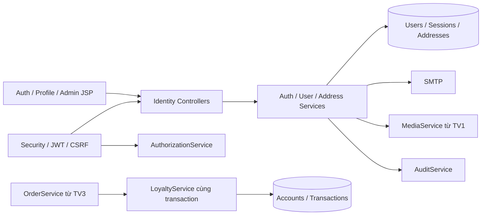
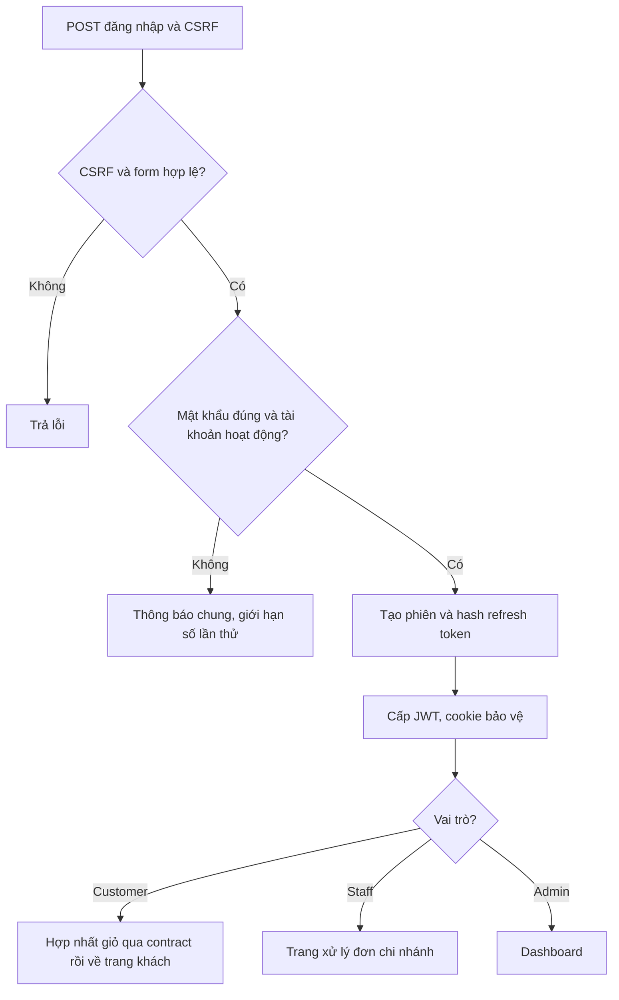

# Nhánh feature/identity-membership — Tài khoản và thành viên

## 1. Thông tin nhận việc

| Mục | Giá trị |
| --- | --- |
| Người phụ trách | [CẦN BỔ SUNG] — TV2 |
| Nhánh | feature/identity-membership |
| Baseline/commit | [CẦN BỔ SUNG] |
| Use case | UC-AUTH-01–05; UC-USER-01–03; UC-ADMIN-01 |
| Trạng thái | Chưa lập trình; hướng dẫn và sơ đồ thiết kế ban đầu |
| Nhật ký AI | [AI_LOG.md](AI_LOG.md) |

Đọc đặc tả gốc, [baseline](../../COMMON_BASELINE.md), [setup](../../SETUP.md) và hướng dẫn ở gốc nhánh. Nhánh này làm luồng danh tính từ đăng ký đến sử dụng tài khoản/thành viên, gồm UI, nghiệp vụ và dữ liệu; không chỉ viết bộ lọc JWT.

## 2. Công việc theo use case

| UC | Công việc trọn luồng | Minh chứng |
| --- | --- | --- |
| AUTH-01 | Validate/chuẩn hóa username/email → BCrypt → tạo Customer và account điểm → form đăng ký | Thành công, trùng định danh, password không hợp lệ |
| AUTH-02 | Authentication → session DB → JWT/cookie → điều hướng role → hợp nhất giỏ qua contract TV3 | Login từng role, sai mật khẩu, tài khoản khóa |
| AUTH-03 | POST có CSRF → revoke session → xóa đúng cookie → ngắt socket | JWT phiên cũ không dùng được |
| AUTH-04 | Token reset hash/một lần/hạn 15 phút → SMTP → form reset → thu hồi phiên | Email giả lập, token hết hạn/đã dùng, phản hồi không lộ email |
| AUTH-05 | Khóa session → kiểm hash/hạn → xoay refresh → JWT mới | Token cũ bị từ chối, tab đồng thời không refresh lặp |
| USER-01 | Hồ sơ của mình → avatar MediaService → đổi password/revoke | Profile, upload lỗi, account người khác bị chặn |
| USER-02 | CRUD địa chỉ thuộc user → mặc định trong transaction → UI | Một default, không lộ địa chỉ người khác, đơn cũ giữ snapshot |
| USER-03 | Account/ledger → tính hạng → UI số dư/lịch sử; service điểm dùng cho đơn | Redeem/refund/earn đúng một lần, số dư/hạng khớp |
| ADMIN-01 | Quản lý user/role/khóa → assignment chi nhánh → revoke/audit → admin JSP | Staff A không có quyền B, giữ Admin hoạt động cuối cùng |

Ghi mỗi mã đầy đủ UC-AUTH/UC-USER/UC-ADMIN vào hồ sơ UC riêng. Điểm thưởng hỗ trợ bán hàng; không phát triển cơ chế tính điểm khác BR-13–16.

## 3. Cấu hình, schema và contract

- Dùng Spring Security 6.x theo Boot BOM, JWT và cookie + CSRF; chưa có version JWT library chính xác thì chốt qua B0, không tự sửa pom.
- Owner 9 bảng: roles, users, staff_store_assignments, auth_sessions, password_reset_tokens, user_addresses, loyalty_accounts, loyalty_transactions, audit_logs. Migration theo main, đủ ba dialect.
- Biến JWT_SECRET/ISSUER/AUDIENCE và MAIL_HOST/PORT/USERNAME/PASSWORD/FROM; APP_BASE_URL để link reset nội bộ. Không commit token/secret/email người thật.
- Access JWT 15 phút, refresh tối đa 7 ngày; session được kiểm tra mỗi request, token hash lưu DB, refresh xoay nguyên tử. BCrypt theo giới hạn password trong USE_CASES.md.
- Route /auth/**, /account/**, /admin/users/**; JSP auth/client/admin dùng decorator chung. Sửa SecurityConfig qua review baseline main.
- Cung cấp CurrentUser/AuthorizationService, AddressService, LoyaltyService và AuditService. Avatar dùng MediaService TV1; thu hồi quyền/session phối hợp socket TV3.
- LoyaltyService tham gia transaction checkout/chuyển trạng thái của TV3, không tự tạo đơn/thu tiền, không dùng REQUIRES_NEW để tách commit điểm khỏi đơn.

## 4. Thứ tự thực hiện

1. Đồng bộ main/B0; chốt principal, role enum, DTO và service signature.
2. Entity/Repo/DTO và migration theo schema; seed roles và user demo có hash thật; không cấp role theo request đăng ký.
3. Auth session/JWT/CSRF/refresh/logout; giữ route và cookie nhất quán, không disable security để các nhánh khác chạy.
4. Đăng ký/login/reset/logout JSP; SMTP test và tình huống lỗi; phối hợp callback hợp nhất giỏ với TV3.
5. Hồ sơ/địa chỉ/avatar; kiểm quyền sở hữu và unique địa chỉ mặc định.
6. User/admin/assignment/audit; quyền chi nhánh cho catalog/orders/socket.
7. Account/ledger/hạng; contract test trừ/hoàn/cộng điểm với transaction đơn.
8. Test JWT sai/hết hạn/revoked, CSRF, reset/refresh lặp, điểm cạnh tranh và quyền; hoàn thiện hình/prompt/hướng dẫn chạy.

## 5. Hình thiết kế ban đầu

Sơ đồ là thiết kế dự kiến. Kiểm tra với code thực rồi lưu nguồn `.mmd` và ảnh xuất trong assets của UC.





Mỗi UC reset, refresh, ledger, địa chỉ, assignment phải có activity riêng khi thực hiện, không dùng sơ đồ login thay cho tất cả.

## 6. Hồ sơ code, UI và setup

| Nhóm UC | Code thực cần diễn giải | UI/hình minh chứng | File/commit/kết quả |
| --- | --- | --- | --- |
| AUTH-01–05 | PasswordEncoder, JWT validation, session revoke/rotation, CSRF, reset hash | Forms auth, lỗi login, email reset giả lập | [CẦN BỔ SUNG từng UC] |
| USER-01–02 | Owner check, avatar compensation, default-address constraint | Profile/avatar/address + lỗi quyền/upload | [CẦN BỔ SUNG từng UC] |
| USER-03 | Transaction khóa account, unique(order,type), floor và tier | Số dư, lịch sử điểm, hạng; dữ liệu trước/sau | [CẦN BỔ SUNG] |
| ADMIN-01 | Phân công/role/revoke, bảo vệ Admin cuối cùng | User list/form/assignments, lỗi sai chi nhánh | [CẦN BỔ SUNG] |

Setup riêng: JWT/SMTP test/account seed, schema session/reset/loyalty; data hai Customer và Staff hai chi nhánh. Ghi cách test reset thật qua mail test, cách chạy login các vai trò và cách đối chiếu ledger với đơn. Screenshot không hiển thị secret, password hash hoặc cookie token.

## 7. Prompt gợi ý — chưa sử dụng

```text
Đọc UC-AUTH-02/03/05 và baseline UTETra. Trên feature/identity-membership,
xây xác thực JSP bằng JWT cookie và session DB, CSRF, refresh rotation,
logout revoke và phân quyền Service. Giữ stack/schema/profile của main.
Giải thích code theo request lifecycle; kiểm thử token sai/hết hạn/revoked,
refresh dùng lại và CSRF. Ghi nhật ký prompt, hình và kết quả thực.
```

```text
Đọc BR-13–16, bảng loyalty_accounts/loyalty_transactions và contract OrderService.
Thiết kế LoyaltyService tham gia cùng transaction đơn, chống redeem/refund/earn
lặp bằng unique(order_id,type). Không tạo luồng thanh toán riêng.
Vẽ activity ledger, ghi quyền sở hữu và test cạnh tranh/rollback với nhánh TV3.
```

## 8. Tiến độ và bàn giao

| UC | Code/test | Kiến trúc/activity | Code/UI images | Setup | Prompt thật | Review/commit |
| --- | --- | --- | --- | --- | --- | --- |
| 9 UC được giao, tách mỗi UC thành một dòng khi làm | Chưa | Chưa kiểm chứng | Chưa | Chưa | Chưa | [điền] |

- [ ] Tất cả UC tài khoản/thành viên đủ luồng chính và lỗi.
- [ ] JWT/cookie/CSRF, SMTP và schema theo main; không lệch token/session contract.
- [ ] Nhánh khác dùng được quyền, địa chỉ, ảnh/audit và service điểm như đã chốt.
- [ ] Điểm rollback cùng đơn, hạng đúng, không ledger trùng/điểm âm.
- [ ] Hình/prompt/code/UI có caption, nguồn và commit thực.

Lỗi còn lại và phối hợp TV1/TV3: [CẦN BỔ SUNG].
