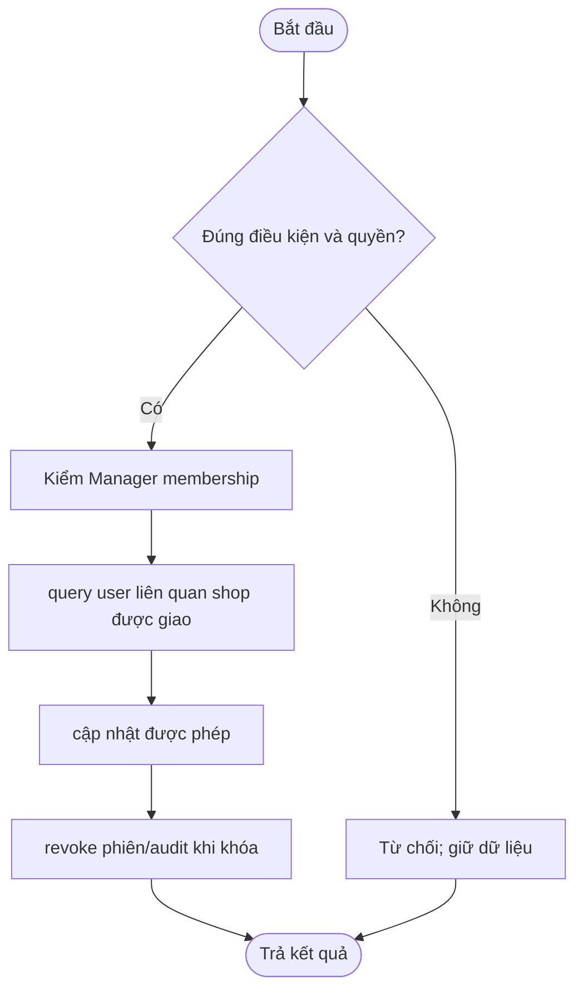

# UC-MGR-01 — Tìm/quản lý user

> Actor: Manager. Owner: feature/identity-membership. P0 bắt buộc. Đặc tả thiết kế; chưa có code, ảnh chạy hoặc test nghiệp vụ của UC này.

## Đặc tả chức năng

Mục tiêu và điều kiện nghiệm thu: Phạm vi user liên quan shop được giao, không tự cấp Admin.

Nguồn: [Danh mục và BR](../../../../USE_CASES.md), [từ điển dữ liệu](../../../../DATABASE_DESIGN.md), [quy định chung](../../../QUY_DINH_VA_CAU_HINH_CHUNG.md). Nền và contract: [COMMON_BASELINE](../../../COMMON_BASELINE.md).

- Kích hoạt: actor chọn chức năng tìm/quản lý user trên giao diện hoặc gọi route tương ứng.
- Tiền điều kiện: nền main đã đồng bộ; bảng cần dùng có migration đã review; dữ liệu tham chiếu tồn tại. Public chỉ đọc dữ liệu được duyệt; thao tác bảo vệ cần tài khoản active/verified, phiên hợp lệ và đúng phạm vi.
- Đầu vào: keyword, userId, allowed action, version. ID và số tiền từ client không thay thế kiểm quyền/tính toán phía server.
- Dữ liệu: `users, store_memberships, orders, auth_sessions, audit_logs`. Ngoài ba bảng identity V1, đây là các bảng cần triển khai, chưa được xem là đã có.
- Contract dự kiến: `AuthorizationService/UserService`; route dự kiến: `/manager/users`. Chốt DTO/signature và migration trên main trước khi code; không tự tạo Service trùng chức năng module khác.
- Hậu điều kiện thành công: đạt điều kiện nghiệm thu nêu trên; trạng thái và dữ liệu nhất quán, trả DTO/view đã escape. GET không thay đổi dữ liệu nghiệp vụ; ghi nhiều bảng phải có transaction và kiểm quyền trước ghi.
- Hậu điều kiện thất bại: không ghi dở/mất dữ liệu; lỗi validation/quyền/version rõ ràng; provider thất bại có pending/retry hoặc lỗi thật, không giả thành công.

### Luồng chính

1. Kiểm Manager membership.
2. query user liên quan shop được giao.
3. cập nhật được phép.
4. revoke phiên/audit khi khóa.

### Sơ đồ hoạt động dự kiến

Sơ đồ mô tả luồng thiết kế; các nhánh lỗi/cạnh tranh cụ thể ở mục tiếp theo. Cập nhật theo code thực và xuất ảnh khi lập báo cáo.

### Luồng thay thế, lỗi và cạnh tranh

Không quản user ngoài scope; không cấp Admin/Vendor tùy ý; stale version; DTO không hash/refresh token. Request thay đổi phải có CSRF; dùng version/unique/locking theo schema khi ghi. Event ra ngoài transaction chỉ phát sau commit; không đưa credential, OTP rõ, token hoặc password vào log/DTO.

### Kiểm thử nghiệm thu cần thực hiện

| Case | Mong đợi | Kết quả hiện tại |
| --- | --- | --- |
| Luồng chính với keyword, userId, allowed action, version hợp lệ | Phạm vi user liên quan shop được giao, không tự cấp Admin | Chưa chạy — UC chưa triển khai |
| Input hoặc tham chiếu không hợp lệ | Lỗi rõ ràng, không ghi dở | Chưa chạy |
| Actor/owner/scope không hợp lệ | 401/403 hoặc 404 theo contract, không lộ dữ liệu | Chưa chạy |
| Tình huống đặc thù: Không quản user ngoài scope; không cấp Admin/Vendor tùy ý; stale version; DTO không hash/refresh token | Tuân thủ luồng lỗi và tính nhất quán nêu trên | Chưa chạy |

### Triển khai theo ba tầng

1. Chốt DTO và các bảng `users, store_memberships, orders, auth_sessions, audit_logs`; nhóm trưởng đặt version migration duy nhất trên main, giữ nguyên V1 đã áp dụng.
2. Entity/Repository ánh xạ FK/unique/version và query scoped; map DTO trong Service khi `open-in-view=false`.
3. `AuthorizationService/UserService` xử lý luồng chính, validation/quyền/transaction và các lỗi đặc thù ở trên.
4. Controller cho `/manager/users` nhận DTO, principal và CSRF; JSP dùng Bootstrap/layout chung, hiển thị loading/empty/error.
5. Viết và chạy các case nghiệm thu; bổ sung code path/symbol/commit và ảnh chạy thật vào các mục hồ sơ bên dưới.

Các ô minh chứng bên dưới được điền khi có kết quả thực; không dùng đặc tả hoặc sơ đồ dự kiến làm bằng chứng chức năng hoàn thành.

## 1. Phạm vi và người thực hiện

| Mục | Nội dung |
| --- | --- |
| UC/nhánh/người | UC-MGR-01 / feature/identity-membership / TV2; tên cá nhân chưa phân công |
| Vai trò và quyền dữ liệu | Manager; lấy identity từ principal, kiểm owner/shop/membership/assignment tại Service |
| Baseline main/commit implementation | [điền] |
| Quy tắc BR và bảng dữ liệu | users, store_memberships, orders, auth_sessions, audit_logs; theo USE_CASES.md và DATABASE_DESIGN.md |
| Trạng thái/ngày | Đặc tả bổ sung 14/10/2026; chức năng chưa triển khai |

Mục tiêu: [điền]. Tiền điều kiện/kích hoạt: [điền]. Đầu vào/đầu ra/hậu điều kiện: [điền]. Luồng chính, luồng lỗi, cạnh tranh và quyền: [điền].

## 2. Kiến trúc và sơ đồ hoạt động

| Mã hình | Loại | Nguồn Mermaid/PlantUML | PNG/SVG xuất | Caption và giải thích | Prompt/commit | Trạng thái |
| --- | --- | --- | --- | --- | --- | --- |
| [MOD-UC-ARCH-01] | Kiến trúc | [path] | [path] | [điền] | [điền] | [dự kiến/kiểm chứng] |
| [MOD-UC-ACT-01] | Activity | [path] | [path] | [điền] | [điền] | [dự kiến/kiểm chứng] |

Giải thích thành phần, chiều dữ liệu và ranh giới transaction; activity có start/end, quyết định và nhánh lỗi. Ghi điểm khác giữa thiết kế AI đề xuất và triển khai thực.

## 3. Hướng dẫn xây dựng từng bước

| Bước | File/symbol tạo hoặc sửa | Công việc và lý do | Input/output | Dependency | Prompt/commit |
| --- | --- | --- | --- | --- | --- |
| 1 — Dữ liệu/migration | [điền] | [schema, FK/UQ/CHECK] | [điền] | [điền] | [điền] |
| 2 — Entity/Repo/DTO | [điền] | [mapping/query/validation] | [điền] | [điền] | [điền] |
| 3 — Service | [điền] | [quyền, nghiệp vụ, transaction] | [điền] | [điền] | [điền] |
| 4 — Controller | [điền] | [route, lỗi, PRG/JSON] | [điền] | [điền] | [điền] |
| 5 — JSP/JS | [điền] | [form/list/error/loading] | [điền] | [điền] | [điền] |
| 6 — Kiểm thử | [điền] | [case quan trọng] | [điền] | [điền] | [điền] |

Thêm văn bản giải thích đủ để người khác xây lại chức năng theo các bước, không chỉ bảng tên class. Đoạn code trọng tâm trong fenced block dùng code thực, nêu path/symbol/commit để tra lại; không chép toàn dự án vào báo cáo.

## 4. Hình diễn giải source code

| Hình | File/symbol/commit | Dòng hoặc đoạn trọng tâm | Callout 1/2/3 | Ý nghĩa/kiểm chứng |
| --- | --- | --- | --- | --- |
| [MOD-UC-CODE-01] | [điền] | [điền] | [điền] | [điền] |

Chụp code thật, đánh dấu validation/quyền/dữ liệu/transaction và giải thích dưới hình. Chỉ chèn đường dẫn ảnh sau khi ảnh có thật; không tạo link ảnh giả chỉ để hoàn thành checklist.

## 5. Hình diễn giải giao diện

| Hình | Trang/vai trò/dữ liệu test | Thao tác và trạng thái | Ảnh thực/mockup | Caption/commit |
| --- | --- | --- | --- | --- |
| [MOD-UC-UI-01] | [điền] | [luồng chính] | [điền] | [điền] |
| [MOD-UC-UI-02] | [điền] | [lỗi/rỗng/quyền] | [điền] | [điền] |

Giải thích các vùng giao diện, lựa chọn và kết quả. Mockup phải ghi rõ chưa triển khai; báo cáo nghiệm thu cần screenshot ứng dụng chạy.

## 6. Setup và dữ liệu demo

Baseline/version/profile: [điền]. Biến config cần thêm và nơi ánh xạ: [điền, không secret]. Migration/seed: [điền]. Lệnh build/chạy/test thực: [điền]. URL/role/thao tác demo: [điền]. Lỗi setup và cách sửa: [điền].

## 7. Kiểm thử và đánh giá AI

| Case | Input/quyền/tình huống | Mong đợi | Kết quả thực | Lệnh/log/ảnh/commit |
| --- | --- | --- | --- | --- |
| [điền] | [điền] | [điền] | [chưa chạy/qua/lỗi] | [điền] |

Prompt liên quan: [ID/link]. AI hỗ trợ phần nào: [điền]. Nhóm chỉnh/sửa/bỏ gì và vì sao: [điền]. Cách xác minh source/hình/cấu hình: [điền]. Hạn chế/lỗi chưa giải quyết: [điền].

## 8. Checklist kết thúc

- [ ] Đúng use case, schema, cấu hình và contract main.
- [ ] Có hướng dẫn từng bước, hình kiến trúc/activity/code/UI với caption và nguồn.
- [ ] Setup và testcase được chạy thực, có kết quả và commit.
- [ ] Prompt nguyên văn/response/đánh giá nhóm được liên kết.
- [ ] Reviewer/ngày/commit được điền, không còn placeholder ở phần nộp.
