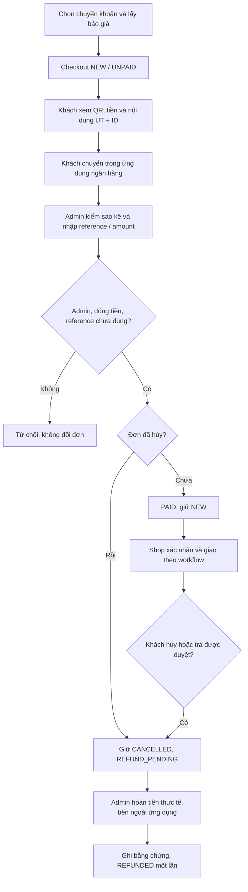

# Chuyển khoản ngân hàng bằng QR — UTETra

Ngày triển khai: 24/10/2026, trên `integration/utetra`. Đây là chuyển khoản **đối soát thủ công**, không phải VNPAY/MOMO hay kết nối API Techcombank.

## Tài khoản nhận và cách hoạt động

- Techcombank; chủ tài khoản **BUI THANH PHUC**; số tài khoản **3337110941**, theo ảnh người dùng cung cấp.
- Ảnh gốc được giữ; bản dùng trong web: `src/main/resources/static/assets/images/payment/techcombank-utetra.jpg`.
- QR là QR tài khoản tĩnh. Khách phải nhập **số tiền từ tổng đơn phía server** và nội dung `UT<orderId>` ở ứng dụng ngân hàng. Không khẳng định QR đã tự chứa số tiền/nội dung đơn.
- Không có API key ngân hàng; không có webhook hay việc tự truy cập tài khoản ngân hàng. Admin đối chiếu sao kê thật rồi mới xác nhận.

## Cấu hình

Trong `src/main/resources/application.properties`:

```properties
payment.bank.enabled=true
payment.bank.bank-name=Techcombank
payment.bank.account-number=3337110941
payment.bank.account-name=BUI THANH PHUC
```

Đây là thông tin tài khoản nhận công khai cho khách, không phải thông tin đăng nhập ngân hàng. Đổi tài khoản phải đổi cả ảnh QR và cấu hình cho khớp, đồng thời đối soát hết đơn đang chờ ở tài khoản cũ trước khi đổi. Không đổi datasource/JWT/provider khác để dùng chức năng này.

## Luồng chức năng

1. User hoặc Vendor chọn `COD` hoặc `BANK_TRANSFER` ở checkout. Client cũ không gửi phương thức vẫn dùng COD.
2. Báo giá khóa phương thức cùng các yếu tố giá trong quote hash. Đổi phương thức phải lấy lại báo giá.
3. Checkout tạo order NEW/UNPAID và payment PENDING; lưu DB, snapshot tiền và xóa giỏ trong cùng transaction.
4. Chi tiết đơn của người mua hiển thị QR, tài khoản, tiền phải chuyển và nội dung theo ID đơn. Khách không có API tự xác nhận đã nhận tiền.
5. Admin mở `/admin/orders/{id}`, kiểm sao kê có đúng người nhận, nội dung `UT<id>` và đủ tổng tiền. Nhập mã giao dịch thật và số tiền thực nhận.
6. Backend kiểm Admin hiện hành, method, version, trạng thái, số tiền nguyên VND và reference; khóa order/payment. Một mã giao dịch chỉ dùng cho một order nhờ kiểm tra ứng dụng và unique `(provider, provider_txn_id)`.
7. Xác nhận thành công ghi payment SUCCEEDED, order PAID, người xác nhận, thời điểm, audit/history/notification. Retry cùng mã và số tiền không tạo sự kiện lần hai.
8. Shop mới được chuyển đơn bank sang CONFIRMED khi PAID. Khi giao bank không thu thêm COD; luồng thưởng điểm/doanh thu vẫn đợi giao thành công.

### Hủy và hoàn tiền

- Hủy trước thanh toán: order/payment hủy, hoàn điểm đã dùng và giải phóng voucher theo quy tắc cũ.
- Hủy sau khi đã chuyển: giữ bằng chứng thu SUCCEEDED; order CANCELLED, payment REFUND_PENDING. Hoàn điểm/voucher khi hủy một lần; chưa đánh dấu tiền đã hoàn.
- Tiền đến sau khi hủy: Admin vẫn ghi nhận giao dịch thực; order tiếp tục CANCELLED, payment REFUND_PENDING, không tự mở lại đơn.
- Trả hàng sau giao: giữ quy trình yêu cầu/duyệt/nhận hàng hoặc miễn trả vật lý trong 3 giờ như trước.
- Hoàn bank: **Admin** chuyển tiền lại khách bên ngoài ứng dụng, xác minh thông tin người nhận, rồi nhập bằng chứng hoàn thực tế. Backend ghi refund một lần; không tự chuyển tiền ngân hàng. Vendor/Manager không được tự xác nhận hoàn từ tài khoản nhận chung.
- Đơn hủy chưa giao không có doanh thu/settlement; hoàn bank không tạo settlement giả hoặc hoàn điểm lần hai.

## API và phân quyền

`POST /admin/orders/{id}/bank-confirmation`, JSON:

```json
{"reference":"TCB-TRANSACTION-EXAMPLE","amount":85000,"version":0}
```

Số tiền và version ở trên chỉ là ví dụ. Lấy số thực từ đơn/sao kê. CSRF/JWT áp dụng như các mutation order khác. Các URL controller order còn lại không bỏ qua kiểm Admin ở Service.

Hoàn bank dùng endpoint refund hiện có, ví dụ `POST /admin/orders/{id}/refund` với `evidence` và `version`. Tên method Java cũ `refundCash` được giữ để không phá caller COD; hiện đã hỗ trợ hoàn thủ công COD/bank và kiểm quyền khác nhau.

## Source và migration

- `order/service/BankTransferSettings.java`: whitelist method, thông tin nhận, memo.
- `order/service/BankTransferService.java`: đối soát, quyền Admin, exact amount, retry và late payment.
- `order/service/CheckoutService.java`: báo giá/checkout snapshot method.
- `order/service/OrderWorkflowService.java`: chặn giao chưa trả, hủy/hoàn bank, giữ COD.
- `identity/CommerceIdentityAdapter.java`, `LoyaltyService.java`: trả điểm khi đơn bank bị hủy đang chờ hoàn; không nới quyền cộng thưởng.
- `order/web/OrderController.java`, `CheckoutController.java`: JSP/API theo Service.
- `views/order/checkout.jsp`, `detail.jsp`, `cart.jsp`: vẫn dùng duy nhất SiteMesh `layouts/app.jsp` và Bootstrap chung.
- Migration mới `V2026102401__bank_transfer_receipt.sql`: thêm unique reference; không sửa checksum migration cũ. Không seed hay xóa dữ liệu cloud.

## Activity diagram



Đây là nguồn sơ đồ; cần xuất hình/chú giải khi nhóm ghép DOCX. Sơ đồ gộp nhánh trả hàng ở mức tổng quan, điều kiện chi tiết nằm trong workflow và hồ sơ trả hàng.

## Phạm vi nghiệm thu

Ảnh minh chứng thật từ môi trường H2 fixture riêng: [khách desktop](assets/bank-20261024/bank-buyer-1440.png), [khách mobile](assets/bank-20261024/bank-buyer-390.png), [Admin đối soát](assets/bank-20261024/bank-admin-1440.png). Ảnh dùng QR người dùng cung cấp, không phải hình AI sinh hoặc giao dịch ngân hàng thật. Caption đề xuất: “Khách xem tài khoản/số tiền/nội dung theo đơn và chờ Admin đối soát”; “Admin nhập reference và tiền thực nhận trước khi xác nhận”.

Các test mới trong `OrderCommerceIntegrationTest` kiểm: chưa trả không được xác nhận đơn; Buyer/Vendor/Manager/Shipper không được ghi nhận thu; sai tiền; retry; reference trùng; giao/trả/hoàn; hủy đã trả; chuyển sau hủy; không trả điểm hai lần; render JSP thật và API với login/CSRF.

Kết quả chạy cuối được ghi tại [biên bản bổ sung](../../REMEDIATION_20261024.md), không coi mô tả testcase là đã chạy đạt. Chưa có sao kê thật hoặc giao dịch ngân hàng thật trong lượt phát triển này. Không dùng phần QR này để báo UC VNPAY đã hoàn thành; nhóm cần xác nhận thầy chấp nhận chuyển khoản thủ công thay yêu cầu cổng online hay vẫn phải làm VNPAY/MOMO.
