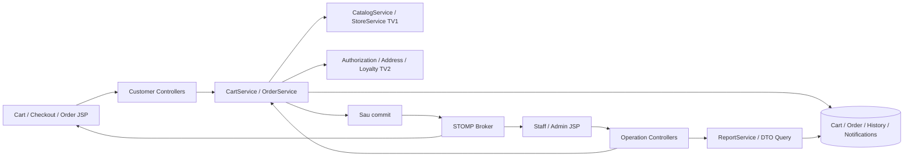
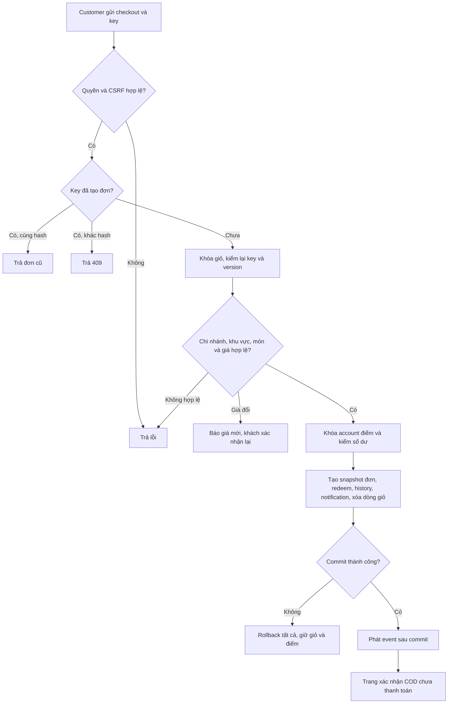

# Nhánh feature/order-payment — Bán hàng, thanh toán và vận hành đơn

## 1. Thông tin nhận việc

| Mục | Giá trị |
| --- | --- |
| Người phụ trách | [CẦN BỔ SUNG] — TV3 |
| Nhánh | feature/order-payment |
| Baseline/commit | [CẦN BỔ SUNG] |
| Use case | UC-ORD-01–08; UC-NOT-01; UC-RPT-01 |
| Trạng thái | Chưa lập trình; hướng dẫn và sơ đồ thiết kế ban đầu |
| Nhật ký AI | [AI_LOG.md](AI_LOG.md) |

Đây là luồng nghiệp vụ chính: **giỏ → đặt hàng → COD → xử lý/hủy/hoàn tất → thu tiền/điểm → theo dõi và báo cáo**. Một người phụ trách đầy đủ dữ liệu/transaction/API/JSP/test/hồ sơ. Không tách thanh toán hoặc realtime cho người khác làm độc lập khi chưa có hợp đồng transaction.

Đọc đặc tả gốc, [baseline](../../COMMON_BASELINE.md), [setup](../../SETUP.md) và hướng dẫn nhánh. Các chức năng khác giữ nguyên; chi nhánh do khách tự chọn, không tính khoảng cách.

## 2. Công việc theo use case

| UC | Công việc từ đầu đến cuối | Minh chứng |
| --- | --- | --- |
| ORD-01 | Nhận variant/sugar/ice/topping → kiểm catalog → tính giá → thêm/gộp giỏ → UI | Món hợp lệ/không hợp lệ, giá gồm topping theo mỗi ly |
| ORD-02 | Session/DB cart → tăng/giảm/xóa → merge sau login → kiểm version/giới hạn | Giỏ cùng/khác chi nhánh, merge retry không nhân đôi |
| ORD-03 | Customer checkout → địa chỉ/khu vực → giá/điểm → idempotency/transaction/snapshot → xác nhận | Checkout thành công, giá thay đổi, submit lặp, rollback |
| ORD-04 | Khách xác nhận COD → UI chưa trả → Staff thu đủ tiền khi hoàn tất → PAID | Tiền phải trả, người/thời điểm thu, thu lặp bị chặn |
| ORD-05 | Notifications DB từng người → event sau commit → UI chuông đơn mới | Đúng chi nhánh, offline đọc lại, rollback không phát |
| ORD-06 | Staff/Admin đọc hàng đợi → chuyển trạng thái hợp lệ/version → history | Không bỏ bước, sai chi nhánh/màn hình cũ bị chặn |
| ORD-07 | Chủ đơn xem detail/timeline → socket user queue → reconnect/polling | Trạng thái mới, sự kiện trùng, tài khoản khác không xem |
| ORD-08 | Lịch sử đơn → hủy PENDING → refund một lần → UI | Hủy/nhận đơn cạnh tranh, đơn cũ giữ snapshot |
| NOT-01 | Inbox/user → đọc/đánh dấu read_at → quyền hiện tại | Đọc độc lập mỗi người, không truy cập inbox khác |
| RPT-01 | Query COMPLETED/PAID → subtotal-discount/phí/thực thu → lọc role/store/date | Số liệu đối chiếu seed, đơn hủy/chưa trả loại khỏi doanh thu |

## 3. Cấu hình, schema và phụ thuộc

- Không đổi baseline Boot/WAR/JSP/SiteMesh/JPA/profile. Owner 8 bảng: carts, cart_items, cart_item_toppings, orders, order_items, order_item_toppings, order_status_history, notifications.
- CatalogService/StoreService từ TV1 cung cấp giá, lựa chọn hợp lệ, trạng thái bán và phí khu vực. Không tự tạo bảng giá hoặc tính khoảng cách.
- CurrentUser/AuthorizationService/AddressService/LoyaltyService/AuditService từ TV2. Không viết lại JWT, quyền hoặc ledger riêng; dịch vụ điểm tham gia transaction của OrderService.
- WebSocket /ws + STOMP same origin và CSRF CONNECT theo baseline. Cấu hình endpoint/broker/security chốt trên main; nhánh này triển khai event/notifications và frontend subscribe.
- Customer /cart/**, /checkout, /orders/**; Staff /staff/orders/**, /staff/reports; Admin /admin/dashboard, /admin/reports; /notifications/**. Không tạo route công khai để tra đơn chỉ bằng orderCode.
- P0 COD; QR/cổng thanh toán vẫn là P1 đã ghi trong đặc tả, không tuyên bố tích hợp khi chỉ hiển thị QR. Thay phạm vi thanh toán phải cập nhật đặc tả và schema qua main.

## 4. Thứ tự triển khai

1. Đồng bộ B0, chốt contract với TV1/TV2; tạo mock chỉ trong test để không chờ UI của nhau.
2. Entity/Repo/DTO và migration giỏ/đơn/history/notifications đúng schema.
3. CartService và session adapter, hash cấu hình gộp dòng, version/merge key; JSP tùy biến/giỏ.
4. Checkout DTO và UI báo giá; server kiểm store/area/variant/toppings/địa chỉ/điểm, trả quote mới khi giá đổi.
5. Transaction chống đơn trùng, khóa đúng thứ tự, snapshot, ledger cùng transaction, xóa giỏ và history/notifications.
6. State machine và cancel/complete/thu COD; optimistic conflict, quyền chi nhánh, ghi điểm đúng một lần.
7. JSP quản lý đơn/detail/timeline/lịch sử; event sau commit, socket authorized, inbox/polling/reconnect.
8. Dashboard/report theo BR-20–21, không tính revenue từ order chưa trả.
9. Chạy AT-01–16; đối chiếu ví dụ 96.000 + 15.000 − 10.000 = 101.000, earn 8 điểm; lưu test/hình/prompt.

## 5. Sơ đồ kiến trúc dự kiến



## 6. Activity checkout dự kiến



Nguồn sơ đồ này là thiết kế, cần bổ sung sơ đồ riêng cho cart merge, thu COD/hoàn tất, hủy/refund, realtime và report theo UC khi có code. Khi xuất hình, ghi commit và điểm khác so với thiết kế ban đầu.

## 7. Hướng dẫn diễn giải code và UI

| Luồng | Code thực cần chụp và giải thích | UI cần chụp | Path/symbol/commit |
| --- | --- | --- | --- |
| Giỏ | Cấu hình hash, gộp, merge session và cart version | Giỏ/options, giới hạn, hết món | [CẦN BỔ SUNG] |
| Checkout | Khóa/idempotency, quote, tính BigDecimal, snapshot, transaction | Địa chỉ/store/area, tiền/điểm, lỗi và success | [CẦN BỔ SUNG] |
| COD/đơn | Transition/permission/version, paid_at, earn/refund | Staff queue/detail, confirm thu tiền, cancel | [CẦN BỔ SUNG] |
| Realtime | After commit, authorized destinations, reconnect | Hai trình duyệt đơn mới/status, inbox | [CẦN BỔ SUNG] |
| Báo cáo | Query trạng thái/thời gian/phạm vi chi nhánh | Dashboard và seed đối chiếu | [CẦN BỔ SUNG] |

Mỗi ảnh code đánh số điểm quan trọng, giải thích đầu vào/đầu ra và vì sao cần kiểm tra. Với transaction, chỉ rõ lỗi nào rollback dữ liệu và vì sao socket lỗi không hủy đơn. Screenshot UI từ ứng dụng chạy thực, không dùng mockup làm bằng chứng.

## 8. Setup và kiểm chứng riêng

Cần seed hai khách, Staff A/B, Admin, món/size/topping/store/area và account điểm. Setup trên cùng profile/config main; mở ít nhất hai phiên trình duyệt: Customer và Staff đúng chi nhánh, thêm Staff chi nhánh khác cho test quyền.

Ghi lệnh thực chạy/test, commit, orderCode thử, trạng thái/payment/ledger trước–sau. Test hai request checkout cùng key, hủy cạnh tranh nhận đơn, complete/thu COD lặp, rollback điểm, subscribe trái quyền và reconnect. Giữ data giả lập, che thông tin người nhận/token trên hình.

## 9. Prompt gợi ý — chưa sử dụng

```text
Đọc UC-ORD-03 và schema UTETra. Làm checkout COD từ Cart DTO đến JSP
trên feature/order-payment, dùng contract TV1/TV2 của main.
Không nhận giá client. Giữ snapshot, checkout_key/request_hash, cart version,
transaction giỏ/đơn/điểm/history/notifications. Nếu quote đổi phải xác nhận lại.
Giải thích code, test replay và rollback; ghi prompt và minh chứng thật vào hồ sơ.
```

```text
Từ code thực UC-ORD-04/06/08 tại <commit>, dựng activity diagram hoàn tất
COD và hủy đơn: quyền, version, PAID, EARN/REFUND đúng một lần.
Chỉ rõ đoạn code cần chụp/callout và trạng thái UI cần minh chứng.
Không vẽ cổng thanh toán hoặc chức năng chưa có; ghi hạn chế hiện tại.
```

## 10. Tiến độ và bàn giao

| UC | Code/test | Diagram/code/UI images | Setup | Prompt thật | Review/commit |
| --- | --- | --- | --- | --- | --- |
| 10 UC được giao, tách mỗi UC thành một dòng khi làm | Chưa | Chưa kiểm chứng | Chưa | Chưa | [điền] |

- [ ] Đủ 10 UC và toàn luồng từ giỏ tới báo cáo.
- [ ] Tiền/điểm/đơn không trùng, không âm, rollback đúng và snapshot giữ lịch sử.
- [ ] HTTP/socket theo chủ đơn và chi nhánh; các contract chạy thật khi ghép.
- [ ] Setup mới chạy được; hình/prompt/test thực đầy đủ theo yêu cầu báo cáo.
- [ ] Giữ chức năng ngoài phần tính khoảng cách theo đặc tả.

Lỗi còn lại/phụ thuộc cần xử lý: [CẦN BỔ SUNG].
