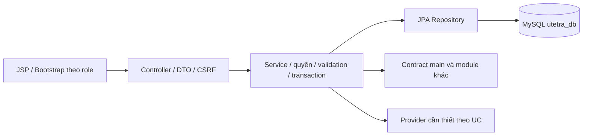

# feature/order-payment — Bán hàng, thanh toán và vận hành mọi role

> Cập nhật theo quy định thầy ngày 13/10/2026. Người phụ trách TV3: [điền tên]. Baseline main/commit: [điền]. Đây là hướng dẫn công việc, không xác nhận mọi UC đã code.

## 1. Các file phải đọc và cấu hình

Đọc QUY_DINH_VA_CAU_HINH_CHUNG, PROJECT_PLAN, DATABASE_DESIGN, USE_CASES, docs/README, COMMON_BASELINE, SETUP và file hướng dẫn ở gốc nhánh. Java21/Boot3.5.13/WAR/JSP/JSTL/SiteMesh3.2.2/Bootstrap5.3.3/MavenWrapper/MySQL utetra_db/JPA/Flyway theo main; không .env, không tự đổi pom/profile/migration/secret. Một template Shop Homepage chung; Vendor có quyền User, Manager theo scope, Admin global.

## 2. Use case, role và công việc

| Mã | Chức năng | Actor | Module owner | Phạm vi | Kết quả kiểm chứng cần đạt |
| --- | --- | --- | --- | --- | --- |
| UC-ORD-01 | Thêm món vào giỏ | Guest, User, Vendor | order-payment | P0 bắt buộc | Validate tùy chọn, gộp đúng cấu hình, topping theo mỗi ly |
| UC-ORD-02 | Sửa/xóa/hợp nhất giỏ | Guest, User, Vendor | order-payment | P0 bắt buộc | Giỏ database cho người đăng nhập, session cho Guest; merge chống lặp |
| UC-ORD-03 | Checkout | User, Vendor | order-payment | P0 bắt buộc | Store/area/carrier/address/quote, server tính giá, snapshot và idempotency |
| UC-ORD-04 | Chọn mã giảm giá | User, Vendor | order-payment | P0 bắt buộc | Scope shop/sản phẩm/thời gian/hạn mức; khóa quota tại checkout |
| UC-ORD-05 | Thanh toán COD | User, Vendor | order-payment | P0 bắt buộc | Khách xác nhận tiền; chỉ người có quyền ghi thu tiền khi giao thành công |
| UC-ORD-06 | Thanh toán VNPAY | User, Vendor | order-payment | P0 bắt buộc | Sandbox URL ký, IPN xác thực số tiền/ref/signature, callback idempotent |
| UC-ORD-07 | Lịch sử và theo dõi đơn | User, Vendor | order-payment | P0 bắt buộc | Đơn mình theo mới/xác nhận/lấy hàng/giao/đã giao/hủy/trả/hoàn |
| UC-ORD-08 | Hủy đơn | User, Vendor | order-payment | P0 bắt buộc | Chỉ NEW cho khách; hoàn điểm, tạo refund nếu đã trả, không refund lặp |
| UC-ORD-09 | Yêu cầu trả hàng–hoàn tiền | User, Vendor | order-payment | P0 bắt buộc | Đơn đã giao, cửa sổ cấu hình, lý do/chứng cứ, theo dõi kết quả thật |
| UC-ORD-10 | Realtime và hộp thông báo | Người đăng nhập | order-payment | P0 bắt buộc | Lưu người nhận riêng, after commit, quyền subscribe, reconnect/polling |
| UC-VND-04 | Quản lý đơn shop | Vendor | order-payment | P0 bắt buộc | Shop mình, chuyển trạng thái hợp lệ/version, có bước PICKED_UP |
| UC-VND-06 | Doanh thu shop | Vendor | order-payment | P0 bắt buộc | Hàng hóa/phí/hoa hồng/hoàn/net tách riêng, filter shop/date |
| UC-VND-07 | Xử lý yêu cầu trả hàng | Vendor | order-payment | P0 bắt buộc | Chấp nhận/từ chối có lý do theo shop; refund qua dịch vụ chung |
| UC-MGR-04 | Chiết khấu app cho shop | Manager | order-payment | P0 bắt buộc | Tỷ lệ/policy shop được giao, không đổi snapshot đơn cũ |
| UC-MGR-06 | Nhà vận chuyển và phí | Manager | order-payment | P0 bắt buộc | Tên/phí và biểu phí khu vực trong phạm vi được cấp, không tính kilomet |
| UC-MGR-08 | Đơn, trả hàng và hoàn tiền | Manager | order-payment | P0 bắt buộc | Kiểm quyền shop, transition/transaction/refund/audit |
| UC-MGR-09 | Báo cáo cửa hàng | Manager | order-payment | P0 bắt buộc | Doanh thu/net/hoàn theo phạm vi shop được giao |
| UC-ADM-04 | Chiết khấu app cho shop | Admin | order-payment | P0 bắt buộc | Policy hoa hồng toàn app/shop, tỷ lệ snapshot và ledger doanh thu |
| UC-ADM-06 | Nhà vận chuyển/phí | Admin | order-payment | P0 bắt buộc | CRUD carrier/rate toàn hệ thống; audit và giữ phí đơn đã chốt |
| UC-ADM-08 | Đơn/giao dịch/trả–hoàn | Admin | order-payment | P0 bắt buộc | Tra cứu, đối soát, refund có chứng cứ, không giả PAID/REFUNDED |
| UC-ADM-09 | Báo cáo toàn hệ thống | Admin | order-payment | P0 bắt buộc | Giá trị thu, hoàn, hoa hồng và shop net đối chiếu được |
| UC-SHP-01 | Đơn giao được phân công | Shipper | order-payment | P1 thêm | Phần thêm, chỉ assignment còn hiệu lực |
| UC-SHP-02 | Cập nhật giao hàng | Shipper | order-payment | P1 thêm | Phần thêm, lấy/giao/thất bại/COD theo assignment, không tự refund |
| UC-SHP-03 | Thống kê giao hàng | Shipper | order-payment | P1 thêm | Phần thêm, thống kê đúng đơn giao cho mình |

Mỗi UC do một người làm đủ Entity/Repo/DTO → Service → Controller → JSP/JS → kiểm thử → hồ sơ. Viết báo cáo tách phần actor/role của từng UC, không chỉ tên module. Chọn chi nhánh thủ công; không loại các chức năng OTP/voucher/refund/review/carrier của thầy.

## 3. Schema, contract và phụ thuộc

Owner các bảng: carts, cart_items, cart_item_toppings, orders, order_items, order_item_toppings, order_status_history, notifications, coupon_redemptions, commission_policies, carriers, carrier_area_rates, payment_transactions, payment_callback_events, return_requests, refund_transactions, store_settlements, delivery_assignments, delivery_events. Chỉ V1 identity đã có trong baseline; bảng khác theo schema thiết kế và migration main mới, không tự tạo cấu trúc khác.

Contract: CartService, OrderService, PaymentService, RefundService, ReportService, NotificationService. Phụ thuộc: Giá/store/promo TV1, quyền/address/loyalty/audit TV2; COD + VNPAY, carrier/commission/settlement, STOMP và Shipper thêm. Signature/DTO/error/transaction/locking phải chốt trên main trước khi ghép; mock chỉ trong test. Không viết lại giá/điểm/auth/payment service của owner khác.

## 4. Thứ tự thực hiện từng UC

1. Merge main, ghi baseline/role/UC, đọc tiền điều kiện/BR/acceptance và dependency.
2. Chốt activity/sequence và schema/DTO/permission; đề xuất migration vào main.
3. Entity/Repository/query/DTO → Service validation/quyền/transaction/idempotency.
4. Controller route/error/CSRF → JSP/Bootstrap/JS loading/empty/error theo cùng template.
5. Chạy test luồng chính/lỗi/quyền/cạnh tranh/callback/media theo UC; đọc kết quả thật.
6. Ghi code path/symbol/commit, chụp code có chú giải và UI chạy thật; xuất sơ đồ có nguồn.
7. Điền setup/demo/data/profile, prompt nguyên văn/response/nhóm sửa/test; review/commit.

## 5. Kiến trúc dự kiến của module



Sơ đồ này là khung kiến trúc dự kiến. Mỗi UC phải có activity/sequence riêng từ code thực và xuất ảnh PNG/SVG; không dùng một hình generic thay tất cả UC trong báo cáo cuối.

## 6. Chỗ ghi minh chứng và tiến độ

| UC/role | Path/symbol/commit | Activity/sequence/ảnh code/UI | Config/setup/data | Prompt/response | Test/reviewer/trạng thái |
| --- | --- | --- | --- | --- | --- |
| UC-ORD-01 / Guest, User, Vendor | [điền] | [chưa có] | [điền] | [điền] | Chưa triển khai |
| UC-ORD-02 / Guest, User, Vendor | [điền] | [chưa có] | [điền] | [điền] | Chưa triển khai |
| UC-ORD-03 / User, Vendor | [điền] | [chưa có] | [điền] | [điền] | Chưa triển khai |
| UC-ORD-04 / User, Vendor | [điền] | [chưa có] | [điền] | [điền] | Chưa triển khai |
| UC-ORD-05 / User, Vendor | [điền] | [chưa có] | [điền] | [điền] | Chưa triển khai |
| UC-ORD-06 / User, Vendor | [điền] | [chưa có] | [điền] | [điền] | Chưa triển khai |
| UC-ORD-07 / User, Vendor | [điền] | [chưa có] | [điền] | [điền] | Chưa triển khai |
| UC-ORD-08 / User, Vendor | [điền] | [chưa có] | [điền] | [điền] | Chưa triển khai |
| UC-ORD-09 / User, Vendor | [điền] | [chưa có] | [điền] | [điền] | Chưa triển khai |
| UC-ORD-10 / Người đăng nhập | [điền] | [chưa có] | [điền] | [điền] | Chưa triển khai |
| UC-VND-04 / Vendor | [điền] | [chưa có] | [điền] | [điền] | Chưa triển khai |
| UC-VND-06 / Vendor | [điền] | [chưa có] | [điền] | [điền] | Chưa triển khai |
| UC-VND-07 / Vendor | [điền] | [chưa có] | [điền] | [điền] | Chưa triển khai |
| UC-MGR-04 / Manager | [điền] | [chưa có] | [điền] | [điền] | Chưa triển khai |
| UC-MGR-06 / Manager | [điền] | [chưa có] | [điền] | [điền] | Chưa triển khai |
| UC-MGR-08 / Manager | [điền] | [chưa có] | [điền] | [điền] | Chưa triển khai |
| UC-MGR-09 / Manager | [điền] | [chưa có] | [điền] | [điền] | Chưa triển khai |
| UC-ADM-04 / Admin | [điền] | [chưa có] | [điền] | [điền] | Chưa triển khai |
| UC-ADM-06 / Admin | [điền] | [chưa có] | [điền] | [điền] | Chưa triển khai |
| UC-ADM-08 / Admin | [điền] | [chưa có] | [điền] | [điền] | Chưa triển khai |
| UC-ADM-09 / Admin | [điền] | [chưa có] | [điền] | [điền] | Chưa triển khai |
| UC-SHP-01 / Shipper | [điền] | [chưa có] | [điền] | [điền] | Chưa triển khai |
| UC-SHP-02 / Shipper | [điền] | [chưa có] | [điền] | [điền] | Chưa triển khai |
| UC-SHP-03 / Shipper | [điền] | [chưa có] | [điền] | [điền] | Chưa triển khai |

Ghi setup thực và thao tác demo theo role; lỗi/vấn đề còn lại ở cuối từng UC note. Không chụp secret/config password vào báo cáo. Phản hồi dài lưu ai-responses/<ID>.md; ảnh/source lưu assets/<UC-ID>. Không bịa test pass hoặc ảnh chạy.

## 7. Prompt mẫu — chưa sử dụng

```text
Đọc toàn bộ quy định/baseline UTETra và hướng dẫn nhánh hiện tại.
Triển khai <UC-ID> từ Entity/Repo/DTO tới Service/Controller/JSP/test.
Giữ MySQL utetra_db, stack và contract main. Actor/scope/OTP/payment/media
phải đúng đặc tả; không tự bỏ chức năng hoặc đổi framework.
Ghi prompt thật, phản hồi, code/ảnh/setup/commit, phần nhóm sửa và kiểm chứng
vào AI_LOG và hồ sơ UC. Sơ đồ dự kiến và ảnh UI thật phải phân biệt.
```

## 8. Checklist bàn giao

- [ ] Đủ UC/role được giao; cả luồng chính/lỗi và quyền dữ liệu.
- [ ] Cấu hình/DDL/DTO/contract đúng main; provider thiếu ghi rõ.
- [ ] Có kiến trúc/activity/sequence, hình code/UI chú giải, setup và test thật.
- [ ] Prompt nguyên văn/response/nhóm sửa/commit/reviewer đầy đủ.
- [ ] Ghép integration cùng owner dependency; kiểm chức năng chung theo thang điểm.
