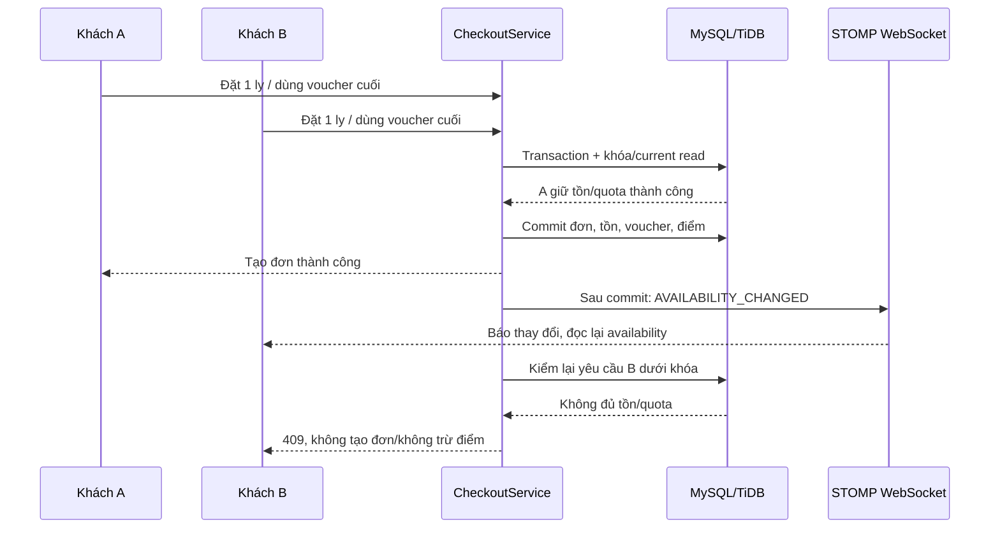

# JWT lưu DB, tồn kho và voucher đồng thời, WebSocket checkout

> Trạng thái mới nhất sau lượt kiểm yêu cầu đầy đủ: [FINAL_REQUIREMENTS_STATUS](../../FINAL_REQUIREMENTS_STATUS.md). VNPAY đã có adapter/test nhưng chưa merchant thật; carrier Manager theo shop đã bổ sung. Các kết luận theo snapshot/lượt kiểm cũ bên dưới giữ để tra lịch sử.

Ngày 24/10/2026, triển khai trên `integration/utetra`, chưa commit/push. Đây là chức năng nghiệp vụ thật, không coi việc khai báo dependency là đã hoàn thành tiêu chí sáng tạo.

## 1. Những gì đã có và bổ sung

- JWT trước đây đã xác minh chữ ký và kiểm phiên/role trong DB, refresh token được băm trong `auth_sessions`. Bản này lưu thêm **JTI, SHA-256 hash của access JWT và hạn dùng** vào chính phiên đó.
- Phiếu giảm giá đã có scope, điều kiện, hạn mức tổng/mỗi người, đặt chỗ RESERVED, USED/RELEASED và khóa khi checkout. Bản này thêm thông báo thay đổi quota cho các checkout và test quota GLOBAL giữa hai shop khác nhau.
- WebSocket trước đây phục vụ đơn/thông báo. Bản này thêm realtime tồn kho/voucher tại checkout và polling dự phòng.
- Trước đây sản phẩm/size chỉ bật/tắt bán. Bản này có **số ly còn nhận đơn theo size**, giữ tồn khi checkout và hoàn tồn khi hủy trước chuẩn bị.
- COD và QR chuyển khoản Techcombank thủ công vẫn hoạt động. **Chưa có ví điện tử hoặc gateway VNPAY/MOMO**; QR ngân hàng không được ghi thành tích hợp ví điện tử.

Các ví dụ JWT/voucher/WebSocket là minh chứng cho tiêu chí sáng tạo, không tự động bảo đảm trọn điểm. Nếu thầy yêu cầu cổng online cụ thể, nhóm vẫn cần hoàn thiện cổng đó.

## 2. Phân biệt WebSocket và chống mua vượt tồn

**DB quyết định ai đặt thành công; WebSocket chỉ báo thay đổi sau commit.** Không giảm tồn bằng biến JavaScript, không để client gửi sự kiện socket tự xác nhận mua/trả tiền và không dựa vào số còn hiển thị ở trình duyệt.



Thứ tự người thắng phụ thuộc thứ tự xử lý/khóa thực tế, không ưu tiên tên A. Ngay cả khi B chưa nhận được socket hoặc cố gửi lại request cũ, checkout vẫn phải từ chối nếu DB không còn đủ tồn/quota.

## 3. JWT lưu trong DB

Migration `V2026102402__jwt_inventory.sql` bổ sung vào `auth_sessions`:

- `access_token_id`: mã JTI của JWT đang hoạt động.
- `access_token_hash`: SHA-256 hash của toàn bộ access token; không lưu bearer token nguyên văn.
- `access_expires_at`: hạn access token.

`JwtService.issue` đăng ký fingerprint thông qua `AccessTokenRegistry` trong transaction. HTTP filter vừa xác minh chữ ký/claims, vừa kiểm phiên, JTI/hạn dùng/hash và role/account hiện tại trong DB. WebSocket giữ principal có JTI để kiểm lại với DB khi subscribe/gửi dữ liệu và khi dọn phiên.

Mỗi login tạo một session riêng; mỗi session có một access JWT hiện hành. Refresh quay vòng refresh token và thay access JTI/hash, vì vậy JWT access cũ của session đó bị từ chối ngay. Logout/reset/khóa/đổi quyền vẫn dùng `revoked_at` và cơ chế thu hồi đã có. Không đưa token/hash/refresh secret ra DTO nghiệp vụ hoặc nhật ký báo cáo.

**Nâng cấp:** session cũ chưa có access metadata không được tiếp tục dùng access JWT cũ. Đăng nhập lại (hoặc refresh hợp lệ theo luồng auth) để có JWT được đăng ký. Không sửa tay metadata token vào DB.

Source: `repository/AccessTokenRegistry`, `security/JwtService`, `JwtAuthenticationFilter`, `UtetraPrincipal`, `entity/AuthSession`, `service/SessionIdentityService`.

## 4. Tồn kho theo size

`product_variants.stock_quantity` là **số ly còn có thể nhận đơn**:

- `NULL`: chưa bật quản lý số lượng hữu hạn cho size đó; giữ tương thích sản phẩm/fixture cũ, không tự đoán tồn bằng 0.
- `0`: hết lượt nhận cho size.
- Số dương: có thể đặt tối đa số còn lại, đồng thời vẫn tuân thủ giới hạn giỏ/đơn.

Vendor/Manager/Admin có quyền shop mở quản lý sản phẩm, nhập trường **Số ly còn nhận size S/M/L**. Bỏ trống giữ tồn hiện tại; size mới chưa nhập sẽ chưa theo dõi hữu hạn. Không cho client cũ bỏ trường stock làm mất tồn đã cấu hình.

Payload size mở rộng:

```json
{"sizeName":"M","extraPrice":5000,"active":true,"stockQuantity":10,"stockVersion":3}
```

`stockVersion` lấy từ `variants[].version` của dữ liệu mới tải. Nó khác `ProductInput.version` của sản phẩm. Backend kiểm version khi chỉnh tồn và JPA optimistic lock bắt xung đột phát sinh sau khi đọc. Một form cũ không được ghi đè lượng tồn đã bị checkout giảm. Input tồn/version phải là số nguyên hợp lệ.

Checkout cộng số lượng theo **variant ID**, kể cả nhiều dòng đường/đá/topping khác nhau. Trong transaction READ_COMMITTED, khóa và cập nhật có điều kiện `stock_quantity >= quantity`, sau đó tạo order/items, điểm và redemption. Nếu bất kỳ bước nào lỗi thì rollback cả tồn/đơn/điểm/voucher; không gửi sự kiện thành công trước commit. Retry cùng checkout UUID trả lại đơn cũ, không giữ tồn lần hai.

`order_items.stock_reserved` ghi size có giữ tồn hữu hạn. Hủy khi NEW/CONFIRMED hoàn tồn một lần trong cùng transaction; từ PICKED_UP trở đi coi đã vào chuẩn bị/giao, không tự đưa đồ uống trở lại số có thể bán. Trả/hoàn sau giao cũng không tự restock đồ uống đã pha. Tồn topping/nguyên liệu vẫn là trạng thái sẵn bán, chưa phải hệ thống định lượng nguyên liệu.

Source: `OrderInventoryService`, `CheckoutService`, `OrderWorkflowService`, `ProductVariant`, `OrderItem`, `CatalogService`, DTO Catalog và `catalog-management.js`.

## 5. Voucher cuối và realtime

- Khóa dòng promotion trước khi kiểm quota; đếm redemption bằng current locking read, tính cả RESERVED/USED. Có kiểm cả quota tổng và của người mua.
- Đơn mới giữ quota; giao thành công chuyển USED. Hủy/hoàn theo nghiệp vụ chuyển RELEASED và báo availability thay đổi. Giữ nguyên snapshot tiền giảm trên đơn đã tạo.
- Voucher GLOBAL có thể được dùng ở nhiều shop; khóa promotion chung đảm bảo hai shop không cùng chiếm suất cuối. Thông báo quota đi qua topic chung để các shop đều biết thay đổi.
- Đơn chờ chuyển khoản vẫn giữ tồn/quota cho đến khi được xử lý hoặc hủy; bản này chưa có job tự hết hạn đơn chuyển khoản. Admin cần xử lý đơn chờ theo quy trình vận hành, không khẳng định đã có TTL tự giải phóng.

Topic mới:

- `/topic/stores/{storeId}/checkout`: thay đổi tồn theo shop.
- `/topic/checkout/promotions`: thay đổi quota/chương trình khuyến mãi.

Payload chỉ có `type`, event ID, variant IDs và promotion IDs; **không có user, đơn, địa chỉ, reference ngân hàng hoặc nội dung riêng**. Chỉ người đã xác thực/phiên còn hiệu lực được subscribe; quyền các topic order riêng/admin/shop vẫn giữ nguyên. Client không được gửi mutation qua STOMP.

`CheckoutAvailabilityEvents` chỉ publish sau commit. Broker lỗi không biến đơn đã commit thành lỗi mua hàng; có polling và kiểm DB ở server. Simple broker hiện phục vụ một instance ứng dụng; không khẳng định đã có broker cluster/multi-instance.

`GET /checkout/availability` trả dữ liệu giỏ của người hiện hành: stock, số lượng trong giỏ, lượt voucher còn lại và revision. Checkout nghe socket rồi đọc endpoint này; khi revision đổi sẽ hủy hiệu lực báo giá đang xem, cập nhật lượt voucher và buộc xem lại báo giá. Có polling 15 giây và đọc lại khi quay lại tab để phục hồi khi mất socket/qua thời điểm hết hạn voucher. Availability là thông tin tham khảo, không phải giữ chỗ; chỉ checkout transaction mới giữ chỗ.

## 6. Kiểm chứng và cách demo

Kết quả thực ngày 24/10/2026:

- **Maven `verify` đạt 153 tests, 0 failures/errors/skipped**, build WAR thành công; log `.local/realtime-jwt-final-20261024.log`, Surefire XML trong target. Lượt clean verify trước đó đạt 152; sau bổ sung regression form stock cũ, lượt verify cuối đạt 153. Không đổi Java nghiệp vụ sau kết quả cuối.
- Playwright/Edge + Tomcat/SiteMesh/STOMP thật, fixture H2 riêng: **3 kịch bản browser đạt**, nhận **4 frame availability**, không lỗi JavaScript. Đơn của người khác làm báo giá bị vô hiệu/voucher hết lượt; hủy trước chuẩn bị trả tồn và quota; Vendor có ô tồn theo size. Lượt đo local H2 quan sát cập nhật sau khoảng 242 ms, không phải cam kết độ trễ production. [Kết quả browser](assets/realtime-20261024/verification.json).
- Đã kiểm ảnh desktop/mobile: [trước checkout cạnh tranh](assets/realtime-20261024/checkout-before-desktop.png), [voucher hết lượt](assets/realtime-20261024/checkout-voucher-exhausted-desktop.png), [trả tồn/quota trên mobile](assets/realtime-20261024/checkout-release-mobile.png), [Vendor chỉnh tồn](assets/realtime-20261024/vendor-stock-mobile.png). Đây là UI thật dùng dữ liệu thử, không phải giao dịch khách hàng thật.
- WAR chạy với TiDB `utetra_db`, Hibernate validate đạt, Flyway validate **8 migration** và áp dụng `2026102402`. [6 HTTP smoke checks](assets/realtime-20261024/native-http-checks.json) kiểm endpoint/tài nguyên bản đóng gói và chặn availability chưa đăng nhập; chưa chạy cạnh tranh tạo đơn trên cloud.
- Shared UI checker so main đạt; `git diff --check` và Node syntax check ba JS thay đổi đạt. Không đổi bộ 16 file layout/theme dùng chung.
- Lượt đầu phát hiện fixture cũ tạo principal thiếu JTI và helper INSERT ghi NULL thay vì dùng default mới; đã sửa fixture dùng JWT đăng ký thật và danh sách cột tường minh. Regression stock dùng giá nguyên VND đúng DTO; không tắt test hay nới assertion để build đạt.

Các kiểm tra cạnh tranh/rollback là integration test H2. Startup/migration/HTTP TiDB không thay kiểm tra tranh tồn/quota trên TiDB có dữ liệu demo. Không seed cloud, không tạo giao dịch ngân hàng/ví thật, không push.

**Bàn giao cho các nhánh:** merge source mới từ integration trước khi chạy chung DB hoặc demo đồng thời. Code cũ chưa biết stock/JTI mới có thể không áp dụng cùng quy tắc; không chỉ copy file migration hoặc JS sang nhánh khác rồi coi đã đồng bộ nghiệp vụ. Agent nhánh đọc DTO `stockQuantity/stockVersion`, schema và luồng JWT trong file này.

Các tình huống cần giữ trong báo cáo:

1. Stock = 1, hai User khác nhau đặt đồng thời: đúng một order thành công, stock = 0; người còn lại không mất điểm/quota/giỏ do checkout thất bại.
2. Một voucher còn một lượt, hai User đồng thời: đúng một redemption RESERVED; kiểm cả voucher GLOBAL ở hai shop.
3. Nhiều dòng cùng size nhưng khác đường/đá: cộng tổng để kiểm tồn, không kiểm riêng từng dòng rồi bán vượt tồn.
4. Checkout lỗi điểm/voucher sau giữ tồn: stock/đơn cùng rollback, không phát tín hiệu commit giả.
5. Hủy trước chuẩn bị: trả tồn một lần; hủy sau chuẩn bị không tự restock đồ uống.
6. Form quản lý mở trước khi khách mua: không ghi đè tồn bằng version cũ.
7. JWT có metadata DB; refresh làm JWT cũ bị từ chối; logout thu hồi phiên/socket.
8. Hai trình duyệt đang checkout: một người dùng suất cuối, người còn lại nhận socket, báo giá cũ bị vô hiệu và voucher hiển thị hết lượt. Giữ test server ngay cả khi cố tắt JavaScript hoặc gửi lại request.

Không seed/reset DB cloud để làm minh chứng. Dùng fixture H2/DB demo riêng, ghi đúng môi trường, sau đó nhóm kiểm thêm trên MySQL/TiDB với dataset đã chuẩn bị. Không gọi đây là giao dịch ví điện tử thật.
