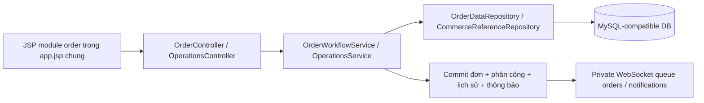
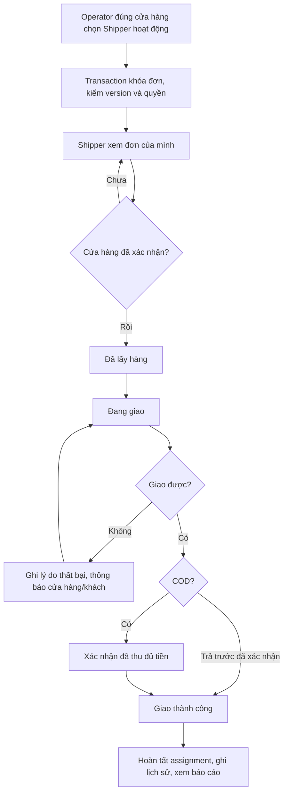
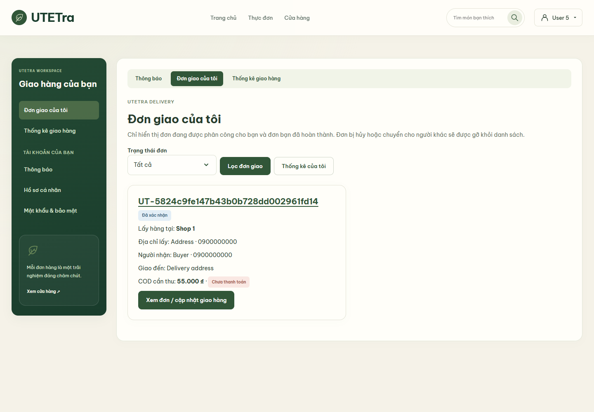
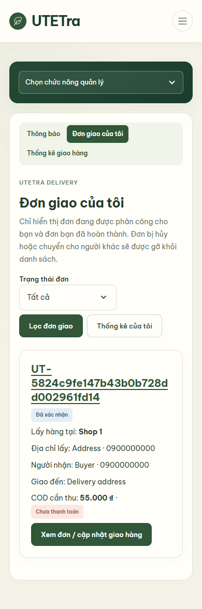
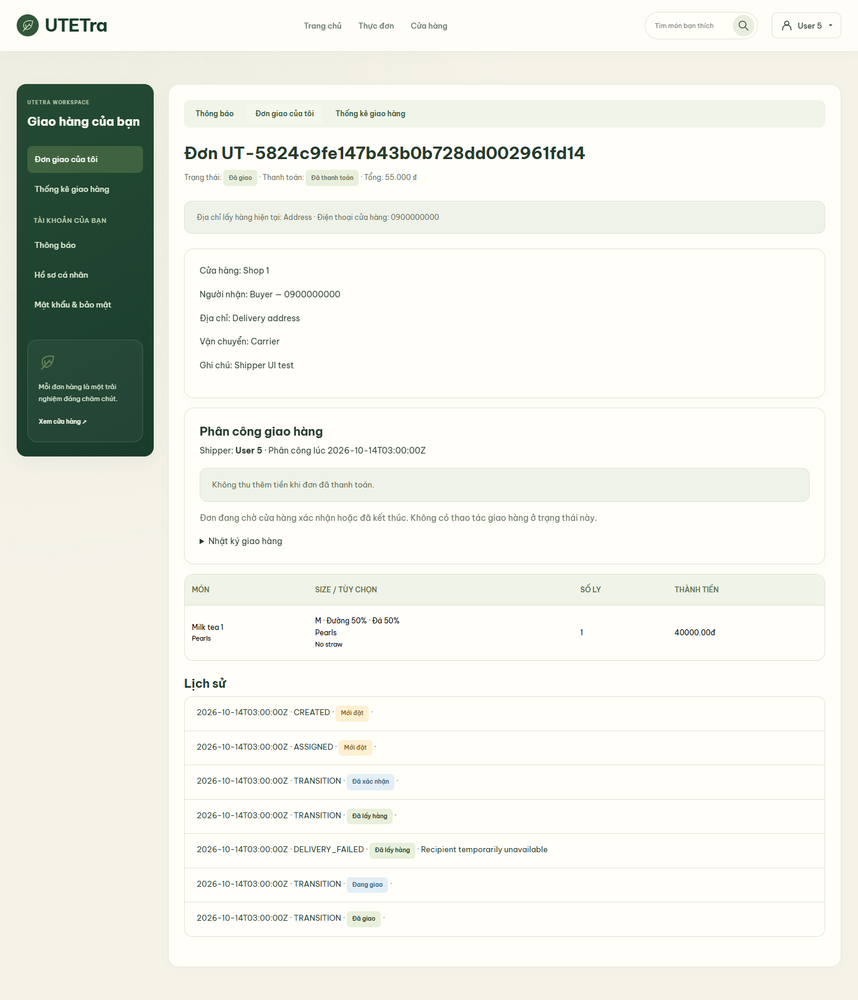
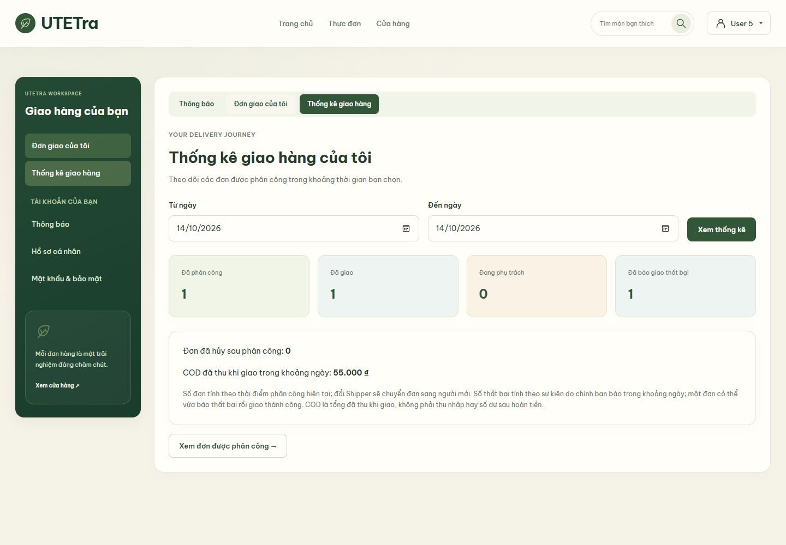

# Hoàn thiện vai trò Shipper — 28/10/2026

Prompt nguyên văn: `bạn hoàn thiện đầy đủ cho role shiper đi`

## Phạm vi và cấu hình

Thực hiện trên `feature/order-payment`, sau khi merge `integration/utetra` tại `57c6b88` bằng merge commit `9d6b553`. Không refactor DB theo 3NF trong tác vụ này.

`src/main/resources/application.properties`: `features.shipper.enabled=true`. Giữ Java 21, Spring Boot, Spring Security/JWT, JSP/JSTL, một SiteMesh layout `app.jsp`, Bootstrap và theme hiện có. Không thay datasource/provider. Dùng các bảng hiện có, không thêm bảng/migration.

Admin vào `/admin/users`, chọn người dùng đã xác minh email, cấp vai trò **Nhân viên giao hàng** và để tài khoản hoạt động. Thay quyền sẽ thu hồi phiên; Shipper cần đăng nhập lại. Không tạo mật khẩu mặc định hay tài khoản cloud tự động.

## Quy trình demo từ đầu đến cuối

1. Khách hàng tạo đơn COD hoặc thanh toán trước; cửa hàng mở trang chi tiết đơn.
2. Vendor đúng cửa hàng, Manager đúng chi nhánh hoặc Admin chọn Shipper từ danh sách tài khoản hoạt động/đã xác minh. Không nhập ID thủ công nữa; backend kiểm tra lại tài khoản khi lưu. Phân công lại cho cùng người đang phụ trách không tạo thêm nhật ký hoặc đổi ngày phân công.
3. Shipper mở `/shipper/orders`. Thẻ đơn có mã đơn, cửa hàng lấy hàng, địa chỉ/điện thoại cửa hàng hiện tại, người nhận, điện thoại, địa chỉ và COD còn phải thu. Có lọc trạng thái và phân trang 20 đơn.
4. Đơn `NEW` chỉ được xem, đợi cửa hàng xác nhận. Shipper chỉ chuyển lần lượt `CONFIRMED → PICKED_UP → DELIVERING → DELIVERED`; không bỏ bước hoặc đảo trạng thái.
5. Khi đã lấy hàng/đang giao có thể báo giao thất bại kèm lý do. Ghi `delivery_events` và lịch sử đơn; trạng thái giao hiện tại được giữ để giao lại hoặc cửa hàng xử lý. Báo thất bại không tự hủy, không tự hoàn tiền.
6. Đơn COD phải đánh dấu đã thu đủ tiền trước khi giao thành công. Đơn trả trước phải có xác nhận thanh toán hợp lệ và không thu thêm. Thành công cập nhật giao hàng, thanh toán COD, điểm, doanh thu và assignment trong transaction nghiệp vụ sẵn có.
7. Shipper xem lại đơn đã giao nhưng không thể sửa trạng thái hoặc báo thất bại. Khi đổi Shipper hoặc hủy phân công, người cũ mất quyền đọc/thao tác; không giữ địa chỉ người nhận trong danh sách của người cũ.
8. `/shipper/reports?from=YYYY-MM-DD&to=YYYY-MM-DD` thống kê của chính người đăng nhập. Khoảng ngày hợp lệ tối đa chênh lệch 365 ngày, dùng múi giờ Việt Nam.

## Cách hiểu thống kê

- Đã phân công/hoàn thành/đang phụ trách/đã hủy: tính theo **ngày phân công hiện tại** của assignment. Đổi Shipper chuyển assignment sang người mới; báo cáo không phải lịch sử toàn bộ lượt phân công trước đây.
- Giao thất bại: số assignment có ít nhất một sự kiện thất bại do chính Shipper báo trong khoảng ngày. Một đơn có thể báo thất bại rồi giao thành công nên các chỉ số không loại trừ nhau.
- COD đã thu khi giao: tổng tiền đơn COD có `payment_confirmed_by` là Shipper và `paid_at` nằm trong khoảng ngày. Đây là tổng đã thu, không phải lương/thu nhập hoặc số dư cần nộp sau hoàn tiền. COD do operator xác nhận không gán cho Shipper.
- Dùng SQL aggregate thay vì nạp tối đa 10.000 assignment rồi đếm. Không xuất số liệu giả khi chưa có đơn.

## Kiến trúc và sơ đồ hoạt động





Sơ đồ là Mermaid do agent soạn, chưa được xuất thành PNG trong tài liệu này. Khi ghép DOCX cần render sơ đồ thành hình và bổ sung hình giải thích mã nguồn có chú thích.

## Nguồn và quyền

- `OrderController`: route danh sách/chi tiết/thao tác dùng principal hiện hành, CSRF và DTO validation; chọn `order/shipper-list.jsp` cho Shipper.
- `OrderWorkflowService`: kiểm role hiện tại, feature flag, assignment, state machine, version; danh sách dùng `exists` theo assignment để tránh nạp trước 10.000 ID; `availableShippers` chỉ cho operator của đơn.
- `OperationsService.shipperReport`: kiểm Shipper, ngày, truy vấn tổng hợp theo user ID từ principal.
- `order/detail.jsp`: cùng trang chi tiết hiện có; hiển thị assignment/nhật ký và ẩn thao tác không được phép. Ẩn menu không thay quyền server.
- `order/shipper-list.jsp`, `order/shipper-report.jsp`: nội dung module trong layout dùng chung, responsive bằng Bootstrap; xuất dữ liệu người dùng qua `c:out`.
- `delivery_assignments`: người phụ trách hiện tại; `delivery_events`: nhật ký; `orders` và `order_status_history`: trạng thái nghiệp vụ và lịch sử; không tạo cấu trúc DB mới.
- WebSocket private queue sẵn có báo cập nhật sau commit; trang/JSON đọc DB mới quyết định trạng thái, không cho client tự gửi trạng thái qua socket.

## Chạy kiểm tra

```powershell
py -3 tools/run_verify.py
py -3 tools/check_shared_ui.py
py -3 tools/check_all_ui.py --shipper
py -3 tools/check_all_ui.py --shopping
```

Tool UI dùng H2 cô lập ở `127.0.0.1:8882` và tự dừng server do nó mở. Không seed/reset DB cloud, không giao hàng hoặc thu tiền thật. Hình/JSON Shipper được ghi trong `.local/shipper-ui/`; bản minh chứng được lưu tại `docs/demo/shipper-20261028/`, xem kết quả thực bên dưới.

## Việc cần nhóm làm trên môi trường báo cáo

- Admin chuẩn bị tài khoản Shipper thật của nhóm đã kích hoạt email và cấp role đúng.
- Chuẩn bị đơn demo và phân công từ đúng cửa hàng; kiểm vận hành trên datasource máy báo cáo.
- Quy trình nộp tiền COD ngoài hệ thống, giao hàng thực và sao kê/hoàn ngân hàng vẫn cần người phụ trách xác nhận; không xem checkbox COD là bằng chứng ngân hàng.
- Thành viên ghi tên/MSSV, ảnh minh chứng và diễn giải phần mã nguồn của mình khi tổng hợp DOCX.


## Kết quả kiểm chứng thực tế

- Maven `clean verify` lượt cuối: **214 tests, 0 failures/errors/skipped**, WAR build thành công.
- Shared UI checker: **một layout, 21 file chung**, không tạo template/layout thứ hai.
- **4 kịch bản Shipper browser** trên Tomcat/SiteMesh/H2: quyền chưa được giao, phân công qua dropdown, bước giao/failure/COD và terminal read-only; danh sách/chi tiết/report ở 1440px và 390px.
- **18 kịch bản shopping browser** đạt sau khi sửa điều kiện chờ navigation/header badge trong test harness; không đổi logic giỏ hàng chỉ để làm test qua.
- Test mới kiểm directory tài khoản hoạt động/quyền operator, phân công cùng người không tạo event lặp, thu hồi quyền khi khóa user, COD chưa thu thì rollback và báo cáo đúng ngày/user.
- Trong kiểm UI đã phát hiện mã đơn dài gây tràn ngang mobile; sửa bằng Bootstrap `text-break`, chạy lại Shipper đạt. Không bỏ assertion responsive để né lỗi.
- Máy chủ UI cô lập do tool mở đã tự dừng. Không kiểm nhận/giao hàng thật, không ghi dữ liệu DB cloud.

Minh chứng: [test-summary.json](../../demo/shipper-20261028/test-summary.json), [Shipper verification](../../demo/shipper-20261028/verification.json), [shopping verification](../../demo/shipper-20261028/shopping-verification.json).








