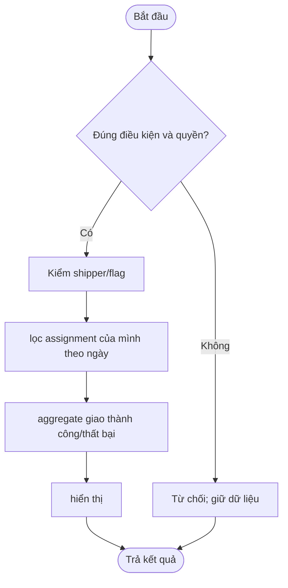

# UC-SHP-03 — Thống kê giao hàng

> Cập nhật 28/10/2026 trên nhánh order: Shipper đã bật trong cấu hình, giao diện và quy trình kiểm chứng tại [SHIPPER_COMPLETION_20261028.md](../SHIPPER_COMPLETION_20261028.md). Các đoạn kế hoạch/kiểm thử cũ bên dưới là lịch sử; dùng hướng dẫn mới cho demo hiện tại.

> Actor: Shipper. Owner: feature/order-payment. P1 thêm. Đặc tả ban đầu được giữ để đối chiếu; kết quả triển khai và kiểm chứng thực tế ở phần hồ sơ bên dưới.

## Đặc tả chức năng

Mục tiêu và điều kiện nghiệm thu: Phần thêm, thống kê đúng đơn giao cho mình.

Nguồn: [Danh mục và BR](../../../../USE_CASES.md), [từ điển dữ liệu](../../../../DATABASE_DESIGN.md), [quy định chung](../../../QUY_DINH_VA_CAU_HINH_CHUNG.md). Nền và contract: [COMMON_BASELINE](../../../COMMON_BASELINE.md).

- Kích hoạt: actor chọn chức năng thống kê giao hàng trên giao diện hoặc gọi route tương ứng.
- Tiền điều kiện: nền main đã đồng bộ; bảng cần dùng có migration đã review; dữ liệu tham chiếu tồn tại. Public chỉ đọc dữ liệu được duyệt; thao tác bảo vệ cần tài khoản active/verified, phiên hợp lệ và đúng phạm vi.
- Đầu vào: date range, paging. ID và số tiền từ client không thay thế kiểm quyền/tính toán phía server.
- Dữ liệu: `delivery_assignments, delivery_events, orders`. Ngoài ba bảng identity V1, đây là các bảng cần triển khai, chưa được xem là đã có.
- Contract dự kiến: `DeliveryService/ReportService`; route dự kiến: `/shipper/reports`. Chốt DTO/signature và migration trên main trước khi code; không tự tạo Service trùng chức năng module khác.
- Hậu điều kiện thành công: đạt điều kiện nghiệm thu nêu trên; trạng thái và dữ liệu nhất quán, trả DTO/view đã escape. GET không thay đổi dữ liệu nghiệp vụ; ghi nhiều bảng phải có transaction và kiểm quyền trước ghi.
- Hậu điều kiện thất bại: không ghi dở/mất dữ liệu; lỗi validation/quyền/version rõ ràng; provider thất bại có pending/retry hoặc lỗi thật, không giả thành công.

### Luồng chính

1. Kiểm shipper/flag.
2. lọc assignment của mình theo ngày.
3. aggregate giao thành công/thất bại.
4. hiển thị.

### Sơ đồ hoạt động dự kiến

Sơ đồ mô tả luồng thiết kế; các nhánh lỗi/cạnh tranh cụ thể ở mục tiếp theo. Cập nhật theo code thực và xuất ảnh khi lập báo cáo.

### Luồng thay thế, lỗi và cạnh tranh

Không xem người khác; date sai; reassign không tăng count hai lần; không lộ revenue toàn shop. Request thay đổi phải có CSRF; dùng version/unique/locking theo schema khi ghi. Event ra ngoài transaction chỉ phát sau commit; không đưa credential, OTP rõ, token hoặc password vào log/DTO.

### Kế hoạch nghiệm thu ban đầu (không phải kết quả chạy)

| Case | Mong đợi | Kết quả hiện tại |
| --- | --- | --- |
| Luồng chính với date range, paging hợp lệ | Phần thêm, thống kê đúng đơn giao cho mình | Chưa chạy — UC chưa triển khai |
| Input hoặc tham chiếu không hợp lệ | Lỗi rõ ràng, không ghi dở | Chưa chạy |
| Actor/owner/scope không hợp lệ | 401/403 hoặc 404 theo contract, không lộ dữ liệu | Chưa chạy |
| Tình huống đặc thù: Không xem người khác; date sai; reassign không tăng count hai lần; không lộ revenue toàn shop | Tuân thủ luồng lỗi và tính nhất quán nêu trên | Chưa chạy |

### Triển khai theo ba tầng

1. Chốt DTO và các bảng `delivery_assignments, delivery_events, orders`; nhóm trưởng đặt version migration duy nhất trên main, giữ nguyên V1 đã áp dụng.
2. Entity/Repository ánh xạ FK/unique/version và query scoped; map DTO trong Service khi `open-in-view=false`.
3. `DeliveryService/ReportService` xử lý luồng chính, validation/quyền/transaction và các lỗi đặc thù ở trên.
4. Controller cho `/shipper/reports` nhận DTO, principal và CSRF; JSP dùng Bootstrap/layout chung, hiển thị loading/empty/error.
5. Viết và chạy các case nghiệm thu; bổ sung code path/symbol/commit và ảnh chạy thật vào các mục hồ sơ bên dưới.

Các ô minh chứng bên dưới được điền khi có kết quả thực; không dùng đặc tả hoặc sơ đồ dự kiến làm bằng chứng chức năng hoàn thành.

## 1. Hồ sơ triển khai ngày 14/10/2026

- Nhánh: `feature/order-payment`; baseline trước triển khai: `bb700d1`; commit code: `29aac50`. Người/reviewer trong nhóm chưa được cung cấp, không tự gán tên.
- Trạng thái: **Đã có code và kiểm chứng với dữ liệu test; chờ review/ghép các module phụ thuộc**.
- Prompt: [ORD-AI-001 đến ORD-AI-008](../../../AI_PROMPT_HISTORY.md#ord-ai-001); [phản hồi và sửa lỗi](../AI_LOG.md).
- Quy tắc thực hiện: Chỉ thống kê assignment hiện lưu của mình theo assigned_at; completed/active và failure events; không thống kê người khác. Việc đổi Shipper lưu DeliveryEvent thay cho archive assignment riêng.

## 2. Code và hướng dẫn theo ba tầng

1. [V2 order-payment](../../../../src/main/resources/db/migration/mysql/V2__order_payment.sql) tạo các bảng thuộc nhánh; [schema đề xuất](../SCHEMA_PROPOSAL.md) giải thích phần phụ thuộc không tự migrate. Entity và `OrderDataRepository` map bảng/unique/version; `CommerceReferenceRepository` đọc contract catalog/identity.
2. Service: `OperationsService.shipperReport`. [OperationsService](../../../../src/main/java/com/utetra/order/service/OperationsService.java) Service kiểm identity/scope và ràng buộc trước ghi; các mutation DB sử dụng transaction READ_COMMITTED, row locks và unique/version. Nhánh lỗi rollback dữ liệu, thông báo được lưu cùng transaction; gửi socket sau commit.
3. Controller: `OperationsController`; route thực: `/shipper/reports`. Lấy actor từ principal, không nhận userId/role/số tiền quyết định từ client. DTO validation và CSRF cho mutation.
4. View: `src/main/webapp/WEB-INF/views/order/shipper-report.jsp`; `orders.js` gọi endpoint JSON/multipart, hiển thị lỗi bằng textContent và dùng layout/Bootstrap chung. Dữ liệu JSP escape bằng c:out. Giao diện/endpoint dựa cùng Service để giữ quy tắc khi gọi ngoài trình duyệt.
5. Kiểm thử có thể chạy lại bằng [SETUP](../SETUP.md). Tên case thực: `scopedOperationsAndCurrentAssignmentsBlockOtherUsers; operatorPagesRenderAndExposeOnlyTheirStore`. [VERIFICATION](../VERIFICATION.md) phân biệt Maven/H2, MySQL, Playwright và provider thật chưa chạy.

## 3. Sơ đồ và minh chứng

Activity Mermaid ở phần đặc tả là nguồn thiết kế ban đầu; kiểm tra các nhánh lỗi/quyền theo Service và test ở mục 2. [Sơ đồ module](../assets/order-architecture.svg) và [nguồn Graphviz](../assets/order-architecture.dot) chỉ mô tả ranh giới ba tầng/transaction thực, không thay activity riêng của từng UC trong báo cáo cuối kỳ.

Ảnh chụp JSP chạy thật với dữ liệu test (không phải giao dịch thực):

- [ui-page.png](../assets/UC-SHP-03/ui-page.png).

## 4. Setup, giới hạn và bàn giao

Đọc [SETUP](../SETUP.md) về dữ liệu catalog/address/identity/session/loyalty/audit cần ghép. VNPAY hoãn; Cloudinary chưa cấu hình/test provider thật. Shipper cần `features.shipper.enabled=true`. Test fixtures chỉ dành cho H2 in-memory hoặc DB MySQL localhost `utetra_order_*` có opt-in, không chạy reset/seed trên utetra_db.

Review schema/version migration và contract cross-module trên integration trước khi ghép main; lần này chỉ thay feature/order-payment. DOCX, ảnh source có callout, sơ đồ activity xuất riêng và reviewer cá nhân cần nhóm hoàn thiện khi nộp báo cáo; không ghi đã có nếu chưa làm.
